# ⚡ AI Fluency Insights

> *Formerly "Dev Token Dashboard".* Renamed because it measures far more than
> tokens: fluency, flow, quality and value. Existing installs keep working —
> re-run `python ai_fluency_insights.py --setup-notifications` once to move the
> statusline hook to the new script name, and `--install-startup` to replace the
> old Windows logon task.

A **100% local** dashboard for your Claude Code usage. Zero token cost — it
never calls any API. It reads the session logs Claude Code already saves on
your machine and turns them into live charts, developer insights, a
ready-to-paste **weekly update**, a personal **adoption scorecard**, and
**flow / quality / value** analysis with evidence-based advice.

One Python file, standard library only, no pip installs, works offline.

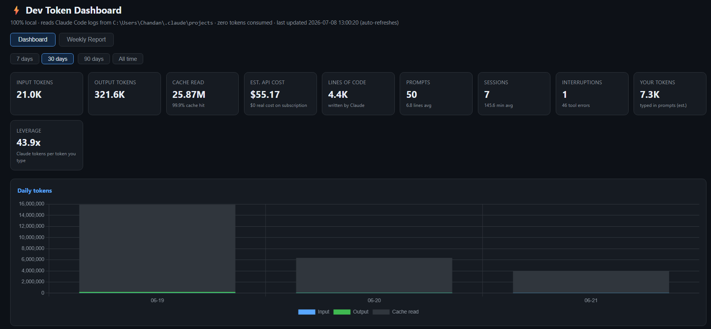

**How is this different from [ccusage](https://github.com/ryoppippi/ccusage)?**
ccusage is a great token/cost counter. This focuses on *developer insights* —
leverage ratio, exploration-vs-building, friction, per-project deep-dives —
plus a **Weekly Report tab that writes your standup update for you**, a **My
Adoption** scorecard, and tabs that show whether work flows smoothly, gets
checked, and what it costs, each number labelled Observed, Derived, Proxy or
Estimated. And it needs no Node/npm: just Python, which you already have.

## Quick start

```
git clone https://github.com/chandan12ar/ai-fluency-insights.git
cd ai-fluency-insights
python ai_fluency_insights.py
```

Opens http://localhost:8787. Requires Python 3.8+ and a machine where
Claude Code has been used (it reads `~/.claude/projects/`).

Full instructions, auto-start at logon, and troubleshooting: **[SETUP.md](SETUP.md)**

## What's new (v1.4) — the "Engineering insight" update

Five new tabs, all from the same local logs. No Jira, GitHub or CI needed.

- **Flow** — turn time, clean first-pass turns, failure recovery, where tool time goes
- **Quality** — was the work checked (tests, builds, lint after the last edit), rework hotspots, safety signals
- **Value** — cost per 100 lines and per verified session, cache savings, cost spikes, model mix
- **Advisor** — your top moves, each quoting its evidence, with one-click experiments
- **Data Health** — what your logs can and cannot measure, the metric catalog, and a privacy mode
- **My Adoption** now has six levels (Explorer → Practitioner → Power user → Expert → Pro → Pro Max, with gates at the top), "what changed lately" and an adoption journey
- Every number carries an **Observed / Derived / Proxy / Estimated** badge so a rough signal is never shown as a fact

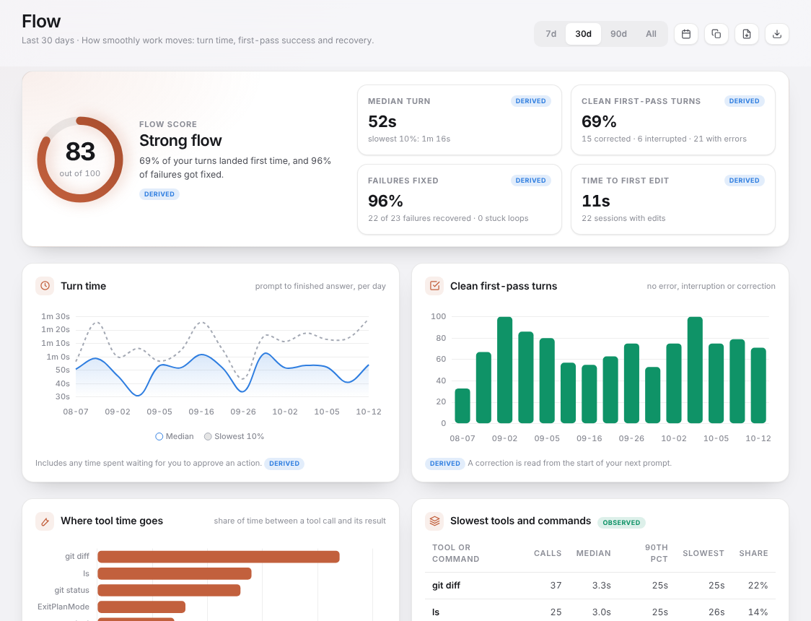

Formulas in [docs/METRICS.md](docs/METRICS.md#13-flow-tab-v14).

## What's new (v1.3) — the "My Adoption" tab

A personal scorecard for *you*: how deeply you use Claude Code and whether
you are getting better at it. Compared only with your own past, 100 % local.

- **Adoption Score (0-100) and level** — six levels, Explorer → Practitioner → Power user → Expert → Pro → Pro Max
- **Four pillars** — Habit, Range, Craft, Impact, each with a trend vs the previous 4 weeks
- **Your next 3 moves** — concrete, rule-based suggestions from your own data
- **Habit calendar, feature checklist, craft bars, impact chart, 12-week trend**
- **Healthy habits** — focus time, late-night and weekend share

Formulas in [docs/METRICS.md](docs/METRICS.md#12-my-adoption-v13-extended-in-v14).

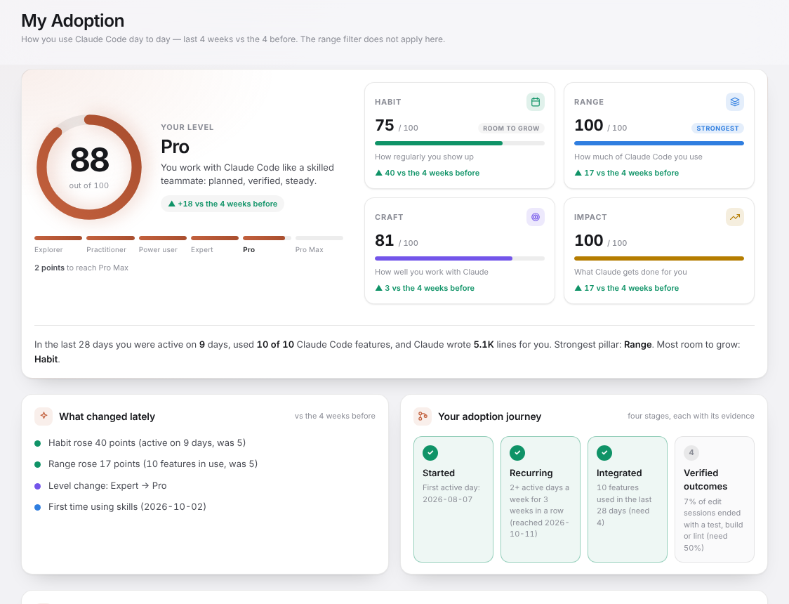

## What's new (v1.2) — the "Reflect" update

Inspired by Anthropic's [Reflect with Claude](https://www.anthropic.com/news/reflect-with-claude)
(which covers claude.ai chat but *not* Claude Code — that's what this fills):

- **AI Fluency report** — weekly 0–100 scores on the four AI-fluency
  dimensions (Delegation, Description, Discernment, Diligence), adapted for
  coding, with a radar chart vs last week and a concrete tip per dimension
- **Time & wellness panel** — active time from 10-minute activity buckets,
  average per active day, longest focus block, quiet-hours (23:00–06:00) and
  weekend shares, plus an active-minutes chart that flags late-night-heavy days
- **Reflection question** — each week the data picks one question worth
  sitting with (too many corrections? all exploration? never verifying?), with
  a **Discuss with Claude** button that runs `claude -p` locally on demand
- **Task mix** — sessions auto-classified into feature / bugfix / refactor /
  docs / explore from their AI titles, stacked per day, and included in the
  weekly markdown export
- **Fix** — `Restart-Insights.ps1` now also kills Store-Python processes
  (`pythonw3.11.exe`), which previously survived restarts holding stale code

All of it 100% local and zero-token, except the two explicit `claude -p` buttons.

## What's new (v1.1)

- **Complete UI redesign** — sticky glass header, icon KPI cards with accent
  colors, gradient charts, dark theme polish, responsive layout, and a live
  "0 tokens" status pill
- **Custom date ranges** — a from–to date picker next to the 7/30/90/all
  buttons; the whole page (every chart, table, and the project modal)
  now respects the selected range, not just the headline KPIs
- **Period-over-period deltas** — KPI cards show ▲/▼ % vs the previous
  equal-length window
- **Momentum bar** — current & best day **streak**, all-time active days,
  and optional **personal goals** with progress bars (daily LoC, daily /
  weekly token budgets — set them in the `GOALS` dict)
- **Exports** — copy a text summary, download the daily table as **CSV**,
  or the full stats payload as **JSON**
- **Sturdier AI summary** — resolves the `claude` executable directly,
  5-minute timeout, and real error messages when it fails
- **Restart scripts** — `Restart-Insights.bat` kills every running copy
  and relaunches a fresh windowless instance (handy after editing the script)
- **Accuracy fixes** — session count/average now follow the selected range,
  timestamps are bucketed in your local timezone, and avg prompt words is
  range-scoped

Full formula reference for every metric: **[docs/METRICS.md](docs/METRICS.md)**

## What you get

### Dashboard tab
- **KPI cards** — input/output tokens, cache read + hit %, estimated API
  cost, lines of code Claude wrote, prompts, sessions, friction (interruptions
  + tool errors), your typed tokens, and your **leverage ratio** (Claude
  output tokens per token you type) — each with a Δ vs the previous period
- **Momentum bar** — day streak, best streak, active days, and goal
  progress bars
- **Charts** — daily tokens, "You vs Claude" balance (log scale), model
  doughnut + breakdown, LoC per day, **exploration vs building** per day,
  **friction** per day, **task mix** per day, tool & slash-command usage,
  weekday×hour heatmap
- **Time & wellness** — active time, longest focus block, quiet-hours and
  weekend shares, active-minutes chart
- **Tables** — projects (click a row for a per-project deep-dive with its
  own timeline, sessions, and files), model breakdown, git branches,
  longest prompts, most-edited files
- **Time ranges** — 7 / 30 / 90 days / all time / custom from–to dates;
  everything on the page follows the selection
- **Exports** — copy summary, CSV of daily stats, full JSON payload

### My Adoption tab
A personal scorecard: Adoption Score and one of six levels, four pillars (Habit,
Range, Craft, Impact), what changed lately, an adoption journey, a feature
checklist, a habit calendar and a "next 3 moves" coach. Compares you only with
your own past. See [the guide](docs/DASHBOARD_GUIDE.md#tab-3-my-adoption-v13-extended-in-v14).

### Engineering insight tabs
Five tabs that follow the selected range (Advisor and Data Health always use
recent history), all from local logs only:

- **Flow** — turn time, clean first-pass turns, failure recovery, where tool time goes, session shape
- **Quality** — verified after the last edit, first-run pass rate, tests alongside code, rework hotspots, safety signals
- **Value** — cost per 100 lines and per verified session, cache savings, cost spikes, model mix (no score by design)
- **Advisor** — ranked, evidence-quoting recommendations with one-click experiments (no AI, no tokens)
- **Data Health** — what your logs can and cannot measure, the metric catalog, and **privacy mode**

Every metric carries an **Observed / Derived / Proxy / Estimated** badge. See
[the guide](docs/DASHBOARD_GUIDE.md#tabs-4-8-engineering-insight-v14) and
[the formulas](docs/METRICS.md#13-flow-tab-v14).

### Weekly Report tab
Built for standups. For any week it shows **what you worked on** (session
titles grouped by project — Claude Code already stores an AI title for
every session, so this is free), KPIs with week-over-week deltas, and an
exploration-vs-building gauge. Then:

- **🎯 AI Fluency report** — radar chart + per-dimension scores and tips
  (Delegation · Description · Discernment · Diligence)
- **💡 Reflection** — one data-backed question about how you worked this
  week, with an optional **Discuss with Claude** button
- **📋 Copy as Markdown** — one click gives you a formatted weekly update
  (now including the task mix) to paste into Teams, Slack, or email
- **✨ AI summary** (optional) — pipes the week through `claude -p` for a
  polished first-person paragraph. Along with "Discuss with Claude", the
  only features that cost tokens, and only when you press them.

## Screenshots

| | |
|---|---|
| **Daily tokens & You vs Claude**<br>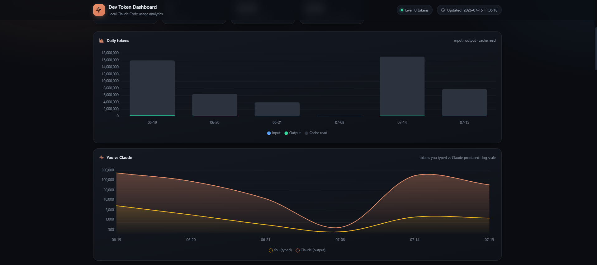 | **Time & wellness**<br>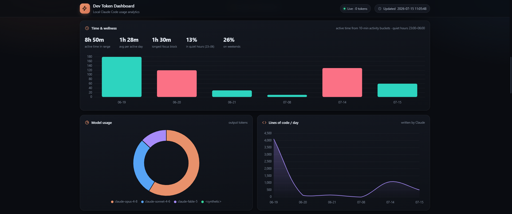 |
| **Exploration, friction & task mix**<br>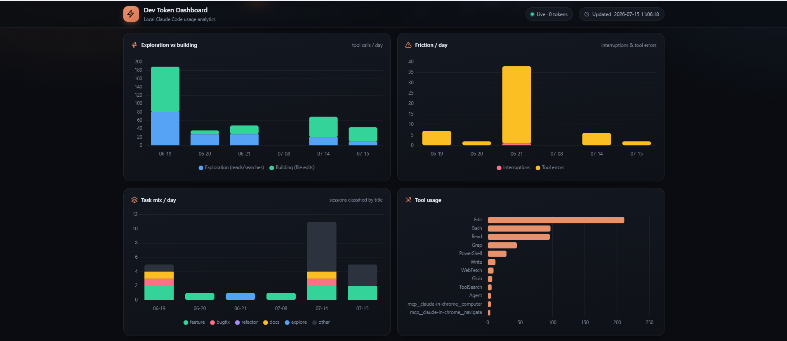 | **AI Fluency report**<br>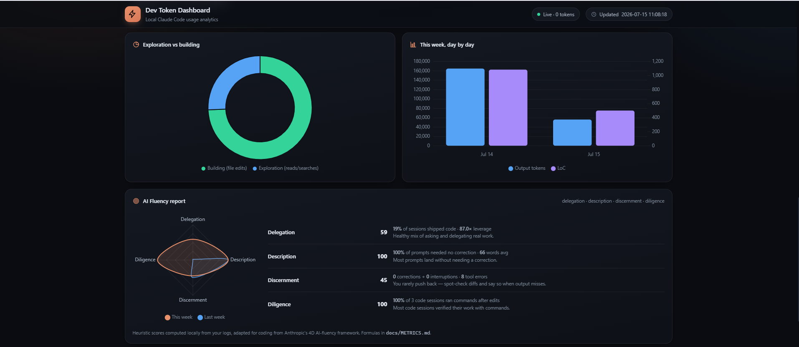 |
| **Heatmap & tables**<br>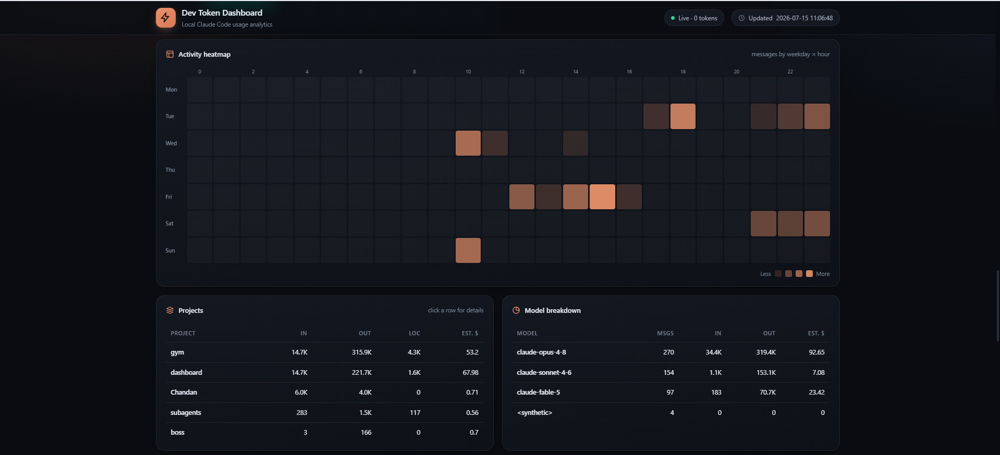 | **Weekly Report**<br>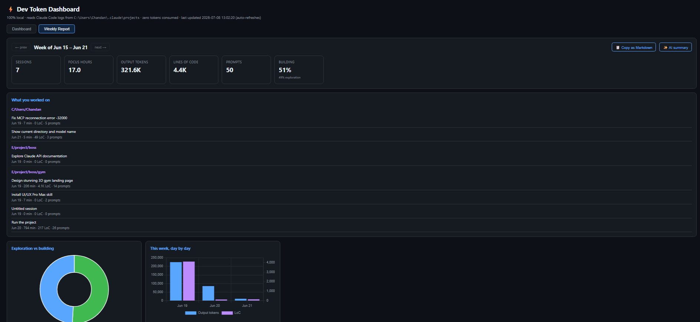 |
| **My Adoption**<br> | **Flow**<br> |
| **Quality**<br>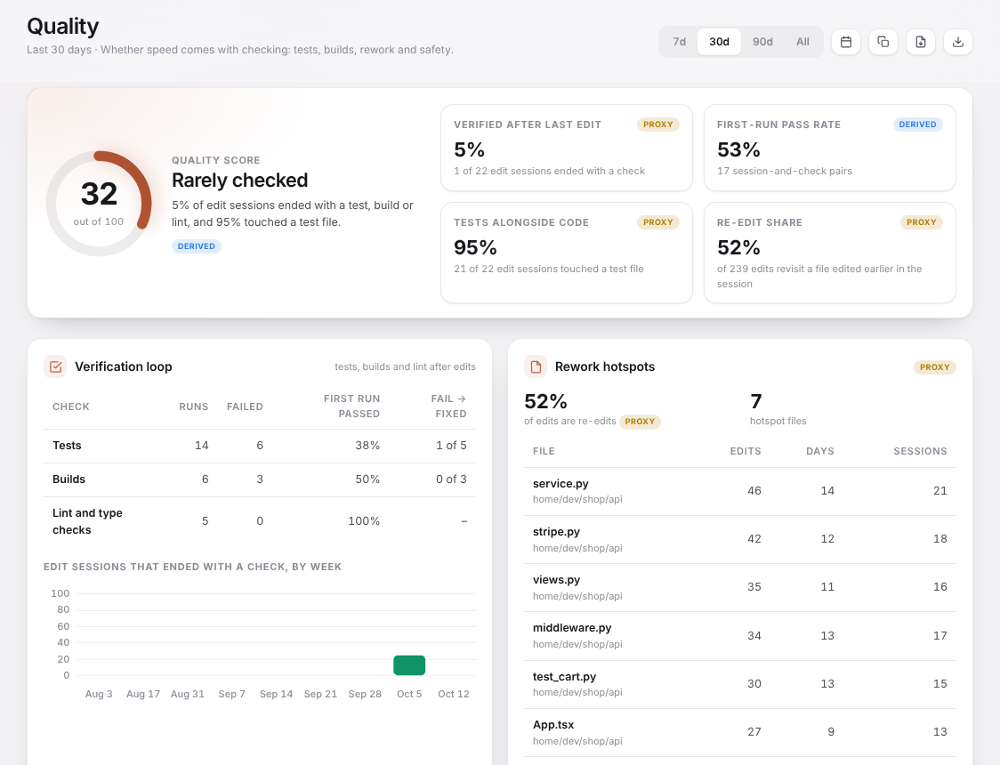 | **Value**<br>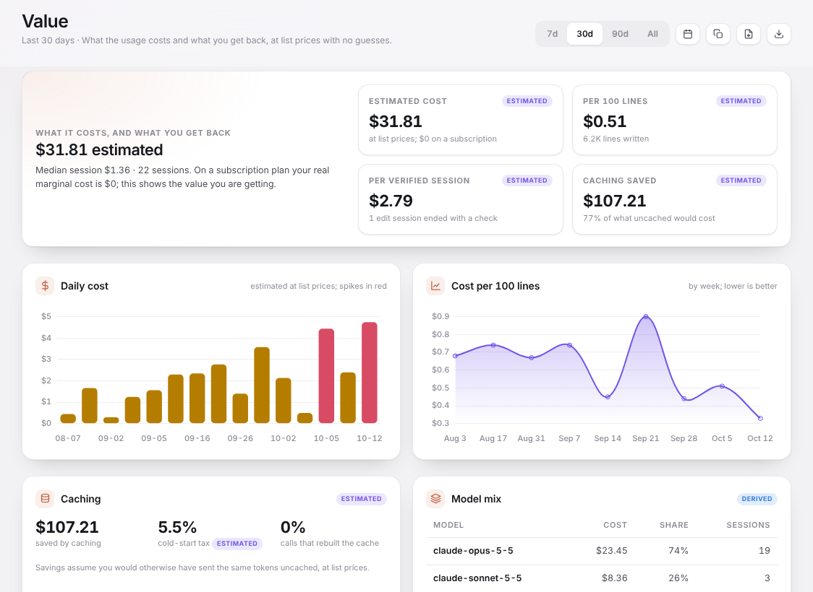 |
| **Advisor**<br>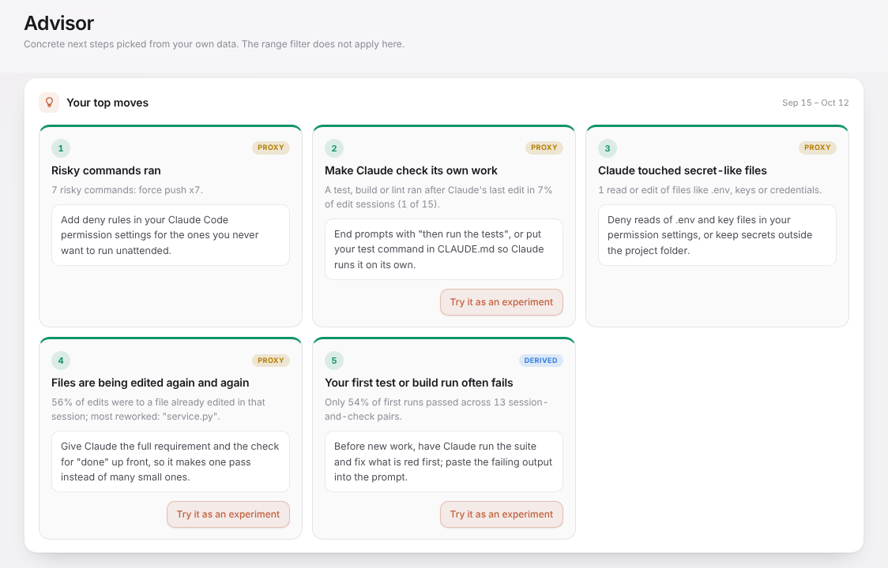 | **Data Health**<br>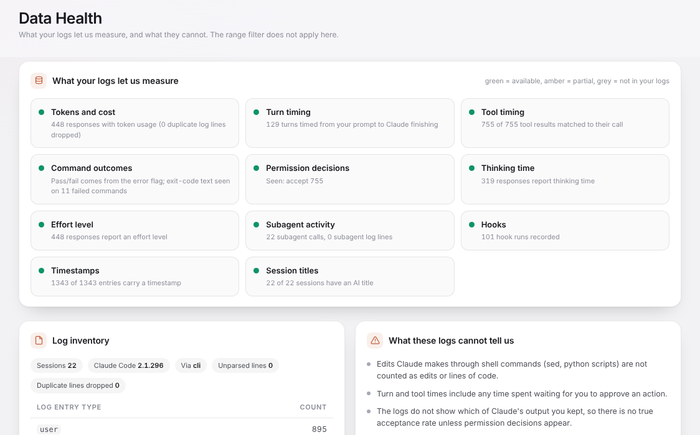 |

## Privacy

Everything stays on your machine. The server binds to `127.0.0.1` only,
Chart.js is bundled locally, and the page makes zero external requests.
Your prompts and logs never leave your disk.

## Notes

- Cost is an *estimate* at public API pricing — on a subscription plan your
  real marginal cost is $0. Tune the `PRICING` table at the top of the script.
- Token totals are **deduplicated per API response**, which is why they're
  lower (and more accurate) than the official Claude Code panel's count —
  the full analysis is in [docs/TOKEN_COUNTS.md](docs/TOKEN_COUNTS.md).
- LoC counts lines written via Write/Edit/MultiEdit/NotebookEdit tool
  calls — additions, not a git diff.

## Docs

- [docs/PROJECT_REPORT.md](docs/PROJECT_REPORT.md) — **the story**: the problem this solves, what every page does, how the scores work, how it helps a developer, and the roadmap
- [docs/DASHBOARD_GUIDE.md](docs/DASHBOARD_GUIDE.md) — **the tour**: every
  section explained in plain language — what it tells you, how the data
  becomes the number, and how to read it (great for showing your team)
- [SETUP.md](SETUP.md) — install, run, auto-start on Windows/macOS/Linux
- [docs/HOW_IT_WORKS.md](docs/HOW_IT_WORKS.md) — architecture and every panel explained
- [docs/METRICS.md](docs/METRICS.md) — **the math**: exact formula behind every metric, what each dashboard section means, and the known approximations
- [docs/TOKEN_COUNTS.md](docs/TOKEN_COUNTS.md) — why our token counting is the correct one

## License

MIT — see [LICENSE](LICENSE).
