# AI Fluency Insights — Architecture & Technical Specification

> **Formerly "Dev Token Dashboard".** The project was renamed on 2026-10-14 (`1624c78`). Some
> internals still carry the old name (`dtd_*` browser-storage keys, the `dev_token_dashboard_statusline.js`
> legacy marker, the `DevTokenDashboard` Windows task). They are kept on purpose for backward
> compatibility and are called out where they appear.

| | |
|---|---|
| **Document version** | 1.0 |
| **Describes** | application **v1.4** at commit `690fe71` (2026-10-14), branch `main` |
| **Document date** | 2026-10-28; code-layout sections updated 2026-10-30 for **v2.0** |
| **Version labels** | The packaged product is **v1.0.0**. In this document "v1.4" and "v2.0" name the code *generations* only: **v1.4** = the original single file, **v2.0** = the restructure into the current package. §1, §3 (source map), §7, §9–§11 and §14 describe the current (package) layout; line numbers elsewhere refer to the v1.4 file at `690fe71`, and the §3 source map shows where each range moved |
| **Audience** | Maintainers, reviewers, and anyone who needs to understand how the system works end to end |
| **Companion docs** | [PROJECT_REPORT.md](PROJECT_REPORT.md) (why it exists), [METRICS.md](METRICS.md) (the math), [DASHBOARD_GUIDE.md](DASHBOARD_GUIDE.md) (page tour), [HOW_IT_WORKS.md](HOW_IT_WORKS.md) (short overview) |

**What this document adds.** The existing docs explain the *problem*, the *pages* and the *formulas*.
None of them gives the complete technical picture: the runtime architecture, the exact 15-second
refresh cycle, the notification pipeline and its workflow, the HTTP contract, the persistence model,
and the failure behaviour. This document does, and it records the issues found while writing it
(see [§16 Findings register](#16-findings-register)).

### How the claims in this document were checked

This was not written from the README. Every behavioural statement was traced to the source, and
the load-bearing ones were then exercised against a running copy of the app. Tags show the
strength of the evidence:

| Tag | Meaning |
|---|---|
| **[S]** | Read directly from the source code (line numbers refer to commit `690fe71`) |
| **[T]** | Also covered by the project's unit tests (all 160 pass: `python -m pytest`) |
| **[P]** | Observed by running the real server against synthetic Claude Code logs and a simulated statusline capture, and for the banner behaviour, in headless Chromium, during this review |
| **[D]** | Stated by the project's own docs or by Claude Code's behaviour; **not** independently verifiable in this review |

**Not verified:** real Windows toast display (the review ran on Linux, where `send_windows_toast`
returns immediately) and Claude Code's internal statusline scheduling. Those are marked **[D]**.

---

## Contents

1. [Executive summary](#1-executive-summary)
2. [System context](#2-system-context)
3. [Runtime architecture](#3-runtime-architecture)
4. [Data source and ingestion](#4-data-source-and-ingestion)
5. [The 15-second refresh cycle](#5-the-15-second-refresh-cycle)
6. [Notifications: design and workflow](#6-notifications-design-and-workflow)
7. [Setup, install and operations workflow](#7-setup-install-and-operations-workflow)
8. [Analytics engines](#8-analytics-engines)
9. [HTTP API reference](#9-http-api-reference)
10. [Frontend architecture](#10-frontend-architecture)
11. [Configuration and files on disk](#11-configuration-and-files-on-disk)
12. [Performance and scalability](#12-performance-and-scalability)
13. [Security and privacy](#13-security-and-privacy)
14. [Testing](#14-testing)
15. [Troubleshooting matrix](#15-troubleshooting-matrix)
16. [Findings register](#16-findings-register)
17. [Version history](#17-version-history)
18. [Appendices](#18-appendices)

---

## 1. Executive summary

AI Fluency Insights is a **100% local, zero-token** analytics dashboard for Claude Code. It never calls
an API. It reads the JSONL session logs that Claude Code already writes under `~/.claude/projects/`,
turns them into metrics, and serves them as a single-page web app on `http://localhost:8787`. The page
polls the local server every **15 seconds**. A separate background thread polls every **5 seconds**
and raises usage notifications (Windows toast plus an in-page banner).

| Characteristic | Value |
|---|---|
| Implementation | Python package `ai_fluency_insights` under `src/` (≈30 modules, ≈3,400 lines of Python) plus the web UI as static files (`web/index.html`, `app.css`, `app.js`; ≈2,200 lines) |
| Dependencies | Python 3.8+ standard library only. Chart.js 4.4.3 is bundled at `web/static/vendor/chart.umd.min.js`. Node is needed only for the optional statusline hook, and Claude Code already requires it |
| Server | `ThreadingHTTPServer` bound to `127.0.0.1:8787` (no auth, no TLS, GET only) |
| Pages | 11 (Overview, Time & Focus, Tools & Models, Projects, Weekly Report, My Adoption, Flow, Quality, Value, Advisor, Data Health) |
| Routes | 5: `/` (the page), `/static/*` (CSS, JS, Chart.js), `/api/stats`, and `/api/ai_summary` + `/api/reflect` (the last two run `claude -p`) |
| State | No database. Logs are the source of truth; the server rebuilds all stats in memory on every request. The only file it writes is `notify_state.json` in the per-user data directory |
| Token spend | $0, except two explicit buttons that run `claude -p` |
| Tests | 160 unit tests under `tests/` (incl. a live HTTP test of the loopback guard). No browser tests |
| Platforms | Windows, macOS, Linux. Toast popups are **Windows-only**; in-page banners work everywhere |

### The design in one paragraph

Claude Code writes logs; a **Scanner** keeps a per-file `(mtime, size)` cache and re-reads only the
files that changed; a **Parser** (`parse_entry`) folds every log line into a `Stats` object; a set of
**engines** (Flow, Quality, Value, Adoption, Advisor, Health) compute scores from `Stats`; the **HTTP
handler** assembles one JSON document per request; the **browser** renders it. Independently, a
**NotificationWatcher** thread watches the same logs and an optional rate-limit file written by a
Claude Code **statusline hook**, and fires milestone alerts.

---

## 2. System context

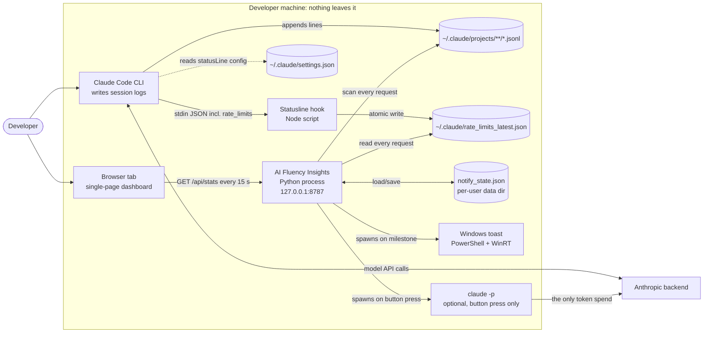

**Key property:** the dashboard has **no connection to Anthropic**. The "official" plan percentages
it shows arrive *indirectly*: Claude Code pipes them to a statusline script on every render, and
that script drops them into a local JSON file. The dashboard only reads that file.

### External interfaces

| Interface | Direction | Format | Owner |
|---|---|---|---|
| `~/.claude/projects/<project>/<session>.jsonl` | read | JSONL, one event per line, append-only | Claude Code |
| `~/.claude/rate_limits_latest.json` | read | `{"rate_limits": {...}, "captured_at": <epoch s>}` | statusline script |
| `~/.claude/settings.json` | read/write (setup wizard only) | JSON, `statusLine` block | Claude Code / wizard |
| `~/.claude/ai_fluency_insights_statusline.js` | write (setup wizard only) | Node script | wizard |
| `notify_state.json` (per-user data dir, see §11.2) | read/write | JSON | dashboard |
| `http://127.0.0.1:8787` | serve | HTTP/1.0, JSON + HTML | dashboard |
| `powershell.exe` | spawn (Windows) | WinRT toast | dashboard |
| `claude -p "<prompt>"` | spawn (button press) | stdout text, 300 s timeout | Claude Code CLI |
| `schtasks` | spawn (Windows, `--install-startup`) | Task Scheduler | dashboard |

---

## 3. Runtime architecture

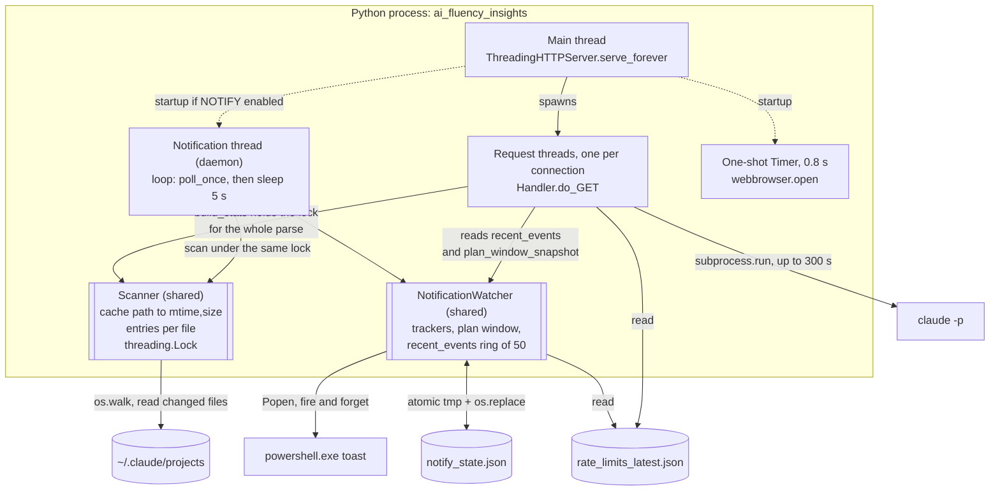

### Threads and shared state

| Thread | Started in | Lifetime | Touches |
|---|---|---|---|
| Main | `main()` | process | accept loop (`srv.serve_forever`) **[S]** |
| Request threads | `ThreadingHTTPServer` | per request | `Scanner` (locked), `NotificationWatcher` (read-only snapshots) **[S]** |
| Notification | `main()` → `_notify_loop` (daemon) | process, only if `NOTIFY["enabled"]` | `Scanner`, `NotificationWatcher`, state file, toast subprocess **[S][T]** |
| Browser opener | `threading.Timer(0.8, …)` | one shot, skipped with `--no-browser` | `webbrowser.open` **[S]** |

**Locking.** `Scanner._lock` is the only real lock. `build_stats()` holds it for the *entire*
scan-and-parse, so concurrent `/api/stats` calls serialise, and the notification thread (which needs
the lock for `scan()`) waits behind a running parse. `NotificationWatcher._lock` only guards writes
to `recent_events`. `plan_window_snapshot()` is called from request threads without a lock; this is
a benign race, since it reads small scalars. **[S]**

### Source map

Since v2.0 the code is a package under `src/ai_fluency_insights/`. Imports only point down the
layers (entry points → integrations / notifications → analytics → core → config / paths); the rules
are in [CONTRIBUTING.md](../CONTRIBUTING.md#layering-rules). The last column maps the v1.4 line
numbers used elsewhere in this document to their new home.

| Module | Responsibility | v1.4 lines |
|---|---|---|
| `config.py` | `PRICING`, `GOALS`, `ADOPTION`, `ADOPTION_LEVELS`, `LEVEL_GATES`, `NOTIFY`, `MILESTONES`, `OFFICIAL_MILESTONES`, `QUIET_START/END`, `should_run_notifications` | 33–126, 309–311 |
| `paths.py` | Claude Code dirs, bundled resource lookup, per-user data dir, legacy state migration | 5447–5452 |
| `core/taxonomy.py` | tool sets, `TOOL_FEATURES`, `ADOPTION_FEATURES`, command classifiers (test/build/lint/risky) | 128–250, 285–307 |
| `core/pricing.py` | `price_for` | 323–329 |
| `core/stats.py` | the `Stats` data model | 341–430 |
| `core/parser.py` | `parse_entry` and its turn / tool-result helpers, `CMD_RE`, `CORRECT_RE`, `count_lines` | 252–284, 313–335, 431–789 |
| `core/scanner.py` | `Scanner`: incremental file cache and `build_stats` | 790–855 |
| `notifications/thresholds.py` | `milestones_crossed`, `steps_crossed`, `weighted_tokens`, `SessionTokenTracker` | 856–944 |
| `notifications/plan_usage.py` | rate-limit file loaders, `PlanWindowTracker` | 945–1049 |
| `notifications/state.py` | state load/save | 1050–1064 |
| `notifications/toast.py` | `send_windows_toast` | 1074–1105 |
| `notifications/watcher.py` | `NotificationWatcher`: polling, replay, firing, snapshot, persistence | 1065–1073, 1106–1432 |
| `analytics/sessions.py`, `weekly.py` | `classify_session`, `longest_focus`, `build_weeks`, `active_streak` | 1433–1581 |
| `analytics/common.py` | shared helpers (`_in`, `_median`, `_rate`, `_rnd`, ...) | 1582–1639, 2183–2186 |
| `analytics/flow.py`, `quality.py`, `value.py`, `health.py` | the four engines | 1640–1951 |
| `analytics/catalog.py` | `METRIC_CATALOG` | 1952–2029 |
| `analytics/advisor.py` | rule-based recommendations | 2030–2176 |
| `analytics/fluency.py`, `adoption.py` | 4D fluency; pillars, levels, coach, funnel | 2177–2638 |
| `analytics/summary.py` | `stats_to_json`, the range-scoped payload builder | 2639–2782 |
| `integrations/claude_cli.py` | `_run_claude`, `ai_week_summary`, `ai_reflection` | 2783–2865 |
| `integrations/statusline.py` | setup wizard: classify / merge / backup / write, `startup_hint` | 5190–5446 |
| `integrations/startup.py` | Windows logon task (`--install-startup`) | from `main()` |
| `web/` | the SPA: `index.html`, `static/css/app.css`, `static/js/app.js`, `static/vendor/` | 2866–5049 |
| `resources/statusline.js` | the Node hook the wizard writes | inside 5190–5446 |
| `server/api.py` | `/api/*` payload assembly (was inline in `do_GET`) | 5051–5189 |
| `server/handler.py` | HTTP routing and static files | 5051–5189 |
| `server/app.py` | server start-up and the notify thread | from `main()` |
| `cli.py`, `__main__.py` | argument parsing and dispatch | 5454–5548 |

---

## 4. Data source and ingestion

### 4.1 Input: Claude Code session logs

Claude Code appends one JSON object per line to `~/.claude/projects/<encoded-cwd>/<session-id>.jsonl`
(or under `$CLAUDE_CONFIG_DIR/projects` when that variable is set; `default_root()` **[S]**).
The directory name encodes the working directory; the dashboard prettifies it with
`lstrip("-").replace("--","/").replace("-","/")` to form the **project label**. **[S]**

Fields the parser reads:

| Entry `type` | Fields consumed | Used for |
|---|---|---|
| any | `type`, `version`, `entrypoint` | Data Health counters only |
| `ai-title` | `sessionId`, `aiTitle` | session titles (Weekly Report, task mix) |
| `permission-mode` | `permissionMode` | permission-mode counts, plan-mode feature day. Has no timestamp, so it **inherits the last dated entry's day** |
| `system` (`subtype: stop_hook_summary`) | — | "Hooks" adoption feature |
| `attachment` | `attachment.type` | Data Health counters |
| `user` | `timestamp`, `sessionId`, `cwd`, `gitBranch`, `isSidechain`, `isMeta`, `permissionDecision.{decision,source}`, `message.content` (string, or blocks of `text` / `tool_result`) | prompts, corrections, interruptions, slash commands, tool results |
| `assistant` | `message.{id,model,stop_reason,usage.{input_tokens,output_tokens,cache_creation_input_tokens,cache_read_input_tokens}}`, `requestId`, `uuid`, `thinkingDurationMs`, `effort`, `message.content[]` `tool_use` blocks (`id`, `name`, `input.{command,file_path,notebook_path,content,new_string,edits[],new_source,subagent_type}`) | tokens, cost, tools, LoC, turn ends, edits, command kinds |
| anything else, and `isMeta` entries | — | ignored |

`tool_result` blocks arrive inside **`user`** entries (`tool_use_id`, `is_error`, `content`). **[S]**

### 4.2 Scanner: the incremental file cache

```
Scanner._cache   : path -> (st_mtime, st_size)
Scanner._entries : path -> list[dict]       # every parsed line of that file
```

`scan()` walks the root with `os.walk`, and for each `*.jsonl`:

1. `os.stat` the file. If `(mtime, size)` equals the cached key, **skip**.
2. Otherwise re-read the **whole file** (not just the tail), `json.loads` each line, silently dropping
   undecodable lines, and replace `_entries[path]`.
3. Afterwards, drop cache entries for files that no longer exist. **[S]**

This makes unchanged files cost one `stat` call. It does **not** avoid re-parsing: `build_stats()`
creates a fresh `Stats` and runs `parse_entry` over *every* cached entry on *every* call (see
[§12](#12-performance-and-scalability)). A corrupt line is skipped without affecting the rest. Entries that raise inside `parse_entry` are counted in `parse_errors` and
surfaced in the UI as a yellow warning. **[S]**

### 4.3 Parser rules (`parse_entry`)

| Concern | Rule |
|---|---|
| **Time** | ISO timestamp → local timezone via `.astimezone()`. `day`, `hour`, `weekday` are local. Undated entries are kept for all-time but dropped by any date filter |
| **Token de-duplication** | usage is counted once per key `(message.id or uuid, requestId)` (`seen_msg_ids`). Claude Code logs one API response across several lines, so naive summing over-counts. See [TOKEN_COUNTS.md](TOKEN_COUNTS.md) |
| **Tool-call de-duplication** | by `tool_use.id` (`seen_tool_ids`) |
| **Cost** | `(in·P_in + out·P_out + cache_write·P_in·1.25 + cache_read·P_in·0.10) / 1e6`. `P` comes from the first `PRICING` key found in the lowercased model name, else `DEFAULT_PRICE` |
| **Lines of code** | additions only: `Write`/`Create` → lines in `content`; `Edit`/`StrEditReplace` → lines in `new_string`; `MultiEdit` → sum over `edits[].new_string`; `NotebookEdit` → `new_source`. Edits made through shell commands are invisible |
| **Exploration vs building** | `READ_TOOLS` vs `WRITE_TOOLS` counts per day and per session |
| **Prompts** | a `user` entry with real text that is not a slash command, `<local-command…>`/`<command-…>` wrapper, or `[Request interrupted…]`. "Human tokens" ≈ `len(text)//4` |
| **Corrections** | a prompt whose start matches `CORRECT_RE` ("no", "wrong", "actually", "undo", …) |
| **Turns** | a real non-sidechain prompt opens a turn; an `assistant` entry with `stop_reason == "end_turn"` closes it and records duration. A new prompt before that closes the previous turn as *abandoned* (`secs = None`) |
| **Tool timing** | `tool_use` timestamp stored in `pending_tools[tool_use_id]`; the matching `tool_result` yields seconds and pass/fail (`is_error`) |
| **Failure episodes** | per session and tool: consecutive failures open an episode; the next success closes it with `fails` and `steps` to recover |
| **Command kind** | `classify_cmd` strips heredocs, env assignments, `sudo/time/nohup`, and runners (`npx`, `uv run`, `python -m`…), then matches test/lint/build patterns against each *invoked* command segment |
| **Safety signals** | `risky_categories` (force-push, hard reset, `rm -r`, pipe-to-shell, `--no-verify`, `chmod 777`, SQL drop) and secret-like file paths. Only the **category** is stored, never the command text |
| **Sidechains** | `isSidechain` entries (subagent work) are excluded from turn and verification tracking |
| **Activity time** | 10-minute buckets `hour*6 + minute//10`; active minutes = buckets × 10 |

### 4.4 The `Stats` model

`Stats` is rebuilt from scratch on every call. Its top-level shape **[S]**:

| Field | Shape | Feeds |
|---|---|---|
| `days` | `day → {input, output, cache_read, cache_write, cost, loc, prompts, messages, human_tokens, reads, writes, interruptions, tool_errors, late_msgs, corrections, cache_savings, …}` | KPIs, charts, streaks |
| `models`, `tools`, `slash`, `branches`, `projects` | counters / dicts | tables, doughnuts |
| `sessions` | `sid → {start, end, msgs, project, reads, writes, loc, prompts, output, bash, cost, first_call_cost, api_calls, cache_resets, seq markers, test_files, first_edit_s, model_cost, turn, open_err…}` | Weekly, Flow, Quality, Value, Adoption |
| `turns`, `tool_calls`, `cmd_runs`, `episodes`, `edits`, `safety`, `perm_decisions`, `thinking`, `efforts` | lists of per-event records, **each tagged with its local day** | Flow / Quality / Value |
| `feature_days` | `feature id → set(days used)` | My Adoption |
| `day_buckets`, `heatmap` | activity buckets, weekday×hour counts | Time & Focus |
| `hc`, `entry_types`, `versions`, `entrypoints` | counters | Data Health |

Because every per-event record carries its day, **any window can be sliced from one full-history
`Stats` without re-parsing**. That is how Flow/Quality/Value follow the selected range and how
period-over-period deltas and the Advisor's 28-day window work.

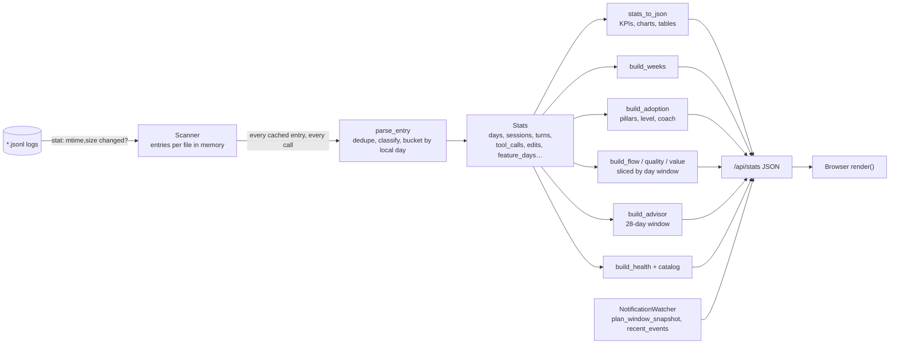

---

## 5. The 15-second refresh cycle

### 5.1 The short answer

**It is a poll, not a reset.** The page runs `setInterval(load, 15000)` **[S: line 5047]**. Every 15
seconds the browser asks the server for a freshly computed snapshot of *everything* (`GET
/api/stats`), then re-renders the page you are looking at. The server keeps **no per-client state**
and nothing is "reset" on the server by a tick: `Stats` is rebuilt from the cached log entries on
every request.

Two things people often assume are tied to the 15-second tick, but are not:

| Assumption | Reality |
|---|---|
| "Notifications trigger every 15 s" | Notifications are produced by a **separate server thread every 5 s** (`NOTIFY["poll_seconds"]`). The 15 s tick only *displays* the events that thread already recorded |
| "The data is reset every 15 s" | The only things "reset" per tick are on the client: charts are destroyed and recreated by `mk()` and the active section is re-rendered. Server-side, the parsed stats are discarded and rebuilt, but from the same cached log entries |

### 5.2 Sequence of one tick

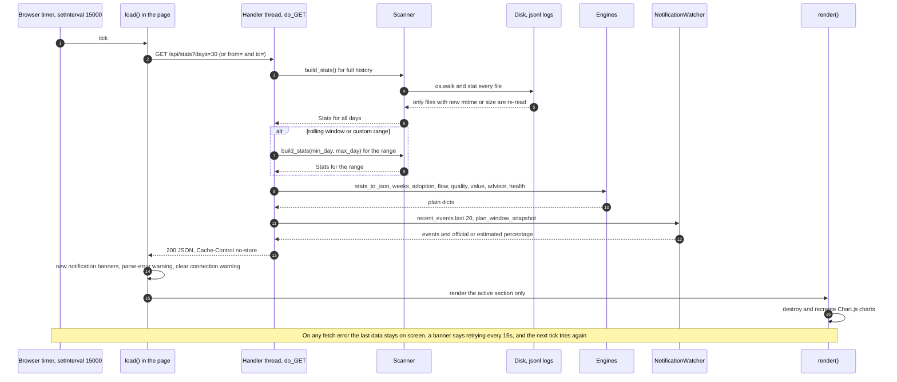

### 5.3 What happens, step by step

| # | Where | Step | Cost driver |
|---|---|---|---|
| 1 | Browser | `load()` builds the query: `days=N` for 7/30/90, `days=0` for all time, or `from=…&to=…` for a custom range | — |
| 2 | Browser → server | `fetch('/api/stats?…')`. Not cached (`Cache-Control: no-store`) and always the full payload (no ETag, no deltas) | payload 14 KB on a tiny history; ≈50–70 KB on 80k entries **[P]** |
| 3 | Server | `Scanner.build_stats()` takes `Scanner._lock`, runs `scan()` (one `stat` per log file; re-reads only changed files), then runs `parse_entry` over **every cached entry** into a fresh `Stats` | **dominant**: linear in total log entries |
| 4 | Server | Range selection (below) may trigger a **second** full `build_stats()` | doubles step 3 for 7/30/90 and custom ranges |
| 5 | Server | Engines run on the in-memory `Stats`: `stats_to_json`, `build_weeks`, `build_adoption` (≈14 windows), `build_flow/quality/value`, the previous-window pass, `build_advisor`, `build_health` | ≈0.6 s at 80k entries **[P]** |
| 6 | Server | Adds `notifications` (last 20 of `recent_events`) and `plan_window` (`plan_window_snapshot()`), `streak`, `goals`, `today`, `week_tokens` | negligible |
| 7 | Server → browser | `json.dumps` and send | — |
| 8 | Browser | Update the "generated" timestamp; show/clear the **parse-error** warning; **append banners for unseen notification ids**; clamp the week index; `updateChrome()`; `render()` | — |
| 9 | Browser | `render()` dispatches on the current `section` and redraws **only that section** (all other sections' data is already in `D`) | Chart.js |

User actions that call `load()` immediately (range buttons, custom range apply/clear) do **not**
restart the 15 s timer; the interval keeps its own cadence. Switching sections does *not* fetch. It
re-renders from the cached `D`. **[S]**

### 5.4 Range handling inside a tick

```
full   = build_stats()                         # always: powers Weekly, Adoption, streaks, deltas
alldays = sorted(full.days)                    # days that have any entry

custom (from/to)  -> ranged = build_stats(from, to)      # 2nd parse; no previous window
rolling N days    -> cur  = alldays[-N:]                 # last N ACTIVE days, not calendar days
                     prev = alldays[-2N:-N]              # the N active days before those
                     ranged = build_stats(cur[0])        # 2nd parse
all time (N=0)    -> ranged = full                       # no 2nd parse
```

`stats_to_json(ranged)` feeds the Overview / Time / Tools / Projects pages. Weekly, My Adoption,
Advisor and Data Health **always** use full history (`NORANGE` on the client). Flow, Quality and
Value are sliced from `full` by day window `[b0, b1]`; when a previous window exists the handler
also computes the same three for it (`prev_insight`) to draw deltas. **[S]**

### 5.5 Every clock in the system

| Clock | Value | Defined at | What it drives |
|---|---|---|---|
| Browser poll | **15 s** | `setInterval(load,15000)` | refresh all page data |
| Notification poll | **5 s** | `NOTIFY["poll_seconds"]` | watch logs and the rate-limit file, fire milestones |
| Statusline refresh | **30 s** | `statusLine.refreshInterval`, written by the wizard | asks Claude Code to re-run the hook periodically **[D]** |
| Active-file window | 15 min | `NOTIFY["active_window_min"]` | only logs written in the last 15 min are replayed for notifications |
| Capture freshness | 30 min | `RATE_LIMITS_STALE_SECONDS` | notifications ignore captures older than this; the panel still uses them |
| UI staleness warning | 2 min | `STALE_AGE_MIN` in `renderPlanUsage` | yellow ⚠ "last updated N ago, may be behind" |
| Estimated session window | 5 h | `WINDOW_SECONDS` | local fallback window; mirrors the plan's 5-hour limit |
| Weekly window | from capture | `rate_limits.seven_day.resets_at` | official only; no local estimate exists |
| Banner lifetime | 20 s | `setTimeout(…, 20000)` | in-page notification auto-dismiss |
| Browser open delay | 0.8 s | `threading.Timer(0.8, …)` | open the tab after the server starts |
| `claude -p` timeout | 300 s | `_run_claude` | the two AI buttons |
| Adoption / Advisor window | 28 days | `ADOPTION["window_days"]` | My Adoption and Advisor |
| Activity bucket | 10 min | `parse_entry` | active time, focus blocks |
| Quiet hours | 23:00–06:00 | `QUIET_START/END` | wellness panel |

### 5.6 End-to-end latency budget

How stale each output can be after the underlying event (a log line written, or a capture file
updated):

| Output | Worst case | Notes |
|---|---|---|
| KPI cards and charts | ≤ 15 s + request time | request ≈ 3 ms on a tiny history, ≈ 3–4 s at 80k entries **[P]** |
| In-page notification banner | ≈ 5 s + 15 s ≈ **20 s** | the watcher records the event within 5 s (measured 4.0 s **[P]**); the next tick shows it |
| Windows toast | ≤ 5 s + PowerShell start-up | the toast does not wait for the page; start-up time not measured |
| Plan usage % bar (official) | capture time + ≤ 15 s | capture time is controlled by Claude Code, not the dashboard **[D]** |
| Plan usage % bar (estimate) | ≤ 15 s | recomputed from `PlanWindowTracker` state each request |

### 5.7 Failure and edge behaviour of the tick

| Condition | Behaviour | Evidence |
|---|---|---|
| Server unreachable, or non-2xx | `catch` adds a `#connwarn` banner: "Can't reach the dashboard server — retrying every 15s. Showing the last data loaded." The previous data stays visible; the banner is removed on the next success | **[S]** |
| Exception inside the handler | `do_GET` has no `try/except`; the stdlib prints a traceback to stderr and drops the connection, so the client takes the same path as "unreachable" | **[S]** (stdlib behaviour) |
| A request takes longer than 15 s | No in-flight guard or `AbortController`; the next tick sends another request. They serialise on `Scanner._lock`, so latency compounds | **[S]** |
| Tab hidden or minimised | No `visibilitychange` handling; the timer keeps firing (browsers may throttle background timers) | **[S]** |
| Unparseable log lines | `totals.parse_errors > 0` shows a yellow banner "N log entries could not be parsed" | **[S]** |
| Chart.js first-paint race | A global `error` listener re-renders once (rate-limited to 1/s) | **[S]** |
| Log directory missing | Detected once at start-up: prints guidance and exits before serving | **[S]** |
| Log file deleted | Dropped from the cache on the next `scan()` | **[S]** |
| Invalid `days=` | Falls back to 30 | **[P]** |

---

## 6. Notifications: design and workflow

### 6.1 What the subsystem does

It tells the developer, while they work, how much of their **Claude plan usage limits** they have
consumed: a toast and an in-page banner when usage crosses a milestone, plus a live **Plan usage
limits** card on the Overview page. It is built from two *independent signal sources* and two
*delivery channels*.

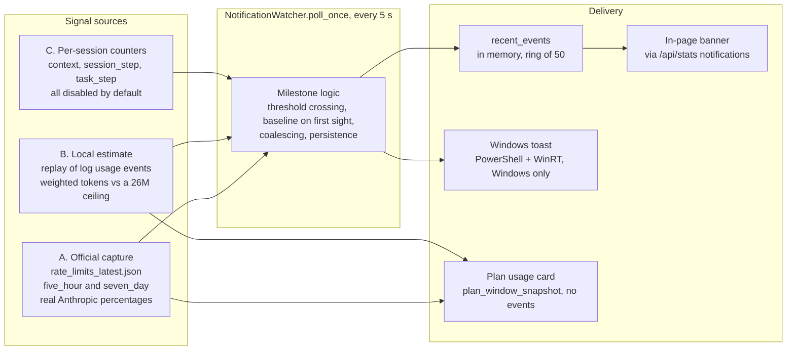

| Signal | Source of truth | Accuracy | Milestones | Event id |
|---|---|---|---|---|
| **A. Official** | `~/.claude/rate_limits_latest.json`, written by the statusline hook | exact: the percentage Anthropic reports | 5 h: **25, 50, 75, 85, 100** %; 7 d: **20, 40, 60, 80, 100** % | `official:{five_hour\|seven_day}:{milestone}` |
| **B. Estimate** | token usage in the JSONL logs | approximate: a single-point calibration | 25, 50, 75, 85, 100 % of the ceiling | `plan:{milestone}:{int(window_total)}` |
| **C. Per-session** | token usage in the JSONL logs | exact counts, no plan meaning | context %, every N session tokens, every N task tokens | `{sid}:{kind}:{value}` |

Signal C is implemented and unit-tested but **off**: `context_window`, `session_step` and `task_step` are
all `0` in `NOTIFY`, with comments noting they fired redundantly. **[S][T]**

### 6.2 Signal A: official rate-limit capture

**Why a hook is needed.** Anthropic's plan usage is not in the session logs and not queryable
without credentials the dashboard deliberately never touches. Claude Code, however, passes it to the
user's **statusLine** command on every status-line render. The project captures it there.

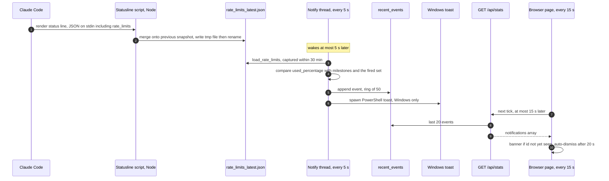

**The statusline script** (`BUNDLED_STATUSLINE_JS`, written by the wizard to
`~/.claude/ai_fluency_insights_statusline.js`) **[S][T]**:

1. Reads the JSON Claude Code sends on stdin.
2. If it contains `rate_limits`, loads the previous snapshot (if any), **merges per window** (so a
   render that carries only one window cannot blank the other) and writes
   `{"rate_limits": …, "captured_at": <epoch s>}` to `~/.claude/rate_limits_latest.json` via a temp
   file and `rename` (atomic). Failures are swallowed so the status line never breaks.
3. Prints a one-line status: `dir  model  ctx N%  5h N%  wk N%`.

```json
{
  "rate_limits": {
    "five_hour": { "used_percentage": 27.0, "resets_at": 1790010800 },
    "seven_day": { "used_percentage": 20.0, "resets_at": 1790345600 }
  },
  "captured_at": 1789992800.5
}
```

**Timing of the capture is owned by Claude Code, not the dashboard.** Per the project's notes, the
hook runs on session events (a new assistant message, `/compact`…) and, with the wizard's
`refreshInterval: 30`, periodically while a session is open. With no Claude Code activity the file
stops updating, so the dashboard shows the last real number with an age rather than a fresh one. **[D]**

#### Milestone algorithm (per window kind)

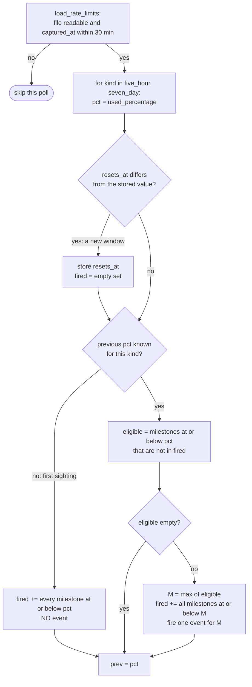

Design consequences, all confirmed by running it **[P]** (see §6.8):

- **One event per poll per window**, always for the *highest* newly-eligible milestone. A jump from
  27 % to 101 % produces a single "100 %" alert, not four.
- **No re-fire on noise.** The fired-set is keyed to the window's `resets_at` and only cleared when
  `resets_at` changes. Percentages that wobble a point or two around a boundary (observed live: 16
  fires of "85 %" in 7.5 minutes before commit `3374b83`) cannot re-alert.
- **Silent baseline.** The first time a kind is seen (first run, or no persisted state) every
  milestone already passed is marked fired without alerting, so opening the dashboard at 70 % does
  not dump "25 / 50 / 75" alerts.
- Because `official_prev` and `official_fired` are persisted, a **restart** neither replays old alerts
  nor loses ones that became due while the dashboard was down.

### 6.3 Signal B: the local estimate

Used when no official capture exists, and, as implemented, **also fires alongside Signal A** (see
[Finding F2](#16-findings-register)).

```
weighted = input + 5·output + 1.25·cache_write + 0.1·cache_read      # input-token equivalents
```

Same relative weights as `PRICING`, because a raw token sum wildly overcounts cache-heavy coding
sessions against a real quota. **[S][T]**

`PlanWindowTracker` is a single **global** window across all sessions: it starts at the first usage
event it sees and **hard-resets to zero** after `WINDOW_SECONDS` (5 h), mirroring the app's reset rather
than a sliding average. `pct()` also returns 0 once 5 h have elapsed even if no new event has arrived,
which fixes a bug that showed "8% used, resets in 0h 0m" (`3d56f44`). **[S][T]**

`NOTIFY["window_ceiling"] = 26_000_000` weighted tokens. It was **calibrated once, on 2026-09-07,
against a single reading of a Pro-plan panel** (35 % used at ~104 min, ≈9.16 M weighted tokens) and
must be re-tuned by hand if it drifts. The estimate's window also starts at *the first event the
dashboard saw*, not at Anthropic's real window boundary, so it can be out of phase with the official
window. **[S]**

### 6.4 One poll in detail

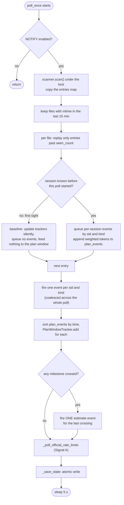

Two safeguards against notification storms **[S][T]**: events from a catch-up burst are **coalesced to one
per (session, kind)**, and the plan window fires **once per poll**.

### 6.5 What the Plan usage card shows (and which source it picks)

The card is not an event; it is recomputed on every `/api/stats` call by `plan_window_snapshot()`.

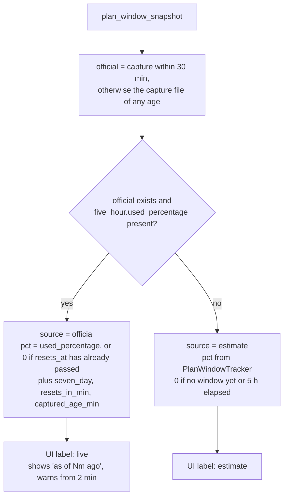

Note the deliberate asymmetry: **toasts** require a capture ≤ 30 min old, but the **card** keeps using
an old capture (zeroed if its window has since reset) in preference to the estimate (`3d56f44`).
The card falls back to the estimate only when a capture file has *never* existed or is corrupt.
**[S][T][P]** (The older text in `DASHBOARD_GUIDE.md` says otherwise; see Finding F3.)

### 6.6 Delivery channels

**Windows toast**, `send_windows_toast(title, message)` **[S]**

- Returns immediately when `os.name != "nt"`.
- Spawns `powershell -NoProfile -NonInteractive -WindowStyle Hidden -Command <script>` with
  `CREATE_NO_WINDOW`, fire-and-forget (`Popen`, no wait; `OSError` swallowed).
- Title and message travel in **environment variables** (`AFI_TOAST_TITLE`, `AFI_TOAST_MSG`), never
  interpolated into the PowerShell source, so log-derived text (project names, session titles) cannot
  inject script.
- Uses the built-in WinRT `ToastNotificationManager`, template `ToastText02`, notifier id
  "AI Fluency Insights". No module installs.
- Per-session toast titles (`project — session title`) are truncated to 64 chars; plan and official titles are short fixed strings.

**In-page banner** **[S][P]**

- Every fired event is appended to `recent_events` (kept to the last **50**) and the handler returns
  the last **20** on every `/api/stats`.
- `load()` creates a `div.warn.notify` in `#alerts` for each event whose `id` is not already in the
  page-lifetime `window.__notifySeen` set, with a dismiss button and a 20 s auto-remove.
- Works on **every OS**; only the OS-level toast is Windows-only.

Event schema (the same object feeds toast and banner):

```json
{
  "id": "official:five_hour:25",
  "ts": 1789992812.3,
  "project": "plan",
  "title": "Current 5h session usage",
  "message": "Current 5h session 25% used (official) — resets in 2h 59m"
}
```

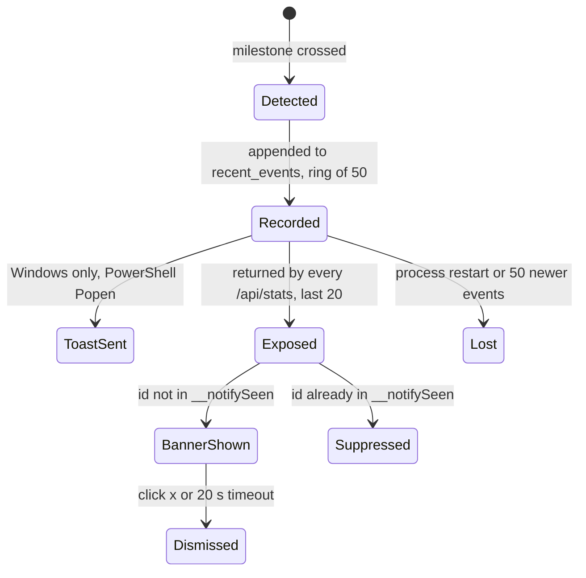

### 6.7 Persistence and restart safety

`notify_state.json` in the per-user data directory (§11.2), written atomically (`.tmp` + `os.replace`)
at the end of every poll. Before v2.0 it lived next to the script as `.notify_state.json`; that file
is copied over once on first run. A failed write is swallowed, so the
subsystem keeps working but loses restart-safety. **[S][T]**

```json
{
  "sessions": { "<sessionId>": { "session_total": 0, "task_total": 0, "last_context_usage": 0 } },
  "seen_counts": { "<path>/<sessionId>.jsonl": 1234 },
  "plan_window": { "window_start": 1790000000.0, "window_total": 6050.0 },
  "official_prev": { "five_hour": 27.0, "seven_day": 20.0 },
  "official_fired": { "five_hour": [25], "seven_day": [20] },
  "official_window_reset_at": { "five_hour": 1790010800.0, "seven_day": 1790345600.0 }
}
```

`seen_counts` is what stops a restart from replaying a long session's history on top of its already
saved totals (which would double-count and fire thousands of past thresholds in one burst). It
assumes log files are **append-only**. `recent_events` itself is memory-only and is lost on restart.

### 6.8 Verified behaviour

Run against the real server process with synthetic logs and a simulated capture file (Linux; toast
delivery itself not exercised). All rows are **[P]**.

| # | Scenario | Observed |
|---|---|---|
| 1 | Capture (5 h = 5 %, 7 d = 20 %) already on disk **before** the server starts | **No events**, including for 7 d = 20 %, which equals a milestone (silent baseline) |
| 2 | Capture rises to 27 % | `official:five_hour:25` visible in `/api/stats` **4.0 s** later (≤ the 5 s poll) |
| 3 | Capture jumps 27 % → 101 % in one write | **One** new event, `official:five_hour:100` (no 50/75/85) |
| 4 | Percentage wobbles 99 ↔ 101 inside the same window | **No** new events |
| 5 | `resets_at` rotates (new 5 h window) and usage goes 2 % → 28 % | `official:five_hour:25` fires **again** |
| 6 | Capture is 40 min old | Card still `source: "official"` with `captured_age_min: 40`. (Toasts ignore captures older than 30 min by construction **[S]**) |
| 7 | Capture file removed | Card falls back to `source: "estimate"` |
| 8 | Fresh official capture (30 %) plus a log event worth 30 M weighted tokens | An additional **estimate** event `plan:100:30006050` fires as well |
| 9 | Headless Chromium: the same event id in a second window while the page stays open | Server records both; **second banner is not shown** until the page is reloaded |

### 6.9 Known issues in this subsystem

Detailed in the [Findings register](#16-findings-register): **F1** repeated official milestones in a
long-lived tab are silently suppressed (the toast still fires); **F2** estimate and official events
can both fire for the same underlying usage with different numbers; **F3** `DASHBOARD_GUIDE.md`
describes an outdated 30-minute fallback; **F7** on reload every retained event is shown again.

---

## 7. Setup, install and operations workflow

### 7.1 Lifecycle

| Stage | Command / action | What happens |
|---|---|---|
| Install | `git clone`, then `pip install .` | Installs the package and the `ai-fluency-insights` command; downloads nothing |
| First run | `ai-fluency-insights` | Checks the log directory exists (else exits with a hint), builds `Scanner`, `NotificationWatcher`, starts the server on `127.0.0.1:8787`, starts the notify thread, opens the browser after 0.8 s. On **Windows** with neither a capture file nor the managed script, prints the one-line hint to run `--setup-notifications` |
| Enable accurate numbers | `ai-fluency-insights --setup-notifications` | Runs the wizard (7.2); handled **before** the server starts and exits |
| Steady state | server + notify thread | Page polls every 15 s; watcher polls every 5 s |
| Restart after editing code | Windows: `scripts\windows\Restart-Insights.bat` | Stops every copy (see 7.4), relaunches one hidden instance, opens the browser |
| Auto-start | Windows `--install-startup`; macOS cron/launchd; Linux systemd user unit | See 7.3 |
| Upgrade from the old name | re-run `--setup-notifications`; `--install-startup` | Repoints the legacy statusline marker and replaces the old logon task |
| Uninstall | `--uninstall-startup`; delete the folder; optionally remove the `statusLine` block | Removes both the current and legacy Windows tasks |

### 7.2 The setup wizard (`--setup-notifications [--dry-run]`)

Design intent: **detect, never clobber.** It configures the statusLine hook without ever
overwriting a user's own. Design spec: [superpowers/specs/2026-09-09-setup-notifications-onboarding-design.md](superpowers/specs/2026-09-09-setup-notifications-onboarding-design.md).

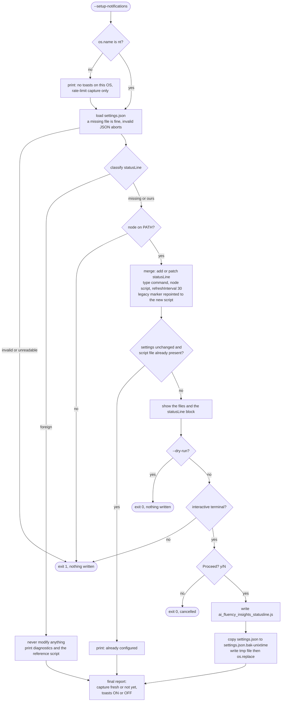

| `classify_statusline` | Condition | Action |
|---|---|---|
| `missing` | no `statusLine`, or it has no string `command` | add our block |
| `ours` | `command` contains `ai_fluency_insights_statusline.js` **or** the legacy `dev_token_dashboard_statusline.js` | patch `refreshInterval` to 30; repoint a legacy command at the new script |
| `foreign` | any other command | change nothing; print what to add by hand |

Safety properties **[S][T]**: only our own namespaced filename is ever written (never `statusline.js`);
a `.bak-<unix>` copy precedes any write; writes are temp-file + `os.replace`; only the `statusLine`
key is touched; the foreign-script inspection is size-capped (1 MB) and its failures are swallowed.
If the script write succeeds but the settings write fails, the script stays and the user is told the
hook is not wired in yet.

### 7.3 Command-line reference

| Flag | Effect |
|---|---|
| *(none)* | Serve on `127.0.0.1:8787` and open the browser |
| `--port N` | Different port |
| `--dir PATH` | Log directory (default `~/.claude/projects`, or `$CLAUDE_CONFIG_DIR/projects`) |
| `--no-browser` | Do not open a tab (used by auto-start) |
| `--dump` | Print the range-less stats JSON and exit (no server, no notify thread) |
| `--setup-notifications` | Run the wizard and exit |
| `--dry-run` | With the wizard: preview only |
| `--install-startup` / `--uninstall-startup` | Windows Task Scheduler: `schtasks /Create /TN AIFluencyInsights /SC ONLOGON` running `pythonw.exe -m ai_fluency_insights --no-browser --port N` (or the `.exe` itself when packaged); refuses if the package isn't installed; also deletes the legacy `DevTokenDashboard` task |
| `--version` | Print the version and exit |

### 7.4 `scripts/windows/Restart-Insights.ps1`

1. Stops every `python*/pythonw*` process whose command line contains `ai_fluency_insights` **or**
   `dev_token_dashboard`, any `AIFluencyInsights.exe`, then stops **whatever is listening on port 8787** (Windows lets several
   sockets share a port, so stale copies can survive otherwise).
2. Waits 0.7 s, starts one hidden `pythonw.exe` (falls back to `python.exe`) running
   `-m ai_fluency_insights --no-browser --port 8787` with `PYTHONPATH` set to the checkout's `src`,
   so edits take effect without reinstalling.
3. Waits 2 s, `GET /` to confirm HTTP 200, opens the browser.

The port is hard-coded to 8787, and step 1 will stop any unrelated process that owns it.

---

## 8. Analytics engines

All engines are **pure functions over `Stats`** (no I/O, no clock reads other than `datetime.now()` for
`generated`), which is what makes them unit-testable. Full derivations live in
[METRICS.md](METRICS.md); this section records the structure, inputs and thresholds. Every metric
is tagged **Observed / Derived / Proxy / Estimated** in `METRIC_CATALOG` (§8.7) so a rough signal is
never presented as a fact.

### 8.1 Flow (`build_flow`, line 1640)

Window: the selected range. Needs ≥ 5 turns for a score.

| Output | Definition |
|---|---|
| Turn time | prompt → `end_turn` reply; median and p90 over completed turns |
| Clean first-pass turn | completed turn with no tool error, no interruption, and no correction in the *next* prompt; `clean_pct = clean / all turns` |
| Failure recovery | failure episodes (same tool failing then succeeding in a session) that recovered ÷ all episodes. Unclosed episodes count as unrecovered |
| Stuck loop | an episode with ≥ 3 consecutive failures of the same tool |
| Where tool time goes | tool-call → result seconds, grouped by tool or command family, top 10 |
| Time to first edit, session length, thinking time, effort mix | medians / p90 from per-session and per-response fields |
| **Flow score** | `100 · (0.5·clean/turns + 0.3·recovery + 0.2·(1 − stuck/episodes))`, with `recovery = 1` and `stuck share = 0` when there are no episodes |

### 8.2 Quality (`build_quality`, line 1723)

Needs ≥ 3 sessions in which Claude edited files.

| Output | Definition |
|---|---|
| Verified after last edit | session where a test/build/lint command ran **after** the last edit (`last_verify_seq > last_write_seq`) ÷ sessions with edits. *A check ran; it does not prove it passed* |
| First-run pass | per (session, check kind): did the first run succeed |
| Tests alongside code | sessions that edited a file matching `TEST_FILE_RE` ÷ sessions with edits |
| Re-edit share, rework hotspots | repeat edits of a file within a session ÷ all edits; files edited ≥ 5 times and (≥ 3 times in one session or on ≥ 3 days) |
| Safety signals | risky-command categories and secret-like file touches (counts only) |
| Permission decisions | decision × source, when the logs carry them |
| **Quality score** | weighted mean of `0.40·verified + 0.20·tests-alongside + 0.20·(1 − min(1, reedit/50 %))`, plus `0.20·first-run-pass` **only when check runs exist** (weights renormalised) |

### 8.3 Value (`build_value`, line 1811)

Deliberately **no score**: a dollar figure has no universal "good". Outputs: estimated cost, cost per
100 lines, cost per *verified* session, cache savings (`cache_read·0.9 − cache_write·0.25` at the input
price), cold-start tax (first-call cost ÷ session cost), cache-reset rate (follow-up calls where cache
writes exceed cache reads), cost spikes (days ≥ max(2× the window's median day, $0.50), requires ≥ 5
costed days), model mix by session, and the share of top-tier-model spend in sessions with no edits.

### 8.4 My Adoption (`build_adoption`, line 2483)

Always full history. Window = the **28 calendar days ending on the most recent active day** (so a
long break does not collapse the score), compared with the 28 days before. Needs ≥ 3 active days.

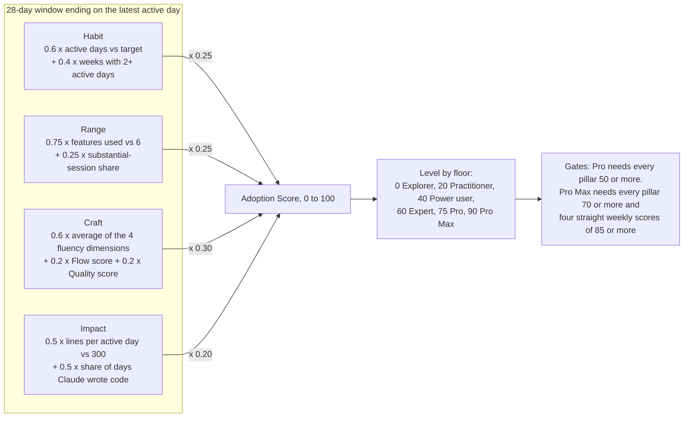

Tunables live in `ADOPTION` (`window_days 28`, `min_active_days 3`, `target_days 12`, `features_full 6`,
`substantial_actions 10`, `loc_target 300`, `weights`). Craft's Flow/Quality components are included
only when those engines have enough data; the weights renormalise.

Other outputs: a 12-point weekly score history; the 10-feature checklist (`ADOPTION_FEATURES`:
memory, verify, plan, subagents, skills, hooks, tasks, mcp, slash, web; detected from tool names,
slash commands, `permission-mode`, `stop_hook_summary`, and `CLAUDE.md`/`AGENTS.md` presence in the
project's real `cwd`); wellbeing (late-night and weekend shares, focus); a four-stage funnel
(Started → Recurring → Integrated → Verified outcomes); and the **coach**: candidate next steps ranked
by severity, at most 3 shown and at most 2 of them "try this feature".

### 8.5 AI-fluency dimensions (`fluency_of`, line 2188)

Adapted for coding from the AI Fluency Framework (Dakan & Feller, with Anthropic; CC BY-NC-SA 4.0;
see the README credits). Heuristic proxies, not measurements.

| Dimension | Formula |
|---|---|
| Delegation | `100·(0.5·share of sessions that wrote code + 0.5·min(1, leverage/50))` |
| Description | `100·(0.65·(1 − (corrections+interruptions)/prompts) + 0.35·word-count sweet spot)`; sweet spot is full marks for 8–150 words per prompt |
| Discernment | `100·(0.5·min(1, pushback / (5 % of prompts)) + 0.5·(1 − tool_errors/edits))` |
| Diligence | `100·(code sessions that ran ≥ 1 shell command ÷ code sessions)` |

The formula exists **twice**: `fluency_of` in Python (used by My Adoption) and `fluencyOf` in the page's
JavaScript (used by the Weekly Report radar). They are identical today; nothing enforces it (Finding F9).

### 8.6 Advisor (`build_advisor`, line 2030)

Rule-based, **no AI, no tokens**. It runs Flow/Quality/Value over the same 28-day window as My
Adoption, emits candidate recommendations each quoting its evidence, ranks them by a severity score,
shows the top 5, lists the next 7 under "more", and up to 4 "wins". Each recommendation has a confidence
badge; some carry a one-click **experiment** that snapshots a baseline in the browser.

| Rule id | Fires when | Severity |
|---|---|---|
| `verify` | ≥ 3 edit sessions and verified < 60 % | `(100 − verified)·0.9` |
| `firstrun` | ≥ 5 run groups and first-run pass < 60 % | `(100 − pass)·0.8` |
| `clean` | ≥ 8 turns and clean < 60 % | `(100 − clean)·0.8` |
| `stuck` | ≥ 2 stuck loops | `min(90, 45 + 10·stuck)` |
| `slowtool` | top tool ≥ 35 % of tool time and ≥ 60 s | `30 + share·0.4` |
| `longsess` | ≥ 5 sessions and (p90 ≥ 180 min or median ≥ 90 min) | `min(70, 30 + p90/6)` |
| `coldstart` | cold-start tax ≥ 45 % and ≥ 8 sessions | `min(70, tax·0.7)` |
| `cachereset` | cache rebuilds ≥ 8 % | `min(65, rate·3)` |
| `rework` | ≥ 30 edits and re-edit ≥ 35 % | `min(75, reedit)` |
| `tests` | ≥ 5 edit sessions and tests-alongside < 40 % | `(100 − pct)·0.5` |
| `risky` | any risky command category | `min(85, 40 + 10·n)` |
| `secrets` | any secret-like file touched | `min(90, 55 + 10·n)` |
| `spike` | a cost spike exists | `min(70, 35 + 5·multiple)` |
| `model` | ≥ 50 % of ≥ $5 top-tier spend in no-edit sessions | `35` |
| `adopt_*` | the My Adoption coach's suggestions | `min(80, coach severity)` |

### 8.7 Data Health and the metric catalog

`build_health` reports, per capability (tokens, turn timing, tool timing, command outcomes,
permission decisions, thinking time, effort, subagents, hooks, timestamps, session titles), whether
the logs contain it: `ok` (≥ 90 % coverage), `partial`, or `missing`. Missing signals are shown as
**"not in your logs"**, never as zero. `METRIC_CATALOG` is the single source for each metric's
confidence tier, formula text and stated limitation, and drives the badges across the UI.

| Confidence | Meaning |
|---|---|
| Observed | read straight from a log field |
| Derived | computed from observed fields with a stated formula |
| Proxy | an indirect signal that may not mean what it suggests |
| Estimated | depends on list prices or a model |

### 8.8 Smaller derived features

| Feature | Rule |
|---|---|
| Task type (`classify_session`) | keyword match on the AI title in this order: bugfix → refactor → docs → feature → explore; falls back to LoC/writes>reads → feature, reads → explore, else other |
| Active time / focus block | count of distinct 10-minute buckets per day; focus = longest run of consecutive buckets |
| Streaks (`active_streak`) | current = consecutive calendar days back from the latest active day; best = longest run ever |
| Weekly report (`build_weeks`) | ISO weeks (Mon–Sun) aggregating days and sessions; always full history |
| Optional AI text | `/api/ai_summary` and `/api/reflect` build a prompt from aggregates and run `claude -p`; the **only** features that spend tokens |

---

## 9. HTTP API reference

Transport: HTTP/1.0 (connection closes after each response), `127.0.0.1` only, **GET only**
(other methods return 501), no authentication, no CORS headers. All responses carry
`Cache-Control: no-store`. Request logging is silenced. **[S][P]**

| Route | Parameters | Response |
|---|---|---|
| `GET /` | — | the single-page app (`text/html`) |
| `GET /static/<path>` | — | files under the package's `web/static/` (CSS, JS, Chart.js), content type by extension; anything resolving outside that directory → 404. If `vendor/chart.umd.min.js` is missing, **302 to the jsDelivr CDN** (Finding F6) |
| `GET /api/stats` | `days` (int, default 30; `0` = all time; invalid → 30), or `from` and/or `to` (`YYYY-MM-DD`, overrides `days`) | the snapshot described below (`application/json`) |
| `GET /api/ai_summary` | `week` (ISO week key such as `2026-W41`) | `{"ok": true, "text": "…"}` or `{"ok": false, "error": "…"}`. Runs `claude -p`, up to 300 s |
| `GET /api/reflect` | `week`, `q` (reflection question, truncated to 500 chars) | same shape as above |
| anything else | — | `404 text/plain` |

The two AI routes always answer HTTP 200 with an `ok` flag (unknown week, empty question, missing
`claude` executable, timeout and non-zero exit are all reported in `error`). They are synchronous: the
handler thread blocks while the subprocess runs, but other requests are still served on other threads.

### `/api/stats` response

| Key(s) | Built by | Scope |
|---|---|---|
| `generated`, `root` | handler | now / log directory |
| `totals`, `days`, `models`, `tools`, `slash`, `projects`, `branches`, `heatmap`, `longest_prompts`, `top_files`, `sessions_list`, `quiet_hours`, `permission_modes`, `subagents` | `stats_to_json(ranged)` | **selected range**. Caps: tools 12, slash 12, projects 10, branches 10, longest prompts 8, top files 8, sessions 300 |
| `weeks` | `build_weeks(full)` | all history |
| `adoption` | `build_adoption(full)` | 28-day window ending at the latest active day, plus 12-week history |
| `flow`, `quality`, `value` | `build_flow/quality/value(full, b0, b1)` | selected range |
| `prev`, `prev_insight` | handler | previous equal window; present **only** for rolling 7/30/90 |
| `advisor` | `build_advisor(full, adoption)` | 28-day window |
| `health`, `catalog` | `build_health(full)`, `catalog_payload()` | all history |
| `streak`, `best_streak`, `active_days`, `goals`, `today`, `week_tokens` | handler | all history |
| `notifications` | `watcher.recent_events[-20:]` | live, in memory |
| `plan_window` | `watcher.plan_window_snapshot()` | live |

`plan_window` shapes:

```json
{ "source": "official", "pct": 27, "resets_in_min": 179, "week_pct": 20,
  "week_resets_in_min": 5759, "captured_age_min": 0 }
```
```json
{ "source": "estimate", "pct": 100, "used": 30006050.0, "ceiling": 26000000, "resets_in_min": 299 }
```

---

## 10. Frontend architecture

The UI lives in `src/ai_fluency_insights/web/`: `index.html` (markup for 11 `<section id="s-…">`
elements), `static/css/app.css` (design tokens and styles) and `static/js/app.js` (vanilla
JavaScript). Until v2.0 all three were one Python string, `HTML` (v1.4 lines 2870–5048). No framework, no build step, no network
requests apart from same-origin `/api/*` and the bundled Chart.js 4.4.3.

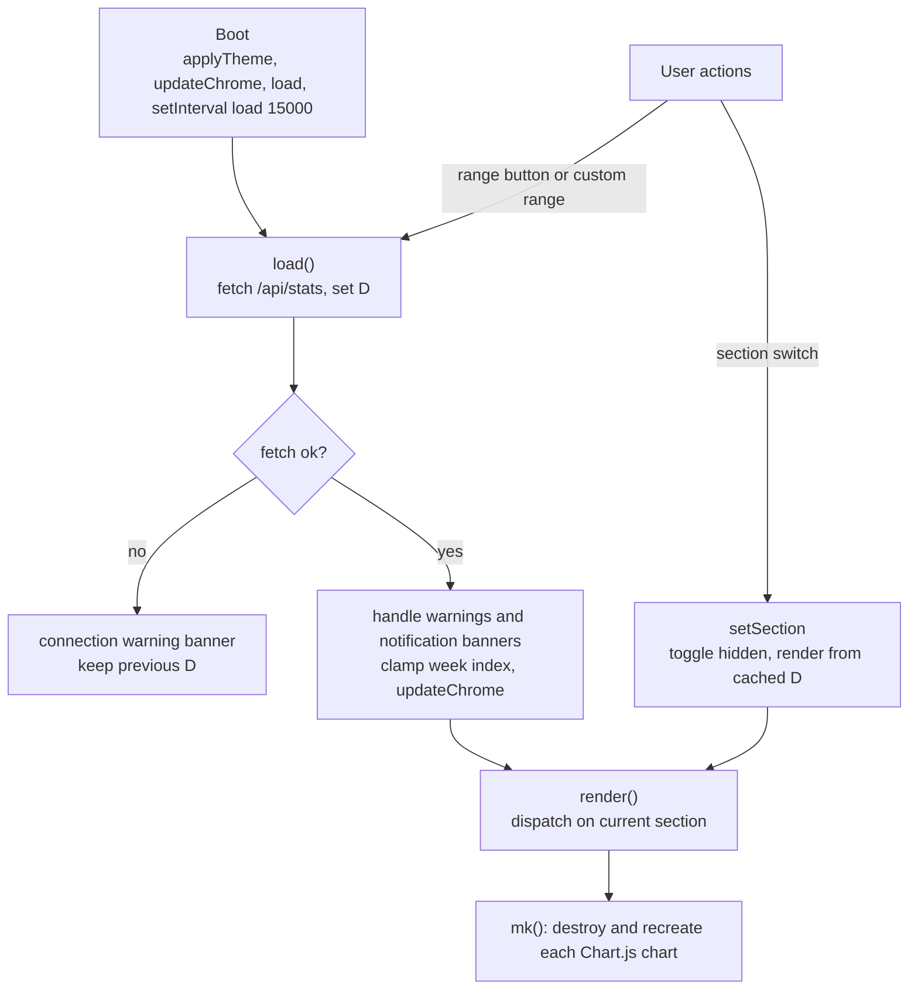

| Concern | Implementation |
|---|---|
| State | globals: `D` (last payload), `section`, `days`, `customFrom/To`, `wIdx` (selected week), `charts{}` |
| Navigation | `setSection` toggles `hidden`; `NORANGE = ['weekly','adoption','advisor','health']` hides the range controls for pages that always use full or fixed windows |
| Rendering | one `renderX()` per page; only the active page is drawn per tick |
| Charts | Chart.js; `mk(id, cfg)` destroys any previous instance first. A one-shot global error handler re-renders on Chart.js's rare first-paint race |
| Theming | system / light / dark via a `data-theme` attribute; palette read from CSS custom properties into JS (`themeCharts`) |
| Motion | spring-physics sliding indicators; honours `prefers-reduced-motion` |
| Escaping | log-derived strings (model, project, branch, file, session titles, prompt previews, banner text) go through `esc()` before `innerHTML` in the renderers spot-checked for this document. A full XSS audit of the ≈2,200-line page was **not** performed |
| Privacy mode | masks project / session / quoted text in the UI (`pv()`, `maskQuoted()`). **Client-side only**: the values are still present in the JSON the browser receives |
| Browser storage | `dtd-theme` (theme), `dtd_priv` (privacy mode), `dtd_experiment` (the one active Advisor experiment: id, metric, baseline, start time). The `dtd` prefix is the pre-rename project name. All access is wrapped in `try/catch` |
| Exports | copy text summary, daily CSV, full JSON, Weekly Markdown. All generated in the browser from `D` |

---

## 11. Configuration and files on disk

### 11.1 Source-level configuration

There is no config file. Tunables are constants in `src/ai_fluency_insights/config.py` (edit, then
restart); the rate-limit and window constants below live in `notifications/plan_usage.py`:

| Constant | Default | Effect |
|---|---|---|
| `PRICING`, `DEFAULT_PRICE` | per-1M-token price by model-name substring | every cost figure |
| `GOALS` | `daily_loc 500`, token budgets `0` (hidden) | Momentum bar progress |
| `ADOPTION`, `ADOPTION_LEVELS`, `LEVEL_GATES` | see §8.4 | My Adoption scoring |
| `NOTIFY["enabled"]` | `True` | gates the entire notification thread |
| `NOTIFY["poll_seconds"]` | `5` | watcher cadence |
| `NOTIFY["active_window_min"]` | `15` | only logs written within this many minutes are replayed |
| `NOTIFY["window_ceiling"]` | `26_000_000` | estimate ceiling, weighted tokens per 5 h |
| `NOTIFY["context_window"]`, `["session_step"]`, `["task_step"]` | `0` (off) | per-session signals |
| `MILESTONES` | `(25, 50, 75, 85, 100)` | estimate and official 5 h milestones |
| `OFFICIAL_MILESTONES` | 5 h: `MILESTONES`; 7 d: `(20, 40, 60, 80, 100)` | official milestones per window |
| `RATE_LIMITS_PATH` | `~/.claude/rate_limits_latest.json` | capture file |
| `RATE_LIMITS_STALE_SECONDS` | `1800` | capture freshness for toasts |
| `WINDOW_SECONDS` | `18000` | estimate window |
| `QUIET_START`, `QUIET_END` | `23`, `6` | wellness quiet hours |

Environment: `CLAUDE_CONFIG_DIR` relocates the log root and the wizard's targets (but see Finding F8).
`AFI_DATA_DIR` overrides the per-user data directory.
CLI flags are in §7.3.

### 11.2 Every file the program touches

| Path | Read | Write | Notes |
|---|---|---|---|
| `~/.claude/projects/**/*.jsonl` (or `--dir`) | ✔ | — | never modified |
| `~/.claude/rate_limits_latest.json` | ✔ | — (written by the Node hook) | read on every poll and every request |
| `~/.claude/settings.json` | ✔ | wizard only | backed up first |
| `~/.claude/settings.json.bak-<unix>` | — | wizard only | one per write |
| `~/.claude/ai_fluency_insights_statusline.js` | — | wizard only | only under this namespaced name |
| `<data dir>/notify_state.json` and `.tmp` | ✔ | ✔ every poll | data dir: `%LOCALAPPDATA%\AIFluencyInsights` (Windows), `~/Library/Application Support/AIFluencyInsights` (macOS), `$XDG_STATE_HOME/ai-fluency-insights` or `~/.local/state/ai-fluency-insights` (Linux), or `AFI_DATA_DIR` |
| `<repo>/.notify_state.json` | ✔ once | — | pre-v2.0 location, copied to the data dir on first run |
| `<package>/web/**`, `<package>/resources/statusline.js` | ✔ | — | bundled with the package |
| Windows Task Scheduler task `AIFluencyInsights` | — | `--install-startup` | legacy `DevTokenDashboard` removed |

---

## 12. Performance and scalability

### 12.1 Cost model

Per `/api/stats`: **O(total log entries)** CPU and memory. The cache saves disk reads and JSON
decoding for unchanged files, but every call re-runs `parse_entry` over all cached entries, once
for full history and **again** for the range (except all-time). The scanner lock is held for the whole
parse.

### 12.2 Measurements

Synthetic but realistic-shaped logs, one machine (Linux sandbox, Python 3.13). Treat these as
order-of-magnitude, not benchmarks: real tool-result bodies make real entries larger. **[P]**

| Dataset | Metric | Result |
|---|---|---|
| 40 files, 27 MB, **80,000 entries** | cold scan (read + `json.loads` everything) | 1.38 s |
| | `build_stats` on a warm cache (re-parse all) | 1.71 s |
| | two `build_stats` (what `days=30` does) | 2.39 s |
| | `stats_to_json` / `build_adoption` / flow+quality+value | 0.01 s / 0.50 s / 0.06 s |
| | **end-to-end `GET /api/stats?days=30`** (3 runs) | **3.3 – 3.8 s**, 71 KB |
| | end-to-end `days=0` (single parse) | 1.9 s, 71 KB |
| | resident memory | ≈ 220 MB (≈ 8× the log size) |
| Tiny (3 entries) | end-to-end `GET /api/stats` | 3 ms, 14 KB |

**Reading the numbers.** At a 15 s tick, an 80k-entry history means roughly a quarter of one core
spent re-parsing, with the notify thread waiting on the lock for part of each parse. A typical
individual's history is far smaller, so the page feels instant; very heavy or multi-year users will
feel it. To measure your own machine:

```bash
time curl -s "http://127.0.0.1:8787/api/stats?days=30" -o /dev/null
```

### 12.3 If it ever needs to scale (not implemented)

1. Cache the built `Stats` against a scanner "generation" counter and rebuild only when `scan()`
   changed a file (most ticks would then cost one `stat` pass).
2. Derive the ranged view from the full records instead of a second parse.
3. Make parsing incremental per file (append-only logs allow parsing only the new tail).
4. Skip a tick when a request is already in flight, and pause when the tab is hidden.

---

## 13. Security and privacy

### 13.1 Privacy properties

- **No outbound network from the app itself.** No telemetry, no analytics, no API calls. **[S]**
- Chart.js is bundled; the only external reference is the CDN **fallback** if
  `web/static/vendor/chart.umd.min.js` is missing (Finding F6).
- The server binds `127.0.0.1` only, so other machines on the network cannot reach it. **[S][P]**
- The only things that ever reach Anthropic are what Claude Code itself sends, plus the two
  button-triggered `claude -p` runs (a prompt built from session titles, project names and weekly
  aggregates, plus the reflection question, not raw prompts). A `claude -p` run is itself logged as a
  tiny new session. **[S]**
- Safety signals store the **category** of a risky command, never the command text. Longest-prompt
  previews (first 120 chars) and file basenames *are* in the payload. **[S]**

### 13.2 Trust boundaries and threats

| Boundary | Observation | Risk |
|---|---|---|
| Browser tab ↔ server | No auth, but **every request's `Host` and `Origin` must name the loopback interface** (`localhost`/`127.0.0.1`/`::1`), else `403` — see `server/handler.py` `_local_only`. A request with `Host: evil.example` or a cross-site `Origin` is refused **[S][T]** | A foreign web page cannot read `/api/stats` or trigger the `claude -p` routes, and DNS-rebinding (which sends the attacker's own `Host`) is blocked. Fixed in v1.0.0 (Finding F5) |
| Server → PowerShell | Toast text is passed via environment variables, never concatenated into the script **[S]** | Low |
| Server → `claude -p` | The prompt (aggregates, session titles, and the reflection question ≤ 500 chars) is passed as one argv element with no shell, **except** on Windows when `claude` resolves to a `.cmd`/`.bat` shim (e.g. an npm global install): the call is then wrapped in `cmd /c`, and cmd.exe re-parses the command line **[S]** | Elsewhere low. On the Windows shim path this is the well-known batch-file argument-injection class. **Not reproduced** (needs Windows); see Finding F13 |
| Wizard → `settings.json` | Invalid JSON aborts; backup first; atomic write; foreign scripts never touched **[S][T]** | Low |
| Log content → UI | Log-derived strings are HTML-escaped with `esc()` in the renderers spot-checked; not a full audit **[S]** | Low (unaudited remainder) |
| Log file integrity | Logs are parsed defensively (bad lines skipped, exceptions counted) **[S]** | A hostile log could skew numbers, not execute code |

---

## 14. Testing

**160 tests, all passing**, written with standard-library `unittest`, almost no network (one spins up a loopback server), no real filesystem
state (temp directories; `tests/__init__.py` points `AFI_DATA_DIR` at one). Run: `python -m pytest`
(or `python -m unittest discover -s tests -t .` with `src` on `PYTHONPATH`). Files mirror the package:
`tests/core`, `tests/analytics`, `tests/notifications`, `tests/integrations`. CI runs them on
Windows and Linux.

| Subsystem | Test classes (count) |
|---|---|
| Threshold maths | `MilestonesCrossedTests` (6), `StepsCrossedTests` (5), `WeightedTokensTests` (3), `SessionTokenTrackerTests` (4) |
| Plan window and watcher | `PlanWindowTrackerTests` (10), `NotificationWatcherTests` (4), `PlanWindowNotificationTests` (2), `NotifyStatePersistenceTests` (2) |
| Official rate limits | `LoadRateLimitsTests` (4), `OfficialRateLimitNotificationTests` (13) |
| Setup wizard | `StatuslineConfigTests` (12), `LoadSettingsJsonTests` (3), `ClaudeConfigDirTests` (2), `NodeAvailableTests` (2), `WriteSettingsWithBackupTests` (3), `RunSetupNotificationsTests` (10), `ShouldRunNotificationsTests` (4), `ForeignStatuslineTests` (5), `ReportForeignStatuslineSizeGuardTests` (2), `StartupHintTests` (4), `PrintFinalReportTests` (3), `BundledStatuslineJsTests` (1) |
| Pricing and cache | `PricingTests` (1), `ColdStartAndCacheHealthTests` (2) |
| Adoption | `AdoptionTests` (7), `AdoptionLevelAndFluencyTests` (6), `CommandDetectionTests` (3) |
| Engines (via a synthetic-log fixture) | `FlowEngineTests` (7), `QualityEngineTests` (7), `ValueEngineTests` (2), `HealthAndCatalogTests` (3), `AdvisorTests` (2) |

**Gaps.** Nothing exercises the HTTP handler (routing, `days`/`from`/`to`, previous-window
logic, error paths), the browser code (render, polling, banner de-duplication), `parse_entry` against
raw edge-case lines outside the engine fixtures, `send_windows_toast`'s real behaviour, or
`scripts/windows/Restart-Insights.ps1`. Finding F1 sits in exactly that untested layer. The probes used for this
document (a synthetic-log generator, a server driver and a headless-Chromium script) are described in
Appendix C and would be a sensible starting point for an integration suite.

---

## 15. Troubleshooting matrix

| Symptom | Likely cause | Check / fix |
|---|---|---|
| "Log directory not found" at start | Claude Code never run here, or logs elsewhere | `--dir <path>`; check `$CLAUDE_CONFIG_DIR` |
| Page shows "Can't reach the dashboard server — retrying every 15s" | Process stopped or port changed | Restart; `scripts\windows\Restart-Insights.bat` on Windows |
| Port already in use | Another copy is running | Open `http://localhost:8787`, or `--port 9000` |
| Charts blank | Stale cache, or `web/static/vendor/chart.umd.min.js` missing (CDN fallback needs internet once) | Hard refresh (`Ctrl+F5`) |
| Plan card says "(estimate)" | No capture file has ever existed | Run `--setup-notifications` |
| Plan card shows ⚠ "last updated N ago, may be behind" | No Claude Code activity writing captures | Use Claude Code in any window; refreshing the browser cannot help (the file is the same) |
| No toast pop-ups | Not Windows, or `NOTIFY["enabled"]` is `False` (startup prints "Toast notifications: OFF"), or capture older than 30 min | See §6; in-page banners still work on every OS |
| Banner didn't appear for an alert you saw as a toast | Finding F1 (same milestone in a later window, page left open) | Reload the page |
| Alerts re-appear after reload | Finding F7 | Expected until fixed |
| Numbers seem lower than the official app panel | Dedup by `message.id + requestId` | [TOKEN_COUNTS.md](TOKEN_COUNTS.md) |
| Tab says "Not enough data yet" | Flow needs 5 timed turns, Quality 3 edit sessions, Adoption 3 active days | Widen the range |
| A metric reads "not in your logs" | Your Claude Code version doesn't write that field | Data Health tab |
| UI feels slow on a large history | Finding F4 | §12 |
| Windows logon task fails to install | Needs an elevated terminal | Run as Administrator, or use a Startup-folder shortcut |

---

## 16. Findings register

Issues found while writing this document. They are recorded as observed; **none were fixed here**.
Severity is the author's judgement. Evidence tags follow the legend at the top.

| ID | Sev. | Area | Finding | Evidence | Suggested direction |
|---|---|---|---|---|---|
| **F1** | Medium | Notifications | **Repeated official milestones are silently suppressed in a long-lived tab.** Official event ids are `official:{kind}:{milestone}` with no window component, and the page de-duplicates on `id` for its whole lifetime (`window.__notifySeen`). In a tab left open for days, the "25 % / 50 % / …" banners appear only for the *first* 5-hour window; later windows record the event server-side (and fire the toast) but show no banner until reload | **[S][P]** reproduced in headless Chromium: second window's `official:five_hour:25` recorded by the server, no banner until reload | Include the window in the id (e.g. append `int(resets_at)`), and update the tests that pin the current ids |
| **F2** | Low–Med | Notifications | **Estimate and official alerts can both fire.** `poll_once` always runs the plan-window estimator and fires its alert, even when a fresh official capture exists. The `PlanWindowTracker` docstring says it is "used only as a fallback". With the hook installed a user can receive two differently-numbered toasts ("Current session 100 % used (30.0M / 26.0M tokens, est.)" and "Current 5h session 85 % used (official)") | **[S][P]** row 8 in §6.8 | Skip `_fire_plan` when `load_rate_limits()` returns a capture |
| **F3** | Low | Docs | `DASHBOARD_GUIDE.md` (§Plan usage limits) says a capture older than 30 min makes the card fall back to the estimate. Since `3d56f44` the card keeps the last real capture, flagged with its age and zeroed after its window resets; only a never-written or corrupt file falls back | **[S][T][P]** | Update the guide text; this document describes the code |
| **F4** | Medium | Performance | Every `/api/stats` re-parses **all** cached entries, twice for ranged views, holding the scanner lock. 80k entries / 27 MB → 3.3–3.8 s per request and ≈ 220 MB RSS | **[P]** §12 | Memoise `Stats` per scanner generation; derive ranges from the full records |
| **F5** | ~~Medium~~ **Fixed (v1.0.0)** | Security | A loopback-only guard now rejects any request whose `Host` or `Origin` is not `localhost`/`127.0.0.1`/`::1` (`server/handler.py` `_local_only`), covered by a live HTTP test. Foreign pages can no longer reach `/api/stats` or the `claude -p` routes, and DNS-rebinding is blocked | **[S][T]** | Done. (A per-process token could still be added as defence in depth) |
| **F6** | Low | Privacy claim | "Zero external requests" has one exception: if `chart.umd.min.js` is missing, `/static/vendor/chart.umd.min.js` replies **302 to jsDelivr** | **[S]** | Fail loudly, or embed the library |
| **F7** | Low | Notifications | On every page load, all retained events (up to 20, no age filter) are shown again as banners, however old | **[P]** | Filter by `ts`, or remember seen ids in `sessionStorage` |
| **F8** | Low | Config | `CLAUDE_CONFIG_DIR` is honoured for the log root and the wizard's targets, but `RATE_LIMITS_PATH` and the Node hook hard-code `~/.claude`. Reader and writer agree, so it works, but with `CLAUDE_CONFIG_DIR` set and no `~/.claude` directory the hook's write fails silently | **[S]** | Resolve the capture path from one place and pass it to the hook |
| **F9** | Low | Maintainability | Fluency formulas duplicated in Python and JavaScript (the wizard's reference script, also flagged here, became `resources/statusline.js` in v2.0) | **[S]** | Compute weekly fluency server-side; keep one source |
| **F10** | Low | Reliability | The 15 s poll has no in-flight guard and does not pause for hidden tabs | **[S]** | Skip when busy; honour `document.hidden` |
| **F11** | Info | Accuracy | The estimate is approximate by construction: one-point ceiling calibration, a window anchored to the first event seen rather than Anthropic's boundary, and a silent baseline that excludes pre-existing sessions | **[S]** | Prefer the official path; treat the estimate as a fallback only |
| **F12** | Info | Quality | No HTTP-layer or browser tests (see §14) | **[S]** | Add an integration suite from the Appendix C probes |
| **F13** | Medium–High *if confirmed* | Security (Windows) | **Possible command injection through `cmd /c`.** `_run_claude` wraps `claude` in `cmd /c` when `shutil.which` returns a `.cmd`/`.bat` path (the usual result of an npm install on Windows). cmd.exe re-parses the command line, and Python's quoting escapes `"` in a way cmd.exe does not honour, so a `"` followed by `&` inside the prompt can start a second command. The prompt includes the reflection question (`q`) and session titles from the logs. Since F5 now blocks foreign pages, `q` is no longer remotely settable, but session titles still flow through `cmd /c` on the Windows `.cmd` shim path | **[S]** code path read; **not reproduced** (Linux sandbox) | Reduced by the F5 fix. To close fully: feed the prompt on stdin instead of argv, or call the shim's underlying `node` directly; reject control characters |

---

## 17. Version history

There is no version constant in the code and no git tags; versions are named in commit subjects and the
README "What's new" sections. Reconstructed from `git log`:

| Version | Date | Highlights | Key commits |
|---|---|---|---|
| **1.0** | 2026-07-08 | Initial local dashboard: scanner, parser, token dedup, KPI cards, charts; architecture + token-count docs; parse-error surfacing | `53ed998`, `2ca6c80`, `f7f80b4` |
| **1.1** | 2026-07-14 | UI redesign, custom date ranges, period-over-period deltas, streaks and goals, exports, METRICS.md | `743f684` |
| **1.2** | 2026-07-15 | "Reflect" update: AI-fluency radar, time and wellness, reflection question, task mix, Weekly tab | `13024e3`, `f142e79` |
| (interim) | 2026-09-03 | Sidebar navigation redesign, DASHBOARD_GUIDE.md | `aa362d0` |
| (interim) | 2026-09-09 | **Notifications**: live toasts, plan-window tracker, then the **setup wizard** (`--setup-notifications`), statusline hook, safe settings writer, `NOTIFY["enabled"]` gate, start-up hint | `ea40c0f`, `08aea36`, `c0fc600` … `2ce1f53` |
| (interim) | 2026-09-11 / 09-14 | Plan panel stale-window fixes; duplicate official-toast fix (fired-set keyed to `resets_at`) | `3d56f44`, `3374b83` |
| (interim) | 2026-09-19 | Sonnet pricing fix; cold-start tax and cache-reset KPIs | `7ae5992` |
| **1.3** | 2026-10-13 | **My Adoption**: score, four pillars, levels, coach, calendar | `59198c8` |
| **1.4** | 2026-10-13 | **Engineering insight** tabs: Flow, Quality, Value, Advisor, Data Health; confidence badges; privacy mode | `9cd9239` |
| (docs) | 2026-10-13 | PROJECT_REPORT.md and docs refresh | `0d19d1f`, `7cff0ac`, `e8fc45d` |
| **rename** | 2026-10-14 | *Dev Token Dashboard → AI Fluency Insights*; framework credit; restart script handles old name | `1624c78`, `6371b48`, `690fe71` |
| **Doc 1.0** | 2026-10-28 | This architecture and technical specification | — |

Compatibility carried across the rename: statusline marker `dev_token_dashboard_statusline.js` is
recognised as "ours" and repointed; the `DevTokenDashboard` logon task is deleted on install and
uninstall; the restart script also stops `dev_token_dashboard` processes; browser keys keep the
`dtd` prefix so saved preferences survive.

---

## 18. Appendices

### A. Glossary

| Term | Meaning |
|---|---|
| **Active day** | a local calendar day with any log entry |
| **Baseline (notifications)** | the silent first replay of a session or first sighting of a rate-limit kind, to avoid dumping past alerts |
| **Capture** | `~/.claude/rate_limits_latest.json`, written by the statusline hook |
| **Coalescing** | firing one alert per (session, kind) or per poll instead of one per crossing |
| **Official** | a number reported by Anthropic (via Claude Code), as opposed to the local estimate |
| **Poll** | a periodic request/scan: the browser's 15 s tick, or the watcher's 5 s loop |
| **Sidechain** | a subagent's log entries (`isSidechain`) |
| **Statusline hook** | the command in `settings.json` → `statusLine` that Claude Code runs to render its status line |
| **Turn** | one prompt through to Claude's `end_turn` reply |
| **Weighted tokens** | `input + 5·output + 1.25·cache_write + 0.1·cache_read`, the estimate's unit |

### B. Related documents

[PROJECT_REPORT.md](PROJECT_REPORT.md) · [METRICS.md](METRICS.md) · [DASHBOARD_GUIDE.md](DASHBOARD_GUIDE.md) ·
[HOW_IT_WORKS.md](HOW_IT_WORKS.md) · [TOKEN_COUNTS.md](TOKEN_COUNTS.md) · [../SETUP.md](../SETUP.md) ·
[superpowers/specs/2026-09-09-setup-notifications-onboarding-design.md](superpowers/specs/2026-09-09-setup-notifications-onboarding-design.md) ·
[superpowers/plans/2026-09-09-setup-notifications-onboarding.md](superpowers/plans/2026-09-09-setup-notifications-onboarding.md)

### C. How the **[P]** results were produced

All runs used throw-away synthetic logs and a fake `HOME`, never real user data, and the repository
was left clean (`.notify_state.json` is git-ignored and was removed afterwards).

1. **Notification probe.** Start the real server with `HOME=<tmp> python ai_fluency_insights.py
   --no-browser --port <p> --dir <tmp>/.claude/projects`; seed one session; write
   `<tmp>/.claude/rate_limits_latest.json` with controlled `used_percentage` and a **stable**
   `resets_at` per window (rotating it simulates a new window); poll `/api/stats` and read
   `notifications` and `plan_window`. Scenarios: §6.8 rows 1–8.
2. **Banner probe.** The same server driven by headless Chromium (Playwright): wait for the first
   banner and its 20 s auto-dismiss, rotate `resets_at`, cross 25 % again, check `#alerts .notify`
   and `window.__notifySeen`, then reload. Scenario: §6.8 row 9.
3. **Performance probe.** Generate 40 session files (80,000 entries, 27 MB); time `Scanner.scan`,
   `build_stats`, each builder in-process, then `curl -w %{time_total}` against a real server.
4. **Header and method probes.** `curl` with a spoofed `Host` / `Origin`, a `POST`, an unknown path
   and `days=abc`.
5. **Diagram validation.** Every Mermaid block in this file was parsed and rendered with
   `mermaid@10.9.1` in headless Chromium; the document ships only diagrams that rendered without
   error.

Not covered: real Windows toast display, Claude Code's own statusline scheduling, macOS/Linux
auto-start recipes, and `Restart-Insights.ps1` (all **[D]** or read-only **[S]**).
