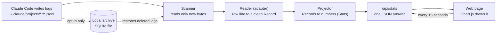
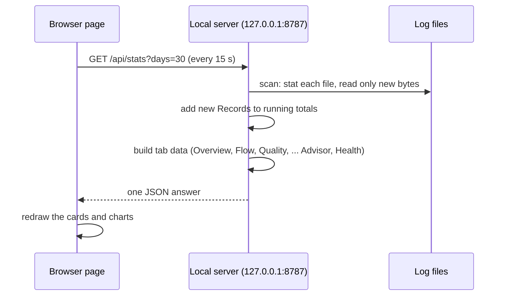

# AI Fluency Insights: Complete Guide for the Review Call

**Purpose.** One document to explain the whole project to a developer, a manager, a security reviewer or a skeptic, and
to answer their questions honestly. Everything here was checked against the code (`ai_fluency_insights.py`) and its
tests on 2026-11-03.

**How to read the status marks**

| Mark | Meaning |
|---|---|
| ✅ Built | In the code, covered by tests, works today |
| ◐ Built, off by default | In the code and tested, but the user must switch it on |
| 🔲 Planned | Designed or discussed, **not** built. Do not describe it as existing |

**Contents**

1. [The project in one minute](#1-the-project-in-one-minute)
2. [Where the data lives: is there a database?](#2-where-the-data-lives-is-there-a-database)
3. [How the scanner works (including pause and resume)](#3-how-the-scanner-works-including-pause-and-resume)
4. [What happens when Claude Code changes its log format](#4-what-happens-when-claude-code-changes-its-log-format)
5. [How each number is read from the logs](#5-how-each-number-is-read-from-the-logs)
6. [The 15-second refresh](#6-the-15-second-refresh)
7. [How the page is drawn (HTML and CSS)](#7-how-the-page-is-drawn-html-and-css)
8. [Every tab in simple English](#8-every-tab-in-simple-english)
9. [Where the wording comes from (and why no API key is needed)](#9-where-the-wording-comes-from-and-why-no-api-key-is-needed)
10. [Formula cheat sheet](#10-formula-cheat-sheet)
11. [Eight ways this helps a developer](#11-eight-ways-this-helps-a-developer)
12. [Questions people will ask, with answers](#12-questions-people-will-ask-with-answers)
13. [Honest limits](#13-honest-limits)
14. [What is built, what is next, and how we will build it](#14-what-is-built-what-is-next-and-how-we-will-build-it)
15. [A 10-minute demo script](#15-a-10-minute-demo-script)
16. [Things not to say](#16-things-not-to-say)
17. [Glossary](#17-glossary)
18. [Where things are in the code](#18-where-things-are-in-the-code)

---

## 1. The project in one minute

> Every time a developer uses Claude Code, it writes a log file on their computer: every prompt, every answer, every
> file it edited, with times and token counts. **AI Fluency Insights reads those files, does the math on the same
> machine, and shows charts that answer three questions: how much am I using Claude, what am I using it for, and how
> well am I working with it.**

Facts to say out loud:

- One Python file (about 7,300 lines), **standard library only**. No installs, no accounts, no API key.
- Runs a small web page at `http://localhost:8787`, reachable only from the same computer (`127.0.0.1`).
- Reads Claude Code's own log files and **never changes them**.
- The page makes no outside requests (the chart library is bundled).
- The page refreshes itself every **15 seconds**.
- 286 automated tests. Numbers are checked against Claude Code's own recorded totals (see section 4).
- It compares a person only with their **own past**. It never ranks people.



---

## 2. Where the data lives: is there a database?

**Short answer.** By default there is **no database**. The dashboard keeps its numbers in memory and rebuilds them from
Claude Code's log files every time it starts. A database (a single SQLite file) **is built, but it is switched off**
until the user turns it on, and its default is waiting for decision 1 (section 14).

### 2.1 What is stored where

| What | Where | Who writes it | Notes |
|---|---|---|---|
| The original logs | `~/.claude/projects/<project>/<session>.jsonl` (or `$CLAUDE_CONFIG_DIR/projects`) | **Claude Code**, not us | We only read. Sub-agent logs are in `<session>/subagents/` |
| Our numbers (tokens, cost, turns, scores) | **In memory only** (about 160 MB for a 270 MB history) | The dashboard, while it runs | Rebuilt from the logs at every start. Gone when the program stops |
| ◐ The archive (a private copy of the logs) | `~/.ai-fluency-insights/archive.sqlite` (change with `--archive-path` or `AFI_ARCHIVE_PATH`) | The dashboard, **only after** `--archive-enable` | See 2.3 |
| Toast-notification memory | `.notify_state.json` next to the script | The notification watcher | Tiny; stops the same toast firing twice |
| Page settings (privacy mode, advisor experiment start value) | The browser's `localStorage` | The page | Never leaves the browser |
| Plan-usage numbers | `~/.claude/rate_limits_latest.json` | Claude Code's `statusLine` hook (optional setup) | We only read it |

### 2.2 Why does it need anything stored at all? The deletion problem

Claude Code **deletes old logs**: after 30 days by default (`cleanupPeriodDays`; the minimum is 1; an organisation's
managed settings can pin it). So with no archive, "all time" in the dashboard really means "the last 30 days or so" and
gets shorter whenever Claude Code cleans up. The dashboard says so in Data Health ("History window" card).

### 2.3 ◐ The optional archive (built, tested, off by default)

- **What it is.** One SQLite file with three tables:
  - `meta`: settings, the on/off switch, a random machine id.
  - `sources`: one row per log file version: which logs folder, the file's relative path, a generation number (a rewritten file
    starts a new generation, the old one is kept), how many lines, and when it disappeared (`gone_at`) if Claude Code deleted it.
  - `lines`: the **raw log lines**, each compressed with zlib, numbered in order.
- **How it is switched on.** Only from the command line: `python ai_fluency_insights.py --archive-enable`. It prints a
  plain warning (the archive holds prompts, code, command output and anything secret that appeared in them), asks the user
  to confirm, then copies everything that exists. The web page **cannot** switch it on.
- **Other commands.** `--archive-status`, `--archive-sync` (for a scheduled task), `--archive-disable` (stop, keep data),
  `--archive-purge` (delete everything, asks first).
- **Safety rules built in.** Two processes can never write the same line twice (one database transaction per file update).
  A file is never deleted from the archive, only marked gone. The file is created readable by the owner only (on Linux/macOS;
  on Windows it relies on the user-profile permissions, which is **not yet tested**). A 2 GB cap pauses saving and says so.
  A broken or missing archive never stops the dashboard.
- **How restore works.** When Claude Code deletes a log, the scanner rebuilds that file's records from the archive, only for
  the same logs folder. If the original file comes back it wins.
- **Proof.** On a real log we deleted the file and the totals stayed identical.
- **Size.** About 1.6x smaller than the raw text (a 3.4 MB log became 2.1 MB).

### 2.4 How the logs are "restructured" (what the code does today) ✅

The raw lines are Claude Code's private format and can change. We never let the rest of the program touch them. Instead:

```
raw JSON line  --(reader / adapter)-->  Record  --(projector)-->  Stats  --(tab builders)-->  JSON for the page
 Claude's format                        OUR clean format           running totals              what each tab shows
```

- **Record** (our own standard, "canonical v1"): one per log line, in the same order. Fields: the line type, session id,
  the time (as an exact UTC time, plus the original text), working folder, git branch, Claude Code version, whether a person
  typed it, and a list of **events**. There are 10 event kinds: `title`, `mode`, `hook_run`, `attachment`, `permission_decision`,
  `tool_result`, `prompt`, `response` (tokens, model, stop reason, thinking time, effort), `tool_call` (name, command, file, lines
  written) and `session_totals` (Claude Code's own cost summary). Anything the reader does not recognise is kept in `extras`
  and counted, never silently dropped.
- **Only the reader knows Claude's raw format.** When Claude Code changes a field, one reader changes and all the metric
  code stays the same. Full description: [CANONICAL_SCHEMA.md](CANONICAL_SCHEMA.md).
- **Raw is kept, derived is rebuilt.** Because Records and Stats are rebuilt from the raw lines every start, an improved
  reader or a corrected formula also fixes old history, including history restored from the archive.

### 2.5 What is **not** done yet (be clear about this) 🔲

| Item | Status |
|---|---|
| Archive **on by default** | Not done. Waiting for decision 1 |
| **Facts-only** archive (store numbers, not raw lines) | Not built. Waiting for decision 2. Would be safer but history could never be recomputed |
| A stored copy of the clean Records | Deliberately **not** built: rebuilding from raw takes seconds, so storing them adds migration work for no gain |
| Combining several computers | Design note only ([LOG_RESILIENCE_ROADMAP.md](LOG_RESILIENCE_ROADMAP.md) section 10). Needs decisions 2 and 4 |
| Saving scanner progress across restarts | Not built. A restart re-reads every file once (about 5 s per 270 MB) |
| Archive tested on **Windows** | Not tested (file locking, OneDrive folders, permissions) |

---

## 3. How the scanner works (including pause and resume)

### 3.1 The method, step by step ✅

Every time the page asks for numbers, the scanner (`Scanner.scan`) does this:

1. **Find files.** Walk the logs folder for `*.jsonl` files. Copies that Claude Code set aside (`*.orphaned-*`,
   `*.superseded-*`) are noted but **not counted**, so numbers are not doubled.
2. **Cheap change check.** For each file, compare `(modified time, size)` with what was seen last time. If equal, skip it.
   This costs one `stat` call per file.
3. **Read only the new bytes.** If the file changed, open it and read **from where we stopped**, not from the start
   (`read_tail`).
4. **Only whole lines count.** If the last line is half-written (Claude Code is writing right now), we do **not** use it yet and do not
   move our bookmark past it. Next time we start again from the start of that line. So a line is never read twice and never
   read half.
5. **Detect rewrites.** We remember a fingerprint (SHA-1) of the start and of the last bytes we read. If they no longer match, or the file
   got smaller, Claude Code rewrote the file, so we throw away what we had for that file and read it from the top.
6. **Decode and adapt.** Each new line is parsed as JSON and turned into a Record. A line that is not valid JSON in the middle of a
   file is counted as a parse error and skipped; a half-written last line is counted separately and is not an error.
7. **Update the numbers.** Only the **new Records** are added to the running totals (the "projection"). Duplicate copies of the same
   API response are dropped (section 5.2).

### 3.2 "What if the scan stopped at a line and new lines arrive later?"

This is the exact question to answer clearly:

- The scanner keeps, **per file, a bookmark**: the byte position after the last complete line it consumed, plus the fingerprints.
- When new lines are appended, the next scan starts at the bookmark, reads the new lines, adds them to the totals, and moves the bookmark.
- Example: the file has 100 lines and we have read all 100. Claude writes lines 101 to 103, and half of 104. Next scan reads 101 to 103,
  **leaves 104 alone**, bookmark stays at the end of 103. When line 104 is finished, the following scan reads it.
- This is proven by a test that grows a file one chunk at a time, cutting it in the middle of lines at random places: the result always
  equals a fresh scan of the final file, and every byte is read once.

### 3.3 What if the dashboard itself is closed, or restarted?

- **Closed, then reopened.** The bookmarks live in memory, so a restart reads every file **once from the top** (about 5 seconds for 270 MB of
  logs, about 160 MB of memory). After that it is incremental again. Saving the bookmarks across restarts is not built (section 2.5).
- **While it is closed, Claude Code keeps working.** Nothing is lost, because Claude Code keeps writing its logs. Anything still on disk is read at the
  next start. The only loss is files Claude Code **deletes** while the dashboard (and the archive) is not running, which is what the optional archive
  is for. Decision 5 is about how to run the archive when the dashboard is closed.

### 3.4 What if an older session grows while a newer one exists? ✅

Two terminals open, or an old session resumed. Totals must be built in a fixed order (by when each file's first dated line was written, then by
name), so a fresh scan and a long-running scan always agree. When an **older** file grows, the plain rule would be to
rebuild everything. Instead, the dashboard keeps a few **snapshots** of the running totals taken before each of the newest 4 files, restores the
nearest valid one, and re-adds only from there. A signature check makes sure the files before the snapshot are exactly as they were; if not, it
rebuilds from scratch (always correct, only slower). Measured on a 273 MB test history: the page's answer after an older session grows went from
1.56 s to 0.30 s.

### 3.5 Other rules that matter

| Situation | What the scanner does |
|---|---|
| Same API response written on several lines (streaming) | Counted once, keyed by `(message id, request id)` |
| Sub-agent logs in `<session>/subagents/` | Counted for the parent project, not a project called "subagents" |
| A file is rewritten (new generation) | Thrown away and re-read; the archive keeps the old generation |
| A file is deleted | If the archive is on, it is restored from the archive; otherwise it disappears from the numbers |
| Time zones | Every time is stored as exact UTC and turned into **your local day, hour and weekday** only when drawn, so travelling never rewrites data |
| Speed | Cold start about 5 s per 270 MB. A refresh after new lines: about 0.1 to 0.3 s end to end. An idle refresh: about 0.08 s (measured on a generated 273 MB test history, not on a real heavy user) |

---

## 4. What happens when Claude Code changes its log format

Claude Code's log format is **internal and undocumented**. It can change without notice. We cannot prevent that, so
we built five layers that **detect** it and **limit the damage**.

| # | Layer | What it does | Example |
|---|---|---|---|
| 1 | **Schema sentinel** | At every scan, records the *shape* of each log line (which fields exist, with what types), per Claude Code version, and compares it with what the dashboard reads and with a saved baseline (`schema/claude_code_known.json`) | A field `message.usage.cache_read_input_tokens` disappears in version 2.2: **warning**. A brand-new field: **info** only |
| 2 | **Visible warnings** | Warnings raise a banner at the top of every page; Data Health lists each finding with the affected versions and metrics; KPI tiles built on the changed field show an amber **Unverified** badge and stop showing text derived from the suspect number | If cache-read tokens vanish, "Cache read", "Est. API cost" and "Cold-start tax" say Unverified instead of quietly showing 0 |
| 3 | **Readers per version** | A registry of readers (adapters). A new format means adding a new reader; the old reader stays for old logs. A version with no reader is read by the newest one but counted as **fallback** and flagged "not verified" | Today one reader, `claude-code-2`, covers all 2.x versions |
| 4 | **Cross-checks with Claude Code's own totals** | Claude Code writes `cost-state` lines with its **own** token counts and dollar cost. We compare: our output tokens vs its (must be within 3%); our prices applied to its token counts vs its dollar figure (must be within 1%) | This is how the earlier cost error was found (our estimate was 17% to 42% too high; now fixed) |
| 5 | **Tests and release routine** | A golden test pins the exact numbers a known log must produce; random tests compare the live scanner with a fresh scan; `tools/release_check.py` runs all log checks and the tests when Claude Code updates | Release checklist: [RELEASE_CHECKLIST.md](RELEASE_CHECKLIST.md). Compatibility table: [COMPATIBILITY.md](COMPATIBILITY.md) |

**What a developer sees when a change happens.** A banner ("Claude Code's log format has changed in N places that this dashboard
relies on, so some numbers may be wrong"), the affected tiles marked Unverified, and a plain list in Data Health. Nothing crashes. A line
that cannot be read is skipped and counted, never fatal.

**Honest limit.** The sentinel sees changes in **fields and types**. If Claude Code keeps a field but changes what it *means*, the sentinel cannot see it.
Only the cross-checks (layer 4) and a human following the release checklist can catch that.

**Verified versions.** Only Claude Code **2.1.316** and **2.1.317** are marked verified, with stated limits (compaction, sub-agents and MCP calls were not
exercised in 2.1.317). Every other version is "unverified": read with the same reader, with the sentinel watching.

Detail: [SCHEMA_NOTES.md](SCHEMA_NOTES.md), [CANONICAL_SCHEMA.md](CANONICAL_SCHEMA.md).

---

## 5. How each number is read from the logs

### 5.1 Tokens (input, output, cache)

Every answer from Claude is a log line of type `assistant`. Inside it, `message.usage` holds four counters. We read exactly these:

| Dashboard name | Log field | Plain meaning |
|---|---|---|
| Input tokens | `input_tokens` | New text sent to Claude that was **not** already cached (your prompt plus new context) |
| Output tokens | `output_tokens` | Everything Claude wrote: answer, code, tool calls, thinking |
| Cache read | `cache_read_input_tokens` | Earlier context Claude re-used from its short-term memory instead of re-reading. Usually the biggest number, and cheap |
| Cache write | `cache_creation_input_tokens` | Context saved into that memory for next time. The log also says whether it went to the 5-minute or the 1-hour memory (the 1-hour one costs more) |

- **Model name** comes from `message.model`; the **stop reason** from `message.stop_reason`.
- If a counter is missing or is not a number, it counts as 0, **is listed by name** in Data Health ("Tokens and cost"), and the
  other counters still count. The old behaviour (losing the whole line) was removed.

### 5.2 Why the same answer is not counted three times

While Claude streams an answer, Claude Code writes **several log lines for one answer**, each with a copy of the same usage numbers.
Adding every line would count tokens about 3 times. So each answer is counted once, using the pair `(message id, request id)` as its identity.
Tool calls are de-duplicated by their own id. Our totals are therefore *lower* than naive sums and usually differ from the official panel.
Proof and numbers: [TOKEN_COUNTS.md](TOKEN_COUNTS.md).

### 5.3 Project name

- The project is the **first folder under the logs folder**. Claude Code names that folder after the working directory, replacing slashes with dashes
  (for example `-home-user-my-app`).
- We turn dashes back into slashes for display (`home/user/my/app`). **This is a guess:** a real folder called `my-app` also shows as `my/app`.
  The true path is also stored from each line's `cwd` field and is used when we need to look at the real folder (for example to see whether a `CLAUDE.md` exists).
- Sub-agent logs belong to their parent project (they used to appear as a project called "subagents": fixed).

### 5.4 Other fields

| Number | Where it comes from |
|---|---|
| Session | One distinct `sessionId`. Start and end are the first and last times seen in it |
| Prompt | A `user` line with real typed text. Slash commands, command output, interruptions and **the summary Claude Code writes after `/compact`** are excluded |
| Your tokens | Prompt length divided by 4 (a rough rule: about 4 characters per token), per prompt |
| Lines of code | Counted from the **content Claude wrote** in file tools: `Write` (`content`), `Edit` (`new_string`), `MultiEdit` (each `new_string`), `NotebookEdit` (`new_source`). Lines = newlines + 1. Additions only, no deletions |
| Tool calls | The `tool_use` blocks inside assistant lines (name, command, file) |
| Tool time | Seconds between a `tool_use` and its `tool_result`, matched by id |
| Failures | A tool result flagged `is_error` |
| Interruptions | A user line containing `[Request interrupted` |
| Thinking time, effort | `thinkingDurationMs` and `effort` on assistant lines |
| Task title | The `ai-title` line Claude Code writes for each session |
| Plan mode / autonomy | `permission-mode` lines |
| Git branch | The `gitBranch` field on each line |
| Hooks | `stop_hook_summary` system lines |
| Cost | Tokens times Anthropic's published prices, see section 10 |

---

## 6. The 15-second refresh



- **Where the 15 seconds is set.** In the page: `setInterval(load, 15000)`. Each tick asks the server for fresh numbers. There is no push from the server.
- **What the server does on a request.** It runs the cheap scan from section 3 (one `stat` per file, reads only changed files), adds only the new records,
  and builds the answer. If nothing changed it returns the previous answer almost instantly.
- **What the user sees.** New lines Claude wrote appear within about 15 seconds. A failed request leaves the last numbers on screen and retries at the next tick.
- **Cost of a refresh.** On a generated 273 MB history (60 files): about 0.08 s when nothing changed, about 0.13 s when the newest session grew, about 0.2 to 0.3 s when
  an older session grew. Before the snapshot and payload work these were about 0.17 s idle, 0.34 s, and about 1.6 s when an older session grew.
- **Separate 5-second watcher.** A background thread (`poll_seconds: 5`) watches for plan-usage milestones and can show a Windows toast. It is independent of the page.
- **Plan usage card.** Reads `~/.claude/rate_limits_latest.json`, which Claude Code's `statusLine` hook writes (optional setup `--setup-notifications`). It only updates when a Claude Code session is
  active, so it can lag. The card says how old the number is.
- **Page-wide ranges.** The 7 / 30 / 90-day buttons mean "the last N **active** days", not calendar days. Custom dates are exact. Weekly Report and My Adoption always use full history.

---

## 7. How the page is drawn (HTML and CSS)

| Part | How it works |
|---|---|
| **One file** | The whole page (HTML, CSS, JavaScript) is a single text block inside the Python file and is sent at `/`. No build step, no framework, no external fonts or scripts |
| **Charts** | Chart.js, **bundled** as `chart.umd.min.js` and served locally. A helper `mk()` creates or updates each chart |
| **Tabs** | 11 `<section>` blocks (`s-overview`, `s-focus`, ...). The nav buttons carry `data-s="..."`; clicking one shows that section and hides the others. Each tab has a `render...()` function that fills its cards from the JSON |
| **Cards and tiles** | A small set of builders produces the repeated pieces: KPI `tile()`, the score ring `insHero()`, the confidence badge `cb()`, delta arrows `insDelta()` |
| **Colours and themes** | CSS variables ("design tokens") defined once at the top (`--canvas`, `--sky`, `--emerald`, `--amber`...). Light is the base; dark mode redefines only the colours that change, and follows the system setting (`prefers-color-scheme`) |
| **Layout** | CSS grid and flex cards; the page is built to work in a normal desktop browser window (other screen sizes are not formally tested) |
| **Refresh** | `load()` fetches the JSON and calls the render functions; `setInterval(load, 15000)` repeats it |
| **Privacy mode** | A toggle that hides session titles, prompt previews and file names on screen (remembered in `localStorage`) |
| **Exports** | Copy (text summary), CSV (per-day table), JSON (whole payload) |
| **No outside requests** | The page loads nothing from the internet. The only time anything leaves the machine is the optional AI buttons (section 9.3) |

The numbers shown in a card are never calculated in the browser from raw logs. The server sends finished numbers; the browser only formats and draws them (a few small
formulas, such as the fluency scores, exist in both places and are kept equal by tests).

---

## 8. Every tab in simple English

Tabs on the left menu: **Overview, Time & Focus, Tools & Models, Projects, Weekly Report, My Adoption**, then a group
**Engineering insight**: **Flow, Quality, Value, Advisor**, and **Data Health**.

Every number on the newer tabs has a small badge showing how much to trust it:

| Badge | Meaning |
|---|---|
| **Observed** | Read straight from a field in the log |
| **Derived** | Calculated from observed fields with a stated formula |
| **Proxy** | An indirect signal; it may not mean exactly what it suggests |
| **Estimated** | Depends on list prices or a guess |

### 8.1 Overview

**Purpose.** "How much am I using Claude Code, and what do I get back?" Follows the range buttons (7 / 30 / 90 days, all time, custom).

| Card | Plain English |
|---|---|
| **Momentum bar** | Day streak (days in a row you used Claude, counted back from your latest active day), best streak ever, total active days, and optional goal bars |
| **Plan usage** | How full your Anthropic 5-hour and weekly limits are. Real numbers if the optional hook is set up; otherwise a local estimate, labelled "(estimate)" |
| **Input tokens** | Text sent to Claude |
| **Output tokens** | Text Claude produced |
| **Cache read** | Context Claude re-used instead of re-reading. The subtitle shows the hit rate: `cache read ÷ (cache read + input)`. If more than 5% of follow-up calls had to rebuild the cache it shows a warning instead |
| **Est. API cost** | What this usage would cost at public API prices. On a subscription your real marginal cost is $0; this is "value received", not a bill |
| **Cold-start tax** | The share of cost spent on each session's very first call (the one that fills the cache). High means many short sessions |
| **Lines of code** | Lines Claude wrote into files (additions only) |
| **Prompts** | Messages you typed |
| **Sessions** | Separate conversations, with average length |
| **Friction** | Times you pressed Esc to stop Claude, plus failed tool calls. A "how often did it hurt" counter |
| **Corrections** | Prompts that start with "no", "wrong", "undo", "you missed"... : times you had to steer Claude back |
| **Your tokens** | Estimated tokens you typed |
| **Leverage** | `Claude's output tokens ÷ your typed tokens`. "50x" means each token you typed produced 50 back. A rough guide, because your tokens are estimated |

Charts: daily tokens, you vs Claude (log scale, so your small line is visible), model usage, lines of code per day, exploration vs building, friction per day.
Every tile shows ▲/▼ against the previous period of the same length.

**How it helps.** A fast health check: is usage growing, is friction falling, is caching working, what is the leverage trend. **Watch out.** Token totals are
de-duplicated, so they are lower than the official panel; cost is a list-price estimate.

### 8.2 Time & Focus

**Purpose.** "Am I working in a sustainable way?"

| Card | Plain English | Formula |
|---|---|---|
| **Active time** | Roughly how long you were really working with Claude | Each message goes into a 10-minute slot. Active time = number of slots × 10 min. One lone message counts as 10 minutes; a gap longer than about 10 minutes stops counting |
| **Avg per active day** | A typical working day | Active time ÷ days with any message |
| **Longest focus block** | Your longest unbroken stretch in one day | Longest run of consecutive 10-minute slots (does not cross midnight) |
| **Quiet hours %** | How much happens late at night | Messages between 23:00 and 06:00 ÷ all messages. The hours can be changed in the script |
| **Weekends %** | How much happens on Saturday/Sunday | Weekend messages ÷ all messages |
| **Active minutes per day** (bars) | The above per day | Bars turn red when more than a quarter of that day's messages were in quiet hours |
| **Activity heatmap** | Your weekly rhythm | Message count by weekday × hour, darker means more |
| **Task mix / day** | What kind of work each day was | Each session is labelled feature / bugfix / refactor / docs / explore / other by matching words in Claude's own session title (for example "fix", "crash" means bugfix). A guess, not exact |
| **Friction / day** | When it was painful | Interruptions plus failed tool calls per day |

**How it helps.** Shows late-night habits, long unbroken focus (good) versus constant context switching, and which days were painful. It is for self-awareness, not for policing.

### 8.3 Tools & Models

**Purpose.** "Which models and tools does the work, and how much autonomy do I give Claude?"

| Card | Plain English |
|---|---|
| **Model usage / breakdown** | Output tokens and estimated cost per model (Opus, Sonnet, Haiku...) |
| **Autonomy mode** | How you let Claude act: ask first, auto-accept edits, plan mode. Read from `permission-mode` lines |
| **Delegation** | Helper sub-agents Claude started, by type |
| **Tool usage** | How many times each tool ran (Edit, Bash, Read...) |
| **Slash commands** | Which `/commands` you used |

**How it helps.** Spot a top-tier model doing simple jobs, see whether you use plan mode or sub-agents, and see the real shape of your workflow.

### 8.4 Projects

| Card | Plain English |
|---|---|
| **Projects** | Per project: tokens, lines of code, prompts, sessions, estimated cost. **Click a row** for that project's daily chart, session titles and most edited files |
| **Git branches** | Output and lines per branch (Claude Code stamps each line with the branch) |
| **Most-edited files** | Where Claude's code landed, by lines (file names only, not paths) |
| **Longest prompts** | Your biggest prompts with a preview. Often reveals over-explaining |

**How it helps.** Shows where AI effort and cost go, and which files get reworked. **Watch out.** Project names are decoded from folder names (section 5.3).

### 8.5 Weekly Report

**Purpose.** "My standup or weekly update writes itself." Weeks are Monday to Sunday (ISO weeks). Browse with Prev / Next.

| Card | Plain English |
|---|---|
| **KPI row** | Sessions, focus hours, output tokens, lines, prompts, building %, each against last week. Focus hours = sum of session lengths ÷ 60 |
| **What you worked on** | Claude's own session titles grouped by project, with date, minutes, lines, prompts. Free (no AI call) |
| **Exploration vs building** | Doughnut of reads and searches vs file edits |
| **Day by day** | Output and lines per weekday |
| **AI Fluency report** | Four 0-100 scores on a radar, this week vs last: **Delegation** (do you give Claude real build work?), **Description** (do your first prompts land?), **Discernment** (do you review and steer?), **Diligence** (do you verify?). Adapted from the 4D AI Fluency Framework (see Credits in the README). Heuristic, so watch the trend, not the number |
| **Reflection** | One question for the week, chosen by fixed rules (many corrections, late nights, heavy exploration or building, little verification), otherwise a classic fallback |
| **AI-written summary / Discuss with Claude** | **Buttons.** The only features that call Claude (section 9.3) |
| **Copy as Markdown** | The week as formatted text for Slack, Teams or email |

**How it helps.** Saves time on status updates and gives a weekly mirror.

### 8.6 My Adoption

**Purpose.** "How deeply do I use Claude Code, and am I improving?" It compares you with **your own past 28 days**, never with other people. It uses the 28 calendar days ending on your latest active day (so a long break does not wreck the score) and needs at least 3 active days; otherwise it says "Building your baseline".

| Pillar | Question | Formula (0-100) |
|---|---|---|
| **Habit** | Do I show up regularly? | `60 × min(1, active days ÷ 12) + 40 × (weeks with 2+ active days ÷ 4)` |
| **Range** | Do I use what Claude Code offers? | `75 × min(1, features used ÷ 6) + 25 × share of "substantial" sessions` (10+ tool actions). Features: project memory (CLAUDE.md), run and verify, plan mode, sub-agents, skills, hooks, task lists, connected tools, slash commands, web research |
| **Craft** | Do I work with Claude well? | `0.6 × mean of the four fluency scores + 0.2 × Flow score + 0.2 × Quality score` (a missing score shares its weight) |
| **Impact** | What does Claude get done for me? | `50 × min(1, lines per active day ÷ 300) + 50 × (days Claude wrote code ÷ active days)` |

`Adoption Score = 0.25 × Habit + 0.25 × Range + 0.30 × Craft + 0.20 × Impact`.

Levels: **Explorer** (0-19), **Practitioner** (20-39), **Power user** (40-59), **Expert** (60-74), **Pro** (75-89, needs every pillar at 50 or more),
**Pro Max** (90+, needs every pillar at 70 or more and four weekly scores in a row at 85 or more). If a gate blocks a level, the page says exactly what to lift.

Other cards: **What changed lately** (up to four plain lines about pillars that moved 5+ points, level changes, features used for the first time), **Your adoption journey**
(Started, Recurring, Integrated, Verified outcomes), **Your next 3 moves** (rule-based coaching), **Your adoption over time** (the score at each of the last 12 week-ends),
**Healthy habits** (average active minutes, longest focus, quiet-hours and weekend share).

**How it helps.** Turns "am I getting better at this?" into something visible with concrete next steps. **Watch out.** Weights and targets are hand-picked; levels are motivational labels, not a standard.

### 8.7 Flow  (engineering insight)

**Purpose.** "How smoothly does work move between me and Claude?" Follows the selected range. Needs at least 5 timed turns for a score.

**Headline.** A 0-100 ring with words: **Strong flow** (80+), **Mostly smooth** (60-79), **Bumpy** (40-59), **Rough going** (below 40), and a sentence such as
"72% of your turns landed first time, and 85% of failures got fixed."

`Flow score = 100 × (0.5 × clean-turn rate + 0.3 × recovery rate + 0.2 × (1 − stuck share))`. With no failures at all, recovery counts as 100% and stuck share as 0.

| What you see | What it means in 1 to 2 lines |
|---|---|
| **Turn** | One round trip: you send a prompt, Claude finishes its answer (`end_turn`). Turns that never finish count as "not clean" |
| **Median turn** | The middle turn time: half of your turns were faster, half slower. The median ignores one freak slow turn. It includes time waiting for you to approve an action |
| **Slowest 10%** | The time that 9 out of 10 turns beat. Shows your worst waits |
| **Clean first-pass turns** | The share of turns that went right the first time: **no** failed tool, **no** interruption by you, and **no** correction ("no, that's wrong...") in your next prompt |
| **Failures fixed** | When a tool fails (a command errors, an edit fails), did that same tool **succeed later in the same session**? This is the share that did. "Steps to recover" is how many tool results it took |
| **Stuck loop** | The same tool failed **3 or more times in a row**. A sign Claude is going round in circles and you should change approach |
| **Time to first edit** | How long from the start of a session until Claude first changes a file (median). Short means you went straight to work. Long can mean planning or exploring. Neither is good or bad on its own |
| **Where tool time goes** | Which tools or commands take the time, as a share of all tool seconds (for shell commands, by what ran: `git push`, `pytest`...). The rest of a turn is Claude thinking, writing and waiting for you |
| **Slowest tools and commands** | A table with calls, median, slowest 10%, longest, and share |
| **Session length** | Time from a session's first to last entry (median, slowest 10%). It includes idle time, so read it as "span", not "work" |
| **Thinking time and effort** | How long Claude's reasoning took and the effort level it reported |

**How it helps.** Shows whether time is lost to waiting, rework, failures or long sessions. **Watch out.** Times include waiting for your approval, and a session is not a task.

### 8.8 Quality  (engineering insight)

**Purpose.** "Does the work get checked, and how much is redone?" Needs 3 edit sessions for a score.

`Quality score = 40% verified + 20% tests alongside code + 20% (1 − min(1, re-edit share ÷ 50%)) + 20% first-run pass` (the last part only when a check ran; otherwise the others are re-weighted).

| What you see | What it means in 1 to 2 lines |
|---|---|
| **Verified after last edit** (proxy) | In what share of sessions where Claude edited files did a **test, build or lint command run after Claude's last edit**? It proves a check *ran*, not that the code is right |
| **First-run pass rate** | The first time a test/build/lint ran in a session, did it pass? |
| **Fail → fixed** | A check failed and a later run passed |
| **Tests alongside code** (proxy) | Share of edit sessions where a test file was also edited (`tests/`, `test_*`, `*_test.*`, `*.spec.*`) |
| **Re-edit share** (proxy) | Edits to a file that was already edited earlier in the same session ÷ all edits. High means many small passes |
| **Rework hotspots** | Files edited 5+ times, either 3+ times in one session or on 3+ days |
| **Friction** | Failed tool calls per 100 edits; interruptions per 100 prompts |
| **Safety signals** | Counts of force-push, hard reset, `git clean -f`, recursive delete, pipe-to-shell, skipped git hooks, `chmod 777`, SQL drop, and reads/edits of secret-like files (`.env`, keys). **Only the category is stored, never the command** |
| **Permission decisions** | Accept/reject decisions and their source, when the logs include them |

**How it helps.** A safety net for AI-written code: are tests run, are risky commands happening, where is rework piling up.

### 8.9 Value  (engineering insight)

**Purpose.** "What does this cost at list prices, and what do I get for it?" No score, because a dollar figure has no universal "good"; each number shows its change against your previous period.

The headline reads like **"$12.40 estimated"** with the line **"Median session $0.40 · 15 sessions"**. That sentence is a fixed template: the middle session cost $0.40 across 15 sessions in the range.

| What you see | What it means |
|---|---|
| **Estimated cost** | Tokens × published Anthropic prices (section 10). On a subscription the real marginal cost is $0 |
| **Per 100 lines** | `estimated cost ÷ lines Claude wrote × 100` |
| **Per verified session** | Cost of edit sessions that ended with a test/build/lint ÷ their count |
| **Caching saved** | What caching saved against sending the same tokens uncached, minus the extra paid to write the cache |
| **Cold-start tax / cache rebuilds** | Share of cost in each session's first call; share of follow-up calls that had to rebuild the cache |
| **Cost spikes** | Days costing at least 2x your typical day (and at least $0.50), with the biggest session of that day. Needs 5 active days |
| **Model mix** | Each model's share of cost |
| **Top-tier model on no-edit sessions** (proxy) | Spend on the most expensive models in sessions where Claude changed nothing |

**How it helps.** Shows runaway sessions, wasteful model choices and whether caching works. **Watch out.** It is a list-price estimate: about 2% to 3% **below** Claude Code's own figure, because some
tokens Claude Code counts never appear in the log (section 13).

### 8.10 Advisor  (engineering insight)

**Purpose.** "What should I change first?" The top 5 next steps over the same 28 days as My Adoption, ranked, each with the **numbers behind it** and a concrete action.
Sections: **Your top moves**, **Your experiment** (one-click: the page remembers the current value of a related metric in your browser and shows how it moves), **What is going well**, **Also noticed**.
It is rule-based; the rules and an example are in section 9.2.

### 8.11 Data Health

**Purpose.** "Can I trust what I am looking at?"

| Card | What it shows |
|---|---|
| **What your logs let us measure** | For each signal (tokens, turn timing, tool timing, permissions, thinking, hooks, sub-agents...) whether your logs actually contain it. A metric with no signal says so instead of showing 0. This card also holds the **Model prices** check (does our price table reproduce Claude Code's own recorded cost; which models have no price row) and the cross-check with Claude Code's totals |
| **Log format changes** | The sentinel's findings (section 4) |
| **Local archive** | Whether the optional archive is on, how much it holds, last sync |
| **Log inventory** | Entry types and counts, Claude Code versions seen, which reader handled each line, unreadable lines, duplicate lines dropped, set-aside copies ignored |
| **What these logs cannot tell us** | Plain list of blind spots |
| **Privacy** | What stays local |
| **Metric catalog** | Every metric with its formula, confidence badge and limitation (single source in the code, `METRIC_CATALOG`) |

---

## 9. Where the wording comes from (and why no API key is needed)

People often ask: "the Advisor says *Start a fresh session per task*. Who wrote that? Which AI? Where is the API key?" The answer: **a person (the developer of
this tool) wrote every sentence in advance, as a template with blanks. The program only fills the blanks with your numbers and decides which templates apply.
No AI model is called for any of this, so no key is needed.**

### 9.1 Five kinds of text on the page

| Kind | Example | How it is made |
|---|---|---|
| **Fixed labels** | "Clean first-pass turns", "Stuck loops" | Written in the page code |
| **Templates with numbers** | "Median session $0.40 · 15 sessions"; "72% of your turns landed first time, and 85% of failures got fixed." | A sentence with blanks; the numbers come from the totals |
| **Bands (score to words)** | Flow ring: "Strong flow" (80+), "Mostly smooth" (60+), "Bumpy" (40+), "Rough going" | `band(score, [words...])` picks the word by threshold |
| **Rule tables** | The Advisor and the "next 3 moves" | `if <number> crosses <threshold>` then add this recommendation (9.2) |
| **Fixed rotation** | The weekly Reflection question | Rules decide which questions apply; the choice rotates by week number, so it is repeatable |

Why this design: it is **free, instant, private, repeatable and auditable**. The same numbers always give the same text, and every recommendation quotes the evidence it came from.

### 9.2 The Advisor, rule by rule

Window: the same 28 days as My Adoption. Each rule that fires becomes a recommendation with a **severity** number; they are sorted by severity, the top 5 are shown as "Your top moves",
the next 7 as "Also noticed", and up to 4 positives under "What is going well".

| Recommendation (title) | Fires when | Severity | Confidence badge |
|---|---|---|---|
| **Make Claude check its own work** | Verified-after-last-edit below 60% (3+ edit sessions) | `(100 − %) × 0.9` | Proxy |
| **Your first test or build run often fails** | First-run pass below 60% over 5+ session-and-check pairs | `(100 − %) × 0.8` | Derived |
| **Sharper first prompts** | Clean first-pass turns below 60% (8+ turns) | `(100 − %) × 0.8` | Derived |
| **Break out of failure loops sooner** | 2 or more stuck loops | `min(90, 45 + 10 × loops)` | Derived |
| **'<tool>' dominates your tool time** | One tool takes 35% or more of tool time (and at least 60 s) | `30 + share × 0.4` | Observed |
| **Start a fresh session per task** | 5+ sessions and (slowest 10% at 180 min or more, or median at 90 min or more) | `min(70, 30 + p90 ÷ 6)` | Derived |
| **Many short sessions are paying the cache set-up cost** | Cold-start tax 45% or more over 8+ sessions | `min(70, % × 0.7)` | Estimated |
| **The cache is being rebuilt mid-session** | 8% or more of follow-up calls rebuilt the cache | `min(65, % × 3)` | Estimated |
| **Files are being edited again and again** | Re-edit share 35% or more over 30+ edits | `min(75, %)` | Proxy |
| **Ask for tests alongside code** | Tests-alongside below 40% (5+ edit sessions) | `(100 − %) × 0.5` | Proxy |
| **Risky commands ran** | Any risky command category detected | `min(85, 40 + 10 × count)` | Proxy |
| **Claude touched secret-like files** | Any read/edit of `.env`, keys, credentials | `min(90, 55 + 10 × count)` | Proxy |
| **Cost spiked on <day>** | A day at 2x or more your typical day | `min(70, 35 + 5 × multiple)` | Estimated |
| **Top-tier model on sessions with no edits** | 50% or more of top-tier spend (and at least $5) | 35 | Proxy |
| **Coach items** (use plan mode, add a CLAUDE.md, protect your evenings...) | The My Adoption coach rules (section 8.6) | up to 80 | Derived |

**Worked example: "Start a fresh session per task".** Suppose the 28-day numbers are: 12 sessions, median 95 minutes, slowest 10% at 210 minutes.
The rule fires (210 is at least 180). Severity = `min(70, 30 + 210 ÷ 6)` = 65. The page shows:

- **Title:** Start a fresh session per task
- **Evidence (template + your numbers):** "Median session is 95 min and the longest 10% run 210 min."
- **Action (fixed text):** "Use /clear between unrelated tasks, and /compact when one long task has to continue."

Same idea for **"Make Claude check its own work"** (evidence: "A test, build or lint ran after Claude's last edit in 40% of edit sessions (4 of 10)." Action: "End prompts with 'then run the tests', or put your test command in CLAUDE.md...")
and **"Risky commands ran"** (evidence: "2 risky commands: force push x1, hard reset x1." Action: "Add deny rules in your Claude Code permission settings...").

**Experiments.** Some recommendations offer "Your experiment": the page saves today's value of the related metric in the browser (`localStorage`) and shows how it moves over a rolling 4 weeks.

### 9.3 The only place an AI is used: three buttons

| Button (Weekly Report) | What happens |
|---|---|
| **AI-written summary** | Builds a prompt from the week and runs **`claude -p "<prompt>"`** as a subprocess |
| **Discuss with Claude** | Same, with the reflection question and the week's counts |
| (nothing else) | Every other number and sentence is rules and templates |

- **Why no API key.** The dashboard does not talk to Anthropic. It starts the user's **own installed Claude Code** (`claude`), which is already logged in. The dashboard holds no credentials.
- **What is sent.** For the summary: the week's dates, up to 50 session lines (project, session title, day, minutes, lines) and the week's totals. For the reflection: the question and the week's counts.
  Your prompts and code are not included, but session titles are Claude's own short summaries of the work, so they can reveal what you worked on. This goes to Anthropic **through Claude Code**, so it is the **only moment data leaves the machine**, and only when the user presses the button.
- **Cost.** It uses the user's own plan, like any Claude Code prompt. The page labels these buttons as token-consuming. There is a 5-minute timeout and a clear error if `claude` is not found.
- **Wording to use on the call:** "The dashboard itself never calls an API and costs zero tokens. The two optional AI buttons run the user's own Claude Code locally and only when pressed."

---

## 10. Formula cheat sheet

| Metric | Formula |
|---|---|
| Cache hit rate | `cache read ÷ (cache read + input) × 100` |
| Cache-rebuild rate | calls after a session's first with `cache write > cache read` ÷ all calls after the first |
| Cold-start tax | `Σ cost of each session's first call ÷ Σ session cost × 100` |
| Estimated cost (per answer) | `(input × in + output × out + cache read × in × read + 5-min write × in × 1.25 + 1-hour write × in × 2) × fast-mode × US-only ÷ 1,000,000 + web searches × $0.01` |
| Prices used (USD per million tokens, input / output) | Sonnet 5.5 and 5: $2 / $10; Sonnet 4.6 and older: $3 / $15; Opus 5.5: $4 / $20; Opus 5 to 4.5: $5 / $25; Opus 4.1 and older: $15 / $75; Fable and Mythos: $10 / $50; Haiku 5.5: $0.10 / $0.50 (Haiku 4.5: $1 / $5, Haiku 3.5: $0.80 / $4). A model that matches no row is priced at $3 / $15 and listed in Data Health. Cache reads cost 0.10x the input price for most models, 0.05x for Sonnet 5.5 and Opus 5.5, 0.025x for Fable and Mythos. From Anthropic's published table (the rows live in `PRICING`); only Sonnet 5.5 and the base Haiku 5.5 tier were checked against Claude Code's own cost |
| Cache savings | `(cache read × (1 − read) − 5-min write × 0.25 − 1-hour write × 1.0) × input price` |
| Leverage | `Claude output tokens ÷ your typed tokens`; your tokens = `prompt characters ÷ 4` |
| Lines of code | `newlines + 1` of the text Claude wrote with Write / Edit / MultiEdit / NotebookEdit |
| Building % | `edits ÷ (reads + edits) × 100` |
| Friction | `interruptions + failed tool calls` |
| Active time | `10-minute slots with any message × 10` |
| Quiet-hours share | `messages between 23:00 and 06:00 ÷ all messages` |
| Delegation | `50 × (code sessions ÷ sessions) + 50 × min(1, leverage ÷ 50)` |
| Description | `65 × one-shot rate + 35 × sweet-spot`; one-shot = `1 − (corrections + interruptions) ÷ prompts`; sweet spot = average prompt of 8 to 150 words scores 1 |
| Discernment | `50 × engagement + 50 × error control`; engagement hits 1 when pushback reaches 5% of prompts; error control = `1 − tool errors ÷ edits` |
| Diligence | `share of code-writing sessions that also ran a shell command` |
| Habit / Range / Craft / Impact | section 8.6 |
| Adoption Score | `0.25 Habit + 0.25 Range + 0.30 Craft + 0.20 Impact` |
| Flow score | `100 × (0.5 × clean-turn rate + 0.3 × recovery + 0.2 × (1 − stuck share))`, needs 5 turns |
| Quality score | `40% verified + 20% tests alongside + 20% (1 − min(1, re-edit ÷ 50%)) + 20% first-run pass`, needs 3 edit sessions |
| Correction | A prompt that **starts** with "no", "wrong", "nope", "actually", "that's not", "stop", "undo", "revert", "don't", "you missed/forgot/broke" |

Full reference with every limitation: [METRICS.md](METRICS.md). Cost details and how it was checked: [COST_MODEL.md](COST_MODEL.md).

---

## 11. Eight ways this helps a developer

1. **See your real AI usage instead of guessing.** Tokens, cost, models, lines written and leverage, per day and per project, from your own logs. Example: "I thought I mostly used Sonnet; 60% of my cost is Opus."
2. **Catch waste early.** Cost-spike days (with the session that caused them), many short sessions paying the cache start-up cost, cache rebuilds from long pauses, and expensive models used on sessions where Claude changed nothing. The Advisor turns each into one concrete action.
3. **Waste fewer turns.** Flow shows how many turns land first time and how many needed a correction or interruption. The fix is usually a better first prompt (goal, files, what "done" looks like), and the dashboard tells you how that number moves.
4. **Trust AI-written code more.** Quality shows whether tests, builds or lints ran after Claude's last edit, whether tests were written alongside, where files get reworked, and whether risky commands or secret files were touched. It is a safety net, not a verdict.
5. **Get out of loops faster.** "Stuck loops" (the same tool failing 3 or more times in a row) and "failures fixed" show when Claude is spinning and you should stop and change approach.
6. **Work sustainably.** Active time, longest focus block, late-night and weekend share, and a friction-per-day chart make habits visible before they become a problem.
7. **Learn what Claude Code can do and track improvement.** My Adoption shows which features you have never used (plan mode, sub-agents, skills, a CLAUDE.md, connected tools) and your own trend over 12 weeks, with three next steps.
8. **Report and share facts, privately.** The weekly report writes your standup from Claude's own session titles, with no AI call. Everything runs on your machine and nothing is uploaded, so it is safe to use on private or company code.

---

## 12. Questions people will ask, with answers

### A. Developer

| Question | Answer |
|---|---|
| Does my code or prompt leave my computer? | No. The dashboard reads local files and serves a page to your own browser. The only exception is the optional AI summary/reflection buttons, which run your own Claude Code and send the week's titles and counts (section 9.3) |
| Do I need an API key? | No. No key, no account, no login. The optional AI buttons use your existing Claude Code login |
| Does it slow Claude Code down? | It only reads files Claude Code has already written, a little every 15 seconds. It never edits them. Claude Code is not aware of it |
| Why is the cost not my bill? | On Pro/Max the marginal cost is $0. The cost is "what the same usage would cost at pay-as-you-go API prices", a value-received number |
| Why do my tokens differ from the official `/usage` panel? | We count each answer once; Claude Code writes several log lines per answer, so naive sums are about 3x too high. We also skip some internal calls. [TOKEN_COUNTS.md](TOKEN_COUNTS.md) |
| What is "leverage"? | Claude's output tokens divided by the tokens you typed. A rough "how much does my typing multiply" number. Your tokens are estimated, so it is a guide only |
| Can I game it? | Yes, it is a mirror, not a test. Adding "then run the tests" to every prompt would raise "verified". That is fine: the behaviour it nudges is good. It must not be used as a performance score |
| Does it judge me? | It compares you only with your own previous 28 days. It never ranks people and has no concept of other users |
| Does it work with the VS Code extension or other ways of starting Claude Code? | It reads the log files, so it should not matter how Claude Code is started, and Data Health lists the entry points it saw. We have **not** tested each entry point separately |
| Why is my project name `home/user/my/app`? | The name is decoded from Claude Code's folder name where dashes replace slashes; a real dash also becomes a slash (section 5.3). It is a known cosmetic limit |
| Why is "Lines of code" 0 on a busy day? | It counts only what Claude **wrote** into files. A research day with no edits is 0. Edits made through shell commands (sed, scripts) are invisible |

### B. Technical (engineering)

| Question | Answer |
|---|---|
| How do you scan the logs? | Per file: compare `(mtime, size)`; if changed, read from a saved byte position; only whole lines count; fingerprints detect rewrites; only new records are added to running totals (section 3) |
| What if it stops mid-way and new lines come later? | The bookmark sits after the last complete line. New lines are read from there. A half-written last line is left for the next scan (section 3.2) |
| What if the format changes? | A sentinel compares each version's fields with what we read and with a baseline; warnings show a banner and mark affected tiles Unverified; per-version readers; cross-checks with Claude Code's own totals (section 4) |
| How is each token counted once? | De-duplicated by `(message id, request id)` |
| How do you handle time zones? | Stored as exact UTC; converted to local day/hour only when displayed |
| What happens on restart? | Reads every file once (about 5 s per 270 MB), then incremental again. Bookmarks are not saved across restarts (not built) |
| How fast and how big is it? | On a generated 273 MB, 60-file history: cold start about 5 s, memory about 160 MB, refresh 0.08 to 0.3 s. Not yet measured on a real very large user |
| Why one Python file with no dependencies? | Zero install friction and easy to audit. The cost is a large file; the code is organised in sections (reader, projector, builders, server, page) and has 286 tests |
| How do you know a change does not break the numbers? | A golden test pins exact numbers for a known log; randomised tests compare the live scanner with a fresh scan after every file operation; we also break safeguards on purpose to confirm the tests notice |
| Is it thread-safe? | The scanner has a lock; each answer is an immutable snapshot, so a request never sees data change under it |
| Why a local web server? | It lets one Python file draw rich charts without a desktop toolkit. Bound to `127.0.0.1` only |
| Is the local server secure on a shared machine? | **No login.** On a multi-user computer, other local users could open the port. We have **not** done a security review of the server (for example host-header checks or an access token). Do not run it on a shared host until that is done (a proposed next item, section 14) |
| Which Python and OS versions? | The README says Python 3.8+. **Tested:** Python 3.13 on Linux only. Windows and macOS are untested ([COMPATIBILITY.md](COMPATIBILITY.md)) |
| Can it read other tools' logs (Copilot, Cursor)? | Not today. The reader registry is ready, but we have no other tool's logs to build against 🔲 |

### C. Metrics and accuracy (the skeptic)

| Question | Answer |
|---|---|
| How accurate is the cost? | Prices are Anthropic's published ones, and our rules reproduce Claude Code's own recorded dollar figure to five decimals when given its own token counts. From our logs alone we come out **2% to 3% lower**, because Claude Code counts some tokens that never appear in the log. Data Health re-checks this and warns on a stale price |
| Was it always this accurate? | No. On 2026-11-02 we found our earlier estimate was 17% to 42% too high on Sonnet 5.5 (growing with session length) because of cache-write and cache-read pricing mistakes. Fixed; past numbers dropped accordingly (details in [COST_MODEL.md](COST_MODEL.md)) |
| Which numbers are hard facts and which are guesses? | Each metric has a badge: Observed (read from a field), Derived (a stated formula), Proxy (an indirect signal), Estimated (needs prices or a model). The scores (Adoption, Flow, Quality, fluency) use hand-picked weights: use the trend, not the number |
| What does "verified after last edit" really prove? | That a test, build or lint command **ran** after Claude's last edit without an error flag. It does not prove the code is correct |
| How is a "correction" detected? | The next prompt **starts** with correcting words. It misses corrections written mid-sentence, and a polite "actually, could you..." can be a false positive |
| How are task types decided? | Keywords in Claude's own session title, with the tool mix as a fallback. Roughly right, not exact |
| Is "session length" real work time? | No: it is first to last entry, including idle time. "Active time" (10-minute slots) is closer to real work |
| Why do 7/30/90-day ranges not match calendar weeks? | They are the last N **active** days, so gaps do not shrink the window. Custom dates are exact |
| Does the compaction summary count as my prompt? | Not any more. We found it did (one 14,783-character summary was 80% of the prompt text in a real log) and fixed it on 2026-11-03 |

### D. Manager or team lead

| Question | Answer |
|---|---|
| Can I see my team's numbers? | Not today. It is a personal, single-machine tool and has no way to combine users 🔲 |
| Can I use it for performance reviews? | We advise against it. The scores are heuristic, comparing people is not what they were designed for, and the tool never ranks anyone |
| What would a team view need? | Facts only (counts, days, models, never raw prompts), clear consent, a statement of who can see what, and retention rules. That is a design and compliance task before any code (decision 4) |
| What does it tell a team about AI adoption? | At the individual level: which features are used, whether work is verified, whether sessions are efficient. A team summary would aggregate those facts, with consent |
| Is there a cost to roll it out? | Free to run (MIT licence). The cost is support and the review work in this guide |

### E. Security, privacy and compliance

| Question | Answer |
|---|---|
| What data does it handle? | Claude Code's logs: prompts, answers, code, command output and file paths. They already exist on the machine |
| Is anything sent out? | Nothing, except the two optional AI buttons that run the user's own Claude Code |
| What does the optional archive change? | It **creates a second copy** of the raw logs (prompts, code, command output, possibly secrets) in one SQLite file. That is why it is opt-in, command-line only, shows a warning, and is owner-readable only (Linux/macOS; Windows untested) |
| Why keep the archive if it is sensitive? | Claude Code deletes logs after 30 days by default; the archive keeps history and lets us re-derive numbers if a formula or Claude Code's format changes. A facts-only alternative is decision 2 |
| Can the archive be removed? | Yes: `--archive-disable` stops capture; `--archive-purge` deletes the file (asks first) |
| What do the safety signals store? | Only the **category** (for example "force push"), never the command text |
| Can I share a log for debugging safely? | `--collect-fixture FILE` replaces text with placeholders and keeps field names, types, models and tool names. Field names stay, so skim before sharing |
| Is it GDPR-relevant? | It processes the user's own data on the user's own machine, with no transfer. A company rollout (decision 4) would need its own review of consent and retention. We have not done that review |
| Licence? | The code is MIT. The AI Fluency scores adapt a framework licensed CC BY-NC-SA 4.0 (non-commercial, share-alike, credited in the README). **A commercial or company distribution must be checked against that licence** |
| Is Anthropic involved? | No. It is independent and unofficial, not affiliated with or endorsed by Anthropic |

### F. Product and business

| Question | Answer |
|---|---|
| What problem does it solve? | Developers use AI coding tools with no feedback on cost, quality or habits. The dashboard gives that feedback privately and for free |
| Who is it for? | Individual developers first. Team use needs decisions in section 14 |
| Why not use Anthropic's `/usage` or the console? | `/usage` shows plan limits, not what you did with them: no flow, quality, rework, projects, habits or advice |
| What are the "levels" (Explorer to Pro Max)? | Motivational labels over a heuristic score. They are not a standard or a certification |
| What is the roadmap? | Section 14 |

### G. Quality assurance and release

| Question | Answer |
|---|---|
| How many tests? | 286, run in about 7 seconds with no installs |
| How do you test the numbers? | Golden snapshots of exact outputs (`tests_data`), equivalence tests against a fresh scan, differential tests against the previous parser, and deliberate "break it" checks |
| What happens when Claude Code updates? | Run `python tools/release_check.py`; follow [RELEASE_CHECKLIST.md](RELEASE_CHECKLIST.md); record the version in [COMPATIBILITY.md](COMPATIBILITY.md) with evidence and what was not exercised |
| Which Claude Code versions are verified? | 2.1.316 and 2.1.317, with stated limits. Others are read by the same reader but flagged unverified |

### H. Operations and support

| Question | Answer |
|---|---|
| How is it started? | `python ai_fluency_insights.py`, then open `http://localhost:8787`. Optional auto-start with `--install-startup` (Windows scheduled task) |
| The page shows weird numbers. What first? | Open **Data Health**. It says which signals your logs contain, whether the format changed, which Claude Code versions were seen, and whether prices still match |
| Plan usage looks stale | It reads a file written by Claude Code's hook only while a session is active. The card says how old it is |
| Where are the settings? | Constants at the top of the script: `PRICING`, `ADOPTION`, `GOALS`, quiet hours, notification options |

---

## 13. Honest limits

State these before someone finds them.

1. **Cost is an estimate** at public list prices, 2% to 3% below Claude Code's own figure, and prices change. Only Sonnet 5.5 and the base Haiku 5.5 tier were verified against Claude Code's own cost; other price rows come from the published table only.
2. **Scores are heuristics** with hand-picked weights and targets. Use trends.
3. **"Verified", "tests alongside", "re-edit" are proxies**, not proof of correctness.
4. **Lines of code** counts additions only and misses edits made through shell commands.
5. **Corrections** are detected only at the start of a prompt.
6. **Task types** are keyword guesses.
7. **Session length** includes idle time; turn and tool times include waiting for approval.
8. **Project names** are decoded from folder names and can look wrong for names with dashes.
9. **History is limited by Claude Code's deletion** unless the optional archive is on (30 days by default).
10. **Format changes:** the sentinel sees changed fields and types, not changed meaning. Only 2.1.316 and 2.1.317 are verified.
11. **Tested on Linux with Python 3.13**; Windows, macOS and other Python versions are untested.
12. **Performance** was measured on a generated 273 MB history, not on a real very large user.
13. **Security of the local server** has not been reviewed; there is no login.
14. **Numbers changed on 2026-11-02 and 2026-11-03** because of the cost correction and the compaction fix. Earlier screenshots will not match.

---

## 14. What is built, what is next, and how we will build it

### 14.1 Status at a glance

| Area | Status |
|---|---|
| Scanner with resume, rewrite detection, torn-line handling | ✅ |
| Format-change sentinel, Unverified tiles, banner, per-version readers | ✅ |
| Cross-checks with Claude Code's own totals; corrected cost model | ✅ |
| Clean internal record format (canonical v1) | ✅ |
| Fast refresh: incremental projection, snapshots, lean score computation | ✅ |
| Release checklist, compatibility matrix, release-check tool | ✅ |
| Local archive (SQLite) with restore of deleted logs | ◐ built, tested, off by default |
| Archive on by default / facts-only archive / scheduled sync helper | 🔲 waiting for decisions |
| Combine several computers; team view | 🔲 design note only |
| Other tools (Copilot) | 🔲 needs real logs |
| Windows testing | 🔲 |
| Local-server hardening (access token, host check) | 🔲 proposed, not yet planned |

### 14.2 The five decisions (and what each means for the build)

I recommend the first option in each. Today's code already behaves like the recommended choices.

| # | Decision | Options | What it changes in the build |
|---|---|---|---|
| 1 | **Archive default** | Opt-in (recommended) / on by default with a first-run notice / ask on first launch | Opt-in: nothing to build. On by default: a first-run notice in the page and terminal, a consent record, and a clear "history kept: yes/no" status. Larger privacy and compliance step |
| 2 | **What the archive stores** | Raw lines (recommended, can re-derive anything) / facts only (safer, cannot be recomputed) / both | Raw: nothing to build. Facts only: store the per-day numbers instead of lines (a new table, a migration, and a statement that old history cannot be corrected later). Both: a mode switch at `--archive-enable` |
| 3 | **Scope** | Claude Code only (recommended) / design for Copilot now | Claude only: nothing. Copilot: needs real Copilot logs first; start with the discovery step in [COPILOT_DASHBOARD_BUILD_PLAN.md](COPILOT_DASHBOARD_BUILD_PLAN.md), then add one reader |
| 4 | **Audience** | Personal (recommended) / teams and companies / personal now, team later | Personal: nothing. Teams: facts-only aggregation, consent, retention rules, a licence check (CC BY-NC-SA), and a security review of the server |
| 5 | **Archive while the dashboard is closed** | Scheduled task / statusline hook / accept the gap with a warning | Warning: add a Data Health notice when the archive has not synced for longer than half the retention period (small). Scheduled task: a command that installs the schedule (Windows Task Scheduler, cron); the lines are already documented. Hook: edits the user's Claude Code settings (more invasive) |

### 14.3 Proposed order of work (rough effort, my estimate)

| Step | Work | Size |
|---|---|---|
| 1 | Answer decisions 1 to 5 on the call | none |
| 2 | **Archive polish:** "last synced" warning in Data Health; a command to install the scheduled sync; clearer first-run wording | small |
| 3 | **Windows pass:** run tests and the archive on Windows (file locking, OneDrive, permissions); fix what breaks | medium |
| 4 | **Local-server hardening:** random access token and a host-header check; document shared-machine guidance | small to medium |
| 5 | **Facts-only mode** (only if decision 2 says so): per-day facts table, migration, UI note on what cannot be recomputed | medium |
| 6 | **Persist scanner progress** across restarts to cut the cold start (only if start-up time hurts real users) | medium |
| 7 | **Combine machines** (only if decision 4 says so): `--archive-export/--archive-import`, archive schema v2 with a machine column and a tested migration, machine filter in the UI | large |
| 8 | **Second tool (Copilot):** after real logs exist: discover the format, add one reader, add its tests and baseline | medium to large |
| 9 | **More verified versions:** run the release checklist on sessions that use compaction, sub-agents and MCP tools | small, ongoing |

### 14.4 How refresh and storage fit together in the plan

- The 15-second refresh does not change: it is a page timer calling the local server, which does the cheap scan and returns numbers (section 6).
- If the archive stays opt-in, nothing about storage changes for most users: memory only, rebuilt each start.
- If the archive becomes default (decision 1), the only new work on each refresh is the archive's own ingest, which already copies only new lines in one transaction per file.

---

## 15. A 10-minute demo script

| Min | Show | Say |
|---|---|---|
| 0-1 | Terminal: `python ai_fluency_insights.py`, open the page | "One file, no install, no key. It only reads the logs Claude Code already wrote." |
| 1-2 | **Overview** | "Tokens, cost, lines, leverage, friction. Cost is a list-price estimate; on a subscription it is value received." Show the 15-second refresh by prompting Claude and watching a number move |
| 2-3 | **Time & Focus** | "Active time, focus blocks, late nights. For self-awareness, not policing." |
| 3-4 | **Tools & Models**, **Projects** | "Which model does the work, how much autonomy I give it, where the cost and code go." Click a project row |
| 4-5 | **Weekly Report** | "My standup writes itself from Claude's own titles. Only these two buttons call Claude." |
| 5-6 | **My Adoption** | "Four pillars compared with my own past. Next three moves are rules, not AI." |
| 6-8 | **Flow**, **Quality**, **Value** | Explain: median turn, clean first-pass, failures fixed, time to first edit; verified after last edit; median session cost |
| 8-9 | **Advisor** | "Every recommendation quotes its numbers. Here is the rule behind this one." (section 9.2) |
| 9-10 | **Data Health** | "If Claude Code changes its log format, we say so here, mark the affected tiles Unverified, and show a banner." Show Log format changes and the Local archive card |

---

## 16. Things not to say

| Do not say | Say instead |
|---|---|
| "It never calls any API" | "The dashboard itself never calls an API. Two optional buttons run your own Claude Code locally" |
| "Nothing is stored" | "By default nothing is stored; an optional, opt-in archive can keep a private copy" |
| "The cost is your bill" | "Estimated cost at API list prices; $0 on a subscription" |
| "The numbers are exact" | "Observed numbers are read from the logs; scores and some metrics are heuristics, labelled as such" |
| "It supports every Claude Code version" | "It reads 2.x logs, detects changes, and has verified 2.1.316 and 2.1.317" |
| "It works on Windows and Mac" | "Built to be cross-platform, tested on Linux; Windows and Mac are next" |
| "Verified means correct" | "A check ran after the last edit" |
| "Use it to rank developers" | "Use it as a personal mirror" |
| "It is secure" | "It is local-only; the server has no login and has not been security-reviewed" |

---

## 17. Glossary

| Term | Plain meaning |
|---|---|
| **Claude Code** | Anthropic's coding assistant that runs in a terminal or editor |
| **Log / transcript / JSONL** | The text file Claude Code writes for each session, one JSON record per line |
| **Session** | One conversation (one `sessionId`) |
| **Turn** | One round: you send a prompt, Claude finishes its answer |
| **Prompt** | A message you typed |
| **Token** | A small piece of text (about 4 characters). Usage is measured in tokens |
| **Input / output tokens** | Text sent to Claude / text Claude wrote |
| **Cache (read / write)** | Claude's short-term memory of earlier context. Writing costs a little extra once; reading is much cheaper |
| **Cold start** | The first call of a session, which fills the cache |
| **Tool call** | Claude using a tool: read a file, edit a file, run a command, search |
| **Sub-agent** | A helper Claude starts for a side task |
| **Plan mode** | Claude proposes an approach before changing files |
| **Compaction (`/compact`)** | Claude Code shrinks a long conversation into a summary |
| **LoC** | Lines of code Claude wrote into files |
| **Leverage** | Claude's output tokens ÷ your typed tokens |
| **Adapter / reader** | The part that understands one version of the log format |
| **Record** | Our clean, stable version of one log line |
| **Stats** | The running totals built from Records |
| **Sentinel** | The check that notices when the log format changes |
| **Golden test** | A test that pins the exact numbers a known input must produce |
| **Archive** | The optional private SQLite copy of the logs |
| **Proxy (metric)** | An indirect signal that may not mean exactly what it suggests |

---

## 18. Where things are in the code

| Topic | Where |
|---|---|
| File discovery, bookmarks, rewrite detection | `Scanner.scan`, `read_tail`, `decode_lines` |
| Reader (raw to Record) | `adapt_entry`, `_adapt_claude_code_2`, `ADAPTERS` |
| Record to numbers | `project_record`, `Stats` |
| Running totals and snapshots | `Scanner.build_stats`, `_Projection`, `Stats.clone` |
| Format-change detection | `flatten_entry`, `census_shapes`, `analyze_schema`, `CONSUMED_FIELDS`, `schema/claude_code_known.json` |
| Cross-checks | `crosscheck`, `pricecheck`, `build_health` |
| Cost | `PRICING`, `price_parts`, `match_price` |
| Tab builders | `stats_to_json`, `build_weeks`, `build_adoption`, `build_flow`, `build_quality`, `build_value`, `build_advisor`, `build_health` |
| Metric descriptions | `METRIC_CATALOG` |
| Archive | `Archive`, `run_archive_command` |
| Server and refresh | `Handler` (`/api/stats`), page timer `setInterval(load, 15000)` |
| Page | `HTML` string in the same file; Chart.js in `chart.umd.min.js` |
| Optional AI buttons | `_run_claude`, `ai_week_summary`, `ai_reflection` |
| Tests | `test_ai_fluency_insights.py`, golden data in `tests_data/` |
| Release tooling | `tools/release_check.py`, `tools/schema_census.py` |

**Deeper documents:** [METRICS.md](METRICS.md) (every formula), [ARCHITECTURE.md](ARCHITECTURE.md) (code design), [DASHBOARD_GUIDE.md](DASHBOARD_GUIDE.md) (tab walkthrough), [CANONICAL_SCHEMA.md](CANONICAL_SCHEMA.md),
[SCHEMA_NOTES.md](SCHEMA_NOTES.md), [COST_MODEL.md](COST_MODEL.md), [TOKEN_COUNTS.md](TOKEN_COUNTS.md), [LOG_RESILIENCE_ROADMAP.md](LOG_RESILIENCE_ROADMAP.md), [RELEASE_CHECKLIST.md](RELEASE_CHECKLIST.md), [COMPATIBILITY.md](COMPATIBILITY.md).
