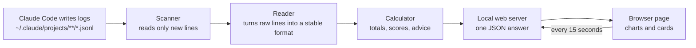

# AI Fluency Insights: Review Call Briefing Pack

| Document control | |
|---|---|
| **Document** | Review Call Briefing Pack, with annexures |
| **Version** | 1.1 (draft for team review) |
| **Date** | 2026-11-03 |
| **Applies to** | AI Fluency Insights, current main script and tests on branch `claude/elegant-heisenberg-c7jxms` |
| **Audience** | Project team members who will present, answer questions, or take part in the review call |
| **Classification** | Internal, project team |
| **Source of truth** | The repository documents listed in Annexure H. Where this pack and the code disagree, the code wins and this pack must be corrected |
| **Prepared by / Reviewed by / Approved by** | To be completed by the project owner |

| Version history | | |
|---|---|---|
| 1.0 | 2026-11-03 | First draft |
| 1.1 | 2026-11-03 | Restructured for team distribution: Q&A answers written to be spoken, annexures added (roadmap, storage research, decision register, risk register), storage presented as planned and under research |

**How to use this pack**

| If you are... | Read |
|---|---|
| Presenting on the call | Sections 1 to 3, 6, 9, then Annexure C |
| Answering technical questions | Section 4, Section 7 (B), Annexures B and E |
| Answering "what does this tab mean" | Section 5 |
| Answering security, privacy or compliance questions | Section 7 (E), Section 8, Annexures B and D |
| Planning the next steps | Annexures A, B and C |

**Status labels used throughout**

| Label | Meaning |
|---|---|
| **Available** | Part of the product today, covered by tests |
| **Planned** | Agreed direction, not yet built |
| **Under research** | Options are being evaluated; no design or release decision yet |

---

## Contents

1. [Executive summary](#1-executive-summary)
2. [Solution overview](#2-solution-overview)
3. [Status at a glance](#3-status-at-a-glance)
4. [How it works: questions and suggested answers](#4-how-it-works-questions-and-suggested-answers)
5. [Tab reference](#5-tab-reference)
6. [Value to developers](#6-value-to-developers)
7. [Questions by audience](#7-questions-by-audience)
8. [Known limitations](#8-known-limitations)
9. [Presenter notes](#9-presenter-notes)
- [Annexure A: Roadmap and delivery plan](#annexure-a-roadmap-and-delivery-plan)
- [Annexure B: Local history storage: research, options and recommendation](#annexure-b-local-history-storage-research-options-and-recommendation)
- [Annexure C: Decision register](#annexure-c-decision-register)
- [Annexure D: Risk and perspectives register](#annexure-d-risk-and-perspectives-register)
- [Annexure E: Formula and metric reference](#annexure-e-formula-and-metric-reference)
- [Annexure F: Verification evidence](#annexure-f-verification-evidence)
- [Annexure G: Glossary](#annexure-g-glossary)
- [Annexure H: Source documents](#annexure-h-source-documents)

---

## 1. Executive summary

**What it is.** AI Fluency Insights is a local dashboard for people who use Claude Code. Claude Code already records every session in log files on the developer's computer. The dashboard reads those files, calculates usage, cost, quality and working-habit measures on the same computer, and shows them in a browser page that refreshes every 15 seconds.

**The three questions it answers.** How much am I using Claude? What am I using it for? How well am I working with it?

**Key characteristics**

- One Python file, standard library only. No installation steps beyond Python, no account, no API key.
- Runs a web page at `http://localhost:8787`, reachable only from the same computer.
- Reads Claude Code's log files and never changes them. In a normal install the page makes no requests to the internet (one fallback is described in section 4.11).
- Compares a person only with their own past. It does not rank people.
- 286 automated tests, plus checks of its totals against Claude Code's own recorded totals.

**Where the project stands.** The reading, calculation and display of all eleven tabs are available and tested. Work completed in the last cycle: detection of Claude Code log-format changes, a corrected cost model checked against Claude Code's own figures, a stable internal data format, faster refresh, and a release routine for new Claude Code versions.

**What is next.** Keeping a longer local history than Claude Code retains is planned and under research (Annexure B). Five decisions are needed from the project owner to move that and related work forward (Annexure C).

---

## 2. Solution overview

---

## 3. Status at a glance

| Area | Status |
|---|---|
| Reading logs, de-duplication, resume after new lines, rewrite and half-written-line handling | Available |
| Detection of Claude Code log-format changes; "Unverified" markers on affected tiles; banner | Available |
| Cost estimate using Anthropic's published prices, checked against Claude Code's own recorded cost | Available |
| Stable internal data format with one reader per log-format version | Available |
| Fast refresh (new lines picked up in about 0.1 to 0.3 seconds on a 273 MB test history) | Available |
| Release checklist, compatibility table and release-check tool for new Claude Code versions | Available |
| Eleven tabs: Overview, Time & Focus, Tools & Models, Projects, Weekly Report, My Adoption, Flow, Quality, Value, Advisor, Data Health | Available |
| Keeping history beyond Claude Code's own retention (default 30 days) | **Under research** (Annexure B) |
| Combining several computers, or a team view | Under research (Annexure B, Annexure C decision 4) |
| Support for other tools' logs (for example Copilot) | Planned, blocked on real sample logs |
| Windows and macOS testing | Planned |
| Security review of the local web server | Planned |

---

## 4. How it works: questions and suggested answers

Each answer below is written to be said aloud. Short, plain statements; add detail only if the person asks.

### 4.1 Where does the data come from, and is anything stored?

> "The dashboard reads the log files that Claude Code already writes on the developer's own computer. It only reads them. It never changes them. By default the dashboard does not keep its own copy. It works out all its numbers while it is running and rebuilds them from the log files every time it starts. The only things saved are a very small notification-state file and the browser's own settings, such as privacy mode.
>
> One consequence is that Claude Code itself deletes old logs, after 30 days by default, so the history we show is limited to what Claude Code still has. Keeping a longer history is something we are planning and researching at the moment."

### 4.2 How does it scan the logs?

> "For every log file it remembers two things: when the file was last changed and how big it was. At each refresh it checks those two values. If nothing changed, the file is skipped, which is very cheap. If the file did change, we read only the new part, starting exactly where we stopped last time, add those new lines to the running totals, and remember the new position. So we never re-read the whole history on each refresh."

### 4.3 What if the scan stopped at a certain line, and new lines are added later?

> "We keep a bookmark for each file, placed after the last complete line we have used. Say a file has 100 lines and we have used all of them. Claude then writes lines 101 to 103 and is halfway through writing 104. On the next scan we read 101 to 103 and leave 104 alone, because it is not finished. The bookmark stays after line 103. When line 104 is complete, the next scan picks it up. So a line is never counted twice and never counted half-written.
>
> If a file is replaced or shortened, which Claude Code does occasionally, we notice because we also keep a fingerprint of the start and end of what we read. In that case we discard what we had for that file and read it again from the top. We tested this by growing a file in small pieces, cutting it in the middle of lines at random places. The final numbers always matched a fresh scan of the finished file."

### 4.4 What if the dashboard is closed and opened again?

> "The bookmarks are held in memory, so after a restart the dashboard reads each file once from the beginning. For about 270 MB of logs that takes around five seconds. After that it is quick again. Nothing is lost while the dashboard is closed, because Claude Code keeps writing its logs regardless. The only thing we cannot recover is a log file that Claude Code itself deletes in the meantime. Saving the bookmarks between restarts is not built yet; it is on the roadmap as an optimisation."

### 4.5 What if two sessions run at the same time, or an old session is resumed?

> "The totals are always built in a fixed order, so the result does not depend on which file we happened to read first. When an older session grows, we do not rebuild everything. We keep a few snapshots of the running totals and restart from the nearest one before the changed file. That brought the refresh time in that situation from about 1.6 seconds to about 0.2 to 0.3 seconds on our large test history."

### 4.6 What happens if Claude Code changes its log format?

> "The log format is internal to Claude Code and can change without notice, so we built several safeguards. At every scan we record the shape of the log lines, meaning which fields exist and what type they have, for each Claude Code version. We compare that with the fields the dashboard actually uses and with a saved baseline. If a field we depend on disappears or changes type, a banner appears at the top of the page, and the tiles built on that field show an amber 'Unverified' tag instead of a possibly wrong number. New fields we do not use are only noted in the Data Health tab.
>
> We also keep one reader per log-format version, so supporting a new format means adding a reader and keeping the old one for old logs. And we cross-check our numbers against the totals that Claude Code records about itself, which is how we found and fixed an error in our cost estimate.
>
> The honest limit is that we see changes in fields and types. If Claude Code keeps a field but changes what it means, only the cross-checks and our release routine can catch that. Today the versions we have formally verified are 2.1.316 and 2.1.317; other versions are read the same way and flagged as unverified."

### 4.7 How are input tokens, output tokens and cache tokens found?

> "Every answer from Claude is a log line that carries a usage block with four counters. Input tokens are the new text sent to Claude. Output tokens are everything Claude wrote. Cache read is earlier context Claude reused instead of re-reading, which is usually the largest number and is cheap. Cache write is context saved for next time; the log says whether it went to the five-minute or the one-hour cache, and the one-hour cache costs more.
>
> One thing to know: while Claude streams an answer, Claude Code writes several log lines for the same answer, each with a copy of the same numbers. If we added every line, tokens would be counted about three times. So we count each answer once, using its message id and request id together. That is why our totals are lower than a naive sum and can differ from the official usage panel."

### 4.8 How is the project name found?

> "Claude Code stores each project's logs in a folder named after the project's working directory, with slashes replaced by dashes. We take that folder name and turn the dashes back into slashes for display. This is a guess, so a real folder called 'my-app' appears as 'my/app'. We also store the real folder path from each log line and use it where we need the real folder, for example to check whether a CLAUDE.md file exists. Logs from sub-agents are attributed to their parent project."

### 4.9 How are sessions, prompts, lines of code, tool calls and failures found?

| Measure | How it is found |
|---|---|
| Session | One distinct session id. Start and end are the first and last times seen in it |
| Prompt | A user line with real typed text. Slash commands, command output, interruptions and the summary Claude Code writes after `/compact` are excluded |
| Your tokens | Prompt length divided by 4, a rough rule of about four characters per token |
| Lines of code | Counted from the text Claude wrote through its file tools (Write, Edit, MultiEdit, NotebookEdit): number of newlines plus one. Additions only |
| Tool calls | The tool-use entries inside Claude's answers: name, command, file |
| Tool time | Seconds between a tool call and its result |
| Failure | A tool result marked as an error |
| Interruption | A user line containing "Request interrupted" |
| Thinking time, effort | Reported by Claude on its answers |
| Session title | Written by Claude Code for each session |
| Autonomy mode | The permission-mode entries |

### 4.10 How does the 15-second refresh work?

> "The page has a timer. Every 15 seconds it asks the local server for fresh numbers. The server checks the log files for new lines, adds them to the running totals, and sends back one answer, which the page uses to redraw its cards and charts. If nothing changed, the answer comes back almost instantly. On our 273 MB test history that is about 0.08 seconds when idle and about 0.1 to 0.3 seconds when new lines arrived. If a request fails, the page keeps the last numbers on screen and tries again at the next tick.
>
> Separately, a small background check every five seconds looks for plan-usage milestones for optional notifications. The plan-usage card itself reads a file written by Claude Code's status-line hook, so it only updates while a Claude Code session is active, and it shows how old the number is."

### 4.11 How is the page drawn?

> "It is a single web page served by the same Python program. There is no build step and no framework. The one library it uses, Chart.js for the charts, is bundled with the project, so nothing is loaded from the internet. (If that bundled file were ever missing, the server would send the browser to a public CDN to fetch the same library; in a normal install this does not happen.) The server sends finished numbers and the page only formats and draws them. Colours and spacing come from a small set of design variables defined once, with a light theme and a dark theme that follows the computer's setting. Each tab is a section of the page that is shown or hidden when you click the menu. A privacy toggle hides session titles, prompt previews and file names on screen."

### 4.12 Where does the wording on the page come from? Is an API key used?

> "No AI model is involved in the wording, so no API key is needed. Every sentence was written in advance by us as a template with blanks. The program fills in your numbers and decides which templates apply. For example, a headline word like 'Strong flow' or 'Bumpy' is picked from the score. A recommendation such as 'Start a fresh session per task' appears only when specific numbers cross a threshold we defined, and it always quotes the numbers behind it.
>
> The only exception is two optional buttons in the Weekly Report, the AI-written summary and 'Discuss with Claude'. They run the developer's own Claude Code on their own computer, only when pressed, and use the developer's own login. The dashboard itself never calls an API and holds no credentials."

**Worked example.** Suppose over the last 28 days there are 12 sessions, the median session is 95 minutes and the slowest 10% run 210 minutes. The rule fires because 210 is at least 180. The page shows:

- Title: **Start a fresh session per task**
- Evidence (template filled with the numbers): "Median session is 95 min and the longest 10% run 210 min."
- Action (fixed text): "Use /clear between unrelated tasks, and /compact when one long task has to continue."

The complete rule list is in Annexure E.2. The two AI buttons send the week's dates, up to 50 lines of session title, project, day, minutes and lines written, and the week's totals. Prompts and code are not sent, but session titles are short summaries of the work and can reveal what was worked on. This is the only time data leaves the computer, and only when the button is pressed.

### 4.13 How accurate is the cost?

> "It is an estimate at Anthropic's published pay-as-you-go prices. On a Pro or Max subscription the real marginal cost is zero, so it should be read as the value received, not a bill. We verified our price rules against the dollar figure Claude Code records for itself: given Claude Code's own token counts, our rules reproduce its cost to five decimal places. From the logs alone our figure comes out about two to three percent lower, because Claude Code counts some tokens that never appear in the log. A check in Data Health repeats this comparison and warns if a price is out of date.
>
> We should be upfront that an earlier version was wrong: it overstated Sonnet 5.5 cost by 17% to 42%, growing with session length, because of how cache reads and writes were priced. That was found on 2 November and corrected."

---

## 5. Tab reference

Eleven tabs. On the newer tabs every figure carries a badge showing how far to trust it: **Observed** (read straight from the log), **Derived** (calculated from observed fields with a stated formula), **Proxy** (an indirect signal that may not mean exactly what it suggests), **Estimated** (depends on prices or a guess).

### 5.1 Overview

Answers: how much am I using Claude Code, and what do I get back? Follows the range buttons (7, 30, 90 days, all time, custom dates). The 7, 30 and 90 day ranges mean the last N *active* days, not calendar days.

| Item | Meaning | How it is calculated |
|---|---|---|
| Momentum bar | Day streak, best streak, total active days, optional goal bars | Days with at least one message; goals are set in the script |
| Plan usage | How full the Anthropic 5-hour and weekly limits are | Real values from Claude Code's status-line hook if set up; otherwise a labelled local estimate |
| Input tokens | Text sent to Claude | Sum of input tokens |
| Output tokens | Text Claude produced | Sum of output tokens |
| Cache read | Context Claude reused instead of re-reading | Hit rate = cache read ÷ (cache read + input). A warning replaces it when more than 5% of follow-up calls had to rebuild the cache |
| Est. API cost | What the usage would cost at list prices | Annexure E.1 |
| Cold-start tax | Share of cost spent on each session's first call, which fills the cache | Sum of first-call costs ÷ sum of session costs |
| Lines of code | Lines Claude wrote into files | Section 4.9 |
| Prompts | Messages the developer typed | Section 4.9 |
| Sessions | Separate conversations, with average length | Distinct session ids |
| Friction | Times Esc was pressed plus failed tool calls | Interruptions + tool errors |
| Corrections | Prompts that steer Claude back ("no", "wrong", "undo", "you missed"...) | Prompt starts with correction wording |
| Your tokens | Estimated tokens typed by the developer | Prompt characters ÷ 4 |
| Leverage | How much Claude produced per token typed | Claude output tokens ÷ your tokens |

Charts: daily tokens, you versus Claude (log scale), model usage, lines of code per day, exploration versus building, friction per day.
**Value:** a quick health check on usage, friction, caching and leverage trends. **Caution:** token totals are de-duplicated, so they are lower than the official panel; cost is a list-price estimate.

### 5.2 Time & Focus

Answers: am I working in a sustainable way?

| Item | Meaning | How it is calculated |
|---|---|---|
| Active time | Roughly how long the developer really worked with Claude | Each message falls into a 10-minute slot; active time = slots × 10 minutes. A single message counts as 10 minutes; a gap longer than about 10 minutes stops counting |
| Average per active day | A typical working day | Active time ÷ days with activity |
| Longest focus block | Longest unbroken stretch in one day | Longest run of consecutive 10-minute slots; does not cross midnight |
| Quiet hours % | Late-night work | Messages between 23:00 and 06:00 ÷ all messages (hours adjustable in the script) |
| Weekends % | Weekend work | Weekend messages ÷ all messages |
| Active minutes per day | The above, per day | Bars turn red when more than a quarter of the day's messages were in quiet hours |
| Activity heatmap | Weekly rhythm | Message count by weekday and hour |
| Task mix per day | What kind of work each day was | Each session is labelled feature, bugfix, refactor, docs, explore or other from words in Claude's own session title; a guess, not exact |
| Friction per day | When work was painful | Interruptions plus failed tool calls |

**Value:** makes late-night habits, long focus blocks and painful days visible. For self-awareness, not monitoring.

### 5.3 Tools & Models

Answers: which models and tools do the work, and how much autonomy is given to Claude?

| Item | Meaning |
|---|---|
| Model usage and breakdown | Output tokens and estimated cost per model |
| Autonomy mode | Whether Claude asks first, auto-accepts edits, or plans first (from permission-mode entries) |
| Delegation | Helper sub-agents Claude started, by type |
| Tool usage | How often each tool ran |
| Slash commands | Which `/commands` were used |

**Value:** shows an expensive model used for simple jobs, and whether plan mode and sub-agents are used.

### 5.4 Projects

| Item | Meaning |
|---|---|
| Projects | Per project: tokens, lines, prompts, sessions, estimated cost. Clicking a row opens that project's daily chart, session titles and most-edited files |
| Git branches | Output and lines per branch, taken from the branch name on each log line |
| Most-edited files | Where Claude's code landed, by lines (file names only) |
| Longest prompts | The largest prompts with a preview |

**Value:** shows where effort and cost go and which files are reworked. **Caution:** project names are decoded from folder names (section 4.8).

### 5.5 Weekly Report

Answers: what did I do this week? Weeks run Monday to Sunday. Browse with Prev and Next.

| Item | Meaning |
|---|---|
| KPI row | Sessions, focus hours, output tokens, lines, prompts, building %, each against last week. Focus hours = total session length ÷ 60 |
| What you worked on | Claude's own session titles grouped by project, with date, minutes, lines and prompts; no AI call is made |
| Exploration versus building | Share of reads and searches versus file edits |
| Day by day | Output and lines per weekday |
| AI Fluency report | Four 0 to 100 scores on a radar chart, this week against last: **Delegation** (is real building work handed to Claude?), **Description** (do first prompts land?), **Discernment** (is output reviewed and steered?), **Diligence** (is work verified?). Adapted from the 4D AI Fluency Framework (credited in the README); heuristic, so the trend matters more than the number |
| Reflection | One question for the week chosen by fixed rules (many corrections, late nights, heavy exploration or building, little verification), otherwise a standard fallback |
| AI-written summary, Discuss with Claude | The two optional buttons that run the developer's own Claude Code (section 4.12) |
| Copy as Markdown | The week as formatted text for chat or email |

**Value:** the weekly update is largely written for the developer.

### 5.6 My Adoption

Answers: how deeply do I use Claude Code, and am I improving? It compares the developer with their own previous 28 days, never with other people. It uses the 28 calendar days ending on the latest active day and needs at least 3 active days; otherwise it shows "Building your baseline".

| Pillar | Question | Calculation (0 to 100) |
|---|---|---|
| Habit | Do I show up regularly? | 60 × min(1, active days ÷ 12) + 40 × (weeks with 2 or more active days ÷ 4) |
| Range | Do I use what Claude Code offers? | 75 × min(1, features used ÷ 6) + 25 × share of substantial sessions (10 or more tool actions). Features: project memory (CLAUDE.md), run and verify, plan mode, sub-agents, skills, hooks, task lists, connected tools, slash commands, web research |
| Craft | Do I work with Claude well? | 0.6 × mean of the four fluency scores + 0.2 × Flow score + 0.2 × Quality score; a missing score shares its weight |
| Impact | What does Claude get done for me? | 50 × min(1, lines per active day ÷ 300) + 50 × (days Claude wrote code ÷ active days) |

Adoption Score = 0.25 Habit + 0.25 Range + 0.30 Craft + 0.20 Impact.
Levels: Explorer (0 to 19), Practitioner (20 to 39), Power user (40 to 59), Expert (60 to 74), Pro (75 to 89, every pillar at least 50), Pro Max (90 and above, every pillar at least 70 and four weekly scores in a row at 85 or more). When a rule blocks a level, the page says exactly what to raise.

Other cards: what changed lately (up to four lines), adoption journey (Started, Recurring, Integrated, Verified outcomes), next three moves (rule-based coaching), score over the last 12 weeks, healthy habits (average active minutes, longest focus, quiet-hours and weekend share).
**Value:** makes progress visible and suggests concrete next steps. **Caution:** weights and targets are hand-picked; levels are motivational labels, not a standard.

### 5.7 Flow

Answers: how smoothly does work move between the developer and Claude? Follows the selected range; a score needs at least 5 timed turns.

Headline: a 0 to 100 ring with a word (80 and above "Strong flow", 60 to 79 "Mostly smooth", 40 to 59 "Bumpy", below 40 "Rough going") and a sentence such as "72% of your turns landed first time, and 85% of failures got fixed."

Flow score = 100 × (0.5 × clean-turn rate + 0.3 × recovery rate + 0.2 × (1 − stuck share)). With no failures, recovery counts as 100% and stuck share as 0.

| Item | Meaning |
|---|---|
| Turn | One round: the developer sends a prompt and Claude finishes its answer. A turn that never finishes counts as not clean |
| Median turn | The middle turn time: half of the turns were faster and half slower, so one unusually slow turn does not distort it. Includes time spent waiting for the developer to approve an action |
| Slowest 10% | The time that 9 out of 10 turns finished within |
| Clean first-pass turns | The share of turns that went right the first time: no failed tool, no interruption, and no correction in the next prompt |
| Failures fixed | When a tool fails, did the same tool succeed later in that session? This is the share that did. "Steps to recover" counts the tool results in between |
| Stuck loop | The same tool failed three or more times in a row, a sign Claude is going in circles |
| Time to first edit | How long from the start of a session until Claude first changes a file (median). Short means work started straight away; long can mean planning or exploring. Neither is good or bad on its own |
| Where tool time goes | The share of tool time taken by each tool or command (for shell commands, by what ran: git push, pytest...). The rest of a turn is Claude thinking, writing and waiting for approval |
| Slowest tools and commands | Calls, median, slowest 10%, longest and share per tool |
| Session length | First to last entry of a session (median and slowest 10%); includes idle time |
| Thinking time and effort | How long Claude's reasoning took and the effort level it reported |

**Value:** shows whether time is lost to waiting, rework, failures or very long sessions. **Caution:** times include waiting for approval, and a session is not the same as a task.

### 5.8 Quality

Answers: is the work checked, and how much is redone? A score needs 3 edit sessions.

Quality score = 40% verified + 20% tests alongside code + 20% × (1 − min(1, re-edit share ÷ 50%)) + 20% first-run pass. The last part applies only when a check ran; otherwise the others are re-weighted.

| Item | Meaning |
|---|---|
| Verified after last edit (proxy) | In what share of sessions where Claude edited files did a test, build or lint run after Claude's last edit. It shows a check ran, not that the code is correct |
| First-run pass rate | Did the first test, build or lint run in a session pass |
| Fail then fixed | A check failed and a later run passed |
| Tests alongside code (proxy) | Share of edit sessions in which a test file was also edited |
| Re-edit share (proxy) | Edits to a file already edited earlier in the same session ÷ all edits. High means many small passes |
| Rework hotspots | Files edited 5 or more times, either 3 or more times in one session or on 3 or more days |
| Friction | Failed tool calls per 100 edits; interruptions per 100 prompts |
| Safety signals | Counts of force-push, hard reset, `git clean -f`, recursive delete, pipe-to-shell, skipped git hooks, `chmod 777`, SQL drop, and reads or edits of secret-like files (`.env`, keys). Only the category is stored, never the command |
| Permission decisions | Accept or reject decisions and their source, when the logs include them |

**Value:** a safety net for AI-written code: are checks run, are risky commands happening, where does rework pile up.

### 5.9 Value

Answers: what does this cost at list prices and what is received for it? There is no score, because a dollar figure has no universal "good"; each figure is shown against the previous period.

The headline reads like "$12.40 estimated" with the line "Median session $0.40 · 15 sessions". That line is a fixed template: the middle session cost $0.40, across 15 sessions in the range.

| Item | Meaning |
|---|---|
| Estimated cost | Tokens × published prices (Annexure E.1). On a subscription the real marginal cost is zero |
| Per 100 lines | Estimated cost ÷ lines Claude wrote × 100 |
| Per verified session | Cost of edit sessions that ended with a test, build or lint ÷ their count |
| Caching saved | What caching saved compared with sending the same tokens uncached, minus the extra paid to write the cache |
| Cold-start tax and cache rebuilds | Share of cost in each session's first call; share of follow-up calls that had to rebuild the cache |
| Cost spikes | Days costing at least twice a typical day (and at least $0.50), with the biggest session of that day; needs 5 active days |
| Model mix | Each model's share of cost |
| Top-tier model on no-edit sessions (proxy) | Spend on the most expensive models in sessions where Claude changed nothing |

**Value:** shows runaway sessions, wasteful model choices and whether caching works. **Caution:** a list-price estimate, about 2% to 3% below Claude Code's own figure (section 4.13).

### 5.10 Advisor

Answers: what should change first? The top five next steps over the same 28 days as My Adoption, ranked by a severity number, each with the figures behind it and a concrete action. Sections: Your top moves, Your experiment (the page remembers the current value of a related metric in the browser and shows how it moves), What is going well, Also noticed. Rule-based; the full rule list is in Annexure E.2.

### 5.11 Data Health

Answers: can I trust what I am looking at?

| Item | Meaning |
|---|---|
| What your logs let us measure | For each signal (tokens, turn timing, tool timing, permissions, thinking, hooks, sub-agents) whether the logs contain it, so a missing signal is shown as missing and not as zero. Also holds the model-price check and the cross-check with Claude Code's own totals |
| Log format changes | Findings from the format-change check (section 4.6) |
| Log inventory | Entry types and counts, Claude Code versions seen, which reader handled each line, unreadable lines, duplicate lines dropped |
| What these logs cannot tell us | A list of blind spots |
| Privacy | What stays local |
| Metric catalog | Every metric with its formula, badge and limitation |

---

## 6. Value to developers

1. **See real AI usage instead of guessing.** Tokens, cost, models, lines written and leverage, by day and by project, from the developer's own logs.
2. **Catch waste early.** Cost-spike days with the session that caused them, many short sessions paying the cache start-up cost, cache rebuilds after long pauses, and expensive models used where Claude changed nothing. The Advisor turns each into one action.
3. **Waste fewer turns.** Flow shows how many turns land first time and how many needed correction. The usual fix is a better first prompt, and the dashboard shows whether the number moves.
4. **Trust AI-written code more.** Quality shows whether tests, builds or lints run after edits, whether tests are written alongside, where files are reworked, and whether risky commands or secret files were touched.
5. **Get out of loops faster.** Stuck loops and failures-fixed show when Claude is going in circles and the developer should change approach.
6. **Work sustainably.** Active time, longest focus block, late-night and weekend share, and friction per day make habits visible before they become a problem.
7. **Learn the tool and track progress.** My Adoption shows which features have never been used (plan mode, sub-agents, skills, CLAUDE.md, connected tools) and a 12-week trend with three next steps.
8. **Report and share facts privately.** The weekly report prepares the standup from Claude's session titles with no AI call. Everything stays on the developer's machine, so it can be used on private or company code.

---

## 7. Questions by audience

### A. Developer

| Question | Answer |
|---|---|
| Does my code or prompt leave my computer? | No. The dashboard reads local files and serves a page to your own browser. The only exception is the two optional AI buttons, which run your own Claude Code and send the week's session titles and counts (section 4.12) |
| Do I need an API key? | No key, account or login. The optional AI buttons use your existing Claude Code login |
| Does it slow Claude Code down? | It reads files Claude Code has already written, a little every 15 seconds, and never edits them. Claude Code is not aware of it |
| Why is the cost not my bill? | On Pro or Max the marginal cost is zero. The figure is what the same usage would cost at pay-as-you-go prices |
| Why do my tokens differ from the official usage panel? | We count each answer once, while Claude Code writes several log lines per answer, and we skip some internal calls (section 4.7) |
| What is leverage? | Claude's output tokens divided by the tokens you typed. A rough guide, because your tokens are estimated |
| Can I game it? | Yes, it is a mirror and not a test. Adding "then run the tests" to every prompt raises "verified", which is good behaviour. It must not be used as a performance score |
| Does it judge me? | It compares you only with your own previous 28 days and has no concept of other users |
| Does it work with the VS Code extension or other ways of starting Claude Code? | It reads the log files, so how Claude Code is started should not matter, and Data Health lists the entry points seen. We have not tested each entry point separately |
| Why is my project named `home/user/my/app`? | Names are decoded from Claude Code's folder names, where dashes replace slashes, so a real dash also becomes a slash (section 4.8) |
| Why is Lines of code zero on a busy day? | It counts only what Claude wrote into files. Research days with no edits are zero, and edits made through shell commands are not seen |
| Does it keep my history longer than 30 days? | Not today. The history shown is whatever Claude Code still has on disk. A longer local history is planned and under research (Annexure B) |

### B. Technical

| Question | Answer |
|---|---|
| How is the scan done? | Section 4.2 |
| What if it stops mid-way and new lines come later? | Section 4.3 |
| What if the format changes? | Section 4.6 |
| How is each token counted once? | De-duplicated by message id and request id together (section 4.7) |
| How are time zones handled? | Times are stored as exact UTC and converted to the local day and hour only when displayed, so travelling does not change history |
| What happens on restart? | Section 4.4 |
| How fast, how big? | On a generated 273 MB, 60-file history: cold start about 5 seconds, memory about 160 MB, refresh 0.08 to 0.3 seconds. Not yet measured on a real very large user |
| Why one Python file with no dependencies? | Zero installation friction and easy to audit. The cost is a large file, which is organised into clear parts and covered by 286 tests |
| How do you know a change does not break the numbers? | A golden test pins exact numbers for a known log; randomised tests compare the live scanner with a fresh scan after every file operation; we also deliberately break safeguards to confirm the tests notice |
| Is it thread-safe? | The scanner is protected by a lock and each answer is an unchangeable snapshot, so a request never sees data change underneath it |
| Why a local web server? | It lets one Python file draw rich charts without a desktop toolkit. It listens on `127.0.0.1` only |
| Is the local server secure on a shared computer? | It has no login, no access token and no host check, and it has not had a security review. On a multi-user computer another local user could open the port. Do not run it on a shared host until the review is done (Annexure A, step 3) |
| Which Python and operating systems? | The README states Python 3.8 or newer. Tested: Python 3.13 on Linux only. Windows, macOS and other Python versions are untested |
| Can it read other tools' logs, such as Copilot? | Not today. The design allows a second reader, but we have no other tool's logs to build against |

### C. Accuracy and metrics

| Question | Answer |
|---|---|
| How accurate is the cost? | Section 4.13 |
| Which numbers are facts and which are guesses? | Each metric has a badge: Observed, Derived, Proxy or Estimated. The scores (Adoption, Flow, Quality, fluency) use hand-picked weights, so the trend matters more than the number |
| What does "verified after last edit" prove? | That a test, build or lint command ran after Claude's last edit without an error flag. It does not prove the code is correct |
| How is a correction detected? | The next prompt starts with correcting words. Corrections written mid-sentence are missed, and a polite "actually, could you..." can be a false positive |
| How are task types decided? | By keywords in Claude's session title, with the tool mix as a fallback. Roughly right, not exact |
| Is session length real working time? | No, it spans first to last entry and includes idle time. Active time (10-minute slots) is closer to real work |
| Why do 7, 30 and 90 day ranges not match calendar weeks? | They are the last N active days, so gaps do not shrink the window. Custom dates are exact |
| Does the compaction summary count as my prompt? | Not any more. It did: one 14,783-character summary was 80% of the prompt text in a real log. It was fixed on 2026-11-03 |

### D. Manager or team lead

| Question | Answer |
|---|---|
| Can I see my team's numbers? | Not today. It is a personal, single-computer tool with no way to combine users. A team view is under research (Annexure B, Annexure C decision 4) |
| Can I use it for performance reviews? | We advise against it. The scores are heuristic and were not designed for comparing people. The tool never ranks anyone |
| What would a team view need? | Facts only (counts, days, models, never raw prompts), consent, a statement of who can see what, retention rules, and a licence check |
| What does it tell a team about AI adoption? | At individual level: which features are used, whether work is verified, whether sessions are efficient. A team summary would aggregate those facts with consent |
| What does a rollout cost? | The software is free (MIT licence). The cost is support and review effort |

### E. Security, privacy and compliance

| Question | Answer |
|---|---|
| What data does it handle? | Claude Code's logs: prompts, answers, code, command output and file paths. They already exist on the computer |
| Is anything sent out? | No, except the two optional AI buttons that run the developer's own Claude Code. One edge case: if the bundled chart file is deleted from the project folder, the browser is redirected to a public CDN (jsDelivr) to fetch the same chart library, which would reveal that a dashboard page was opened |
| Does it write anything to disk? | A very small notification-state file next to the script, and the browser's own settings. By default nothing else |
| What do the safety signals store? | Only the category, for example "force push", never the command text |
| Can a log be shared safely for debugging? | The `--collect-fixture` command replaces text with placeholders and keeps field names, types, models and tool names. Field names remain, so skim before sharing |
| If history is kept longer, what are the privacy implications? | Significant: it would be a second copy of prompts, code and possibly secrets. That is why it is under research with opt-in, safeguards and a facts-only alternative (Annexure B) |
| Is it GDPR relevant? | It processes the user's own data on the user's own computer with no transfer. A company rollout would need its own review of consent and retention, which has not been done |
| Licence? | The code is MIT. The AI Fluency scores adapt a framework licensed CC BY-NC-SA 4.0 (non-commercial, share-alike, credited in the README). A commercial or company distribution must be checked against that licence |
| Is Anthropic involved? | No. This is an independent, unofficial tool, not affiliated with or endorsed by Anthropic |

### F. Product and business

| Question | Answer |
|---|---|
| What problem does it solve? | Developers use AI coding tools with no feedback on cost, quality or habits. The dashboard provides that feedback privately and free of charge |
| Who is it for? | Individual developers first. Team use depends on the decisions in Annexure C |
| Why not use Anthropic's usage panel? | The panel shows plan limits, not what was done with them: no flow, quality, rework, projects, habits or advice |
| What are the levels, Explorer to Pro Max? | Motivational labels over a heuristic score; not a standard or a certification |
| What is the roadmap? | Annexure A |

### G. Quality assurance and release

| Question | Answer |
|---|---|
| How many tests? | 286, run in about seven seconds with nothing to install |
| How are the numbers tested? | Golden snapshots of exact outputs, equivalence tests against a fresh scan, comparisons with the previous parser, and deliberate break-it checks (Annexure F) |
| What happens when Claude Code updates? | Run the release-check tool and follow the release checklist; record the version in the compatibility table with the evidence and what was not exercised |
| Which Claude Code versions are verified? | 2.1.316 and 2.1.317, with stated limits. Others are read by the same reader but flagged as unverified |

### H. Operations and support

| Question | Answer |
|---|---|
| How is it started? | `python ai_fluency_insights.py`, then open `http://localhost:8787`. Optional auto-start on Windows with `--install-startup` |
| The page shows odd numbers. What first? | Open Data Health. It shows which signals the logs contain, whether the format changed, which Claude Code versions were seen, and whether prices still match |
| Plan usage looks stale | It reads a file written by Claude Code's hook only while a session is active; the card shows how old the number is |
| Where are settings? | Constants at the top of the script: prices, adoption targets, goals, quiet hours, notification options |

---

## 8. Known limitations

State these before someone else finds them.

1. **Cost is an estimate** at public list prices, about 2% to 3% below Claude Code's own figure. Only Sonnet 5.5 and the base Haiku 5.5 tier were verified against Claude Code's own cost; other price rows come from the published table only.
2. **Scores are heuristics** with hand-picked weights and targets. Use trends.
3. **"Verified", "tests alongside" and "re-edit" are proxies**, not proof of correctness.
4. **Lines of code** counts additions only and misses edits made through shell commands.
5. **Corrections** are detected only at the start of a prompt.
6. **Task types** are keyword guesses.
7. **Session length** includes idle time; turn and tool times include waiting for approval.
8. **Project names** are decoded from folder names and can look wrong where names contain dashes.
9. **History is limited by Claude Code's own deletion** (30 days by default). A longer history is under research.
10. **Log-format checking** sees changed fields and types, not changed meaning. Only 2.1.316 and 2.1.317 are verified.
11. **Tested on Linux with Python 3.13.** Windows, macOS and other Python versions are untested.
12. **Performance** was measured on a generated 273 MB history, not on a real very large user.
13. **The local server has not been security reviewed** and has no login. It also falls back to a public CDN for the chart library if the bundled file is missing.
14. **Figures changed on 2026-11-02 and 2026-11-03** because of the cost correction and the compaction fix. Earlier screenshots will not match.

---

## 9. Presenter notes

### 9.1 Ten-minute demonstration

| Minutes | Show | Key message |
|---|---|---|
| 0 to 1 | Start the program and open the page | One file, no installation, no key. It only reads the logs Claude Code already wrote |
| 1 to 2 | Overview | Tokens, cost, lines, leverage, friction. Cost is a list-price estimate. Prompt Claude and watch a number move within 15 seconds |
| 2 to 3 | Time & Focus | Active time, focus blocks, late nights. For self-awareness, not monitoring |
| 3 to 4 | Tools & Models, Projects | Which model does the work, how much autonomy is given, where cost and code go. Click a project row |
| 4 to 5 | Weekly Report | The standup largely writes itself. Only the two buttons call Claude |
| 5 to 6 | My Adoption | Four pillars against the developer's own past. Next three moves are rules, not AI |
| 6 to 8 | Flow, Quality, Value | Median turn, clean first-pass, failures fixed, time to first edit; verified after last edit; median session cost |
| 8 to 9 | Advisor | Every recommendation quotes its numbers; show the rule behind one |
| 9 to 10 | Data Health | If Claude Code changes its log format we say so here, mark the affected tiles Unverified and show a banner |

### 9.2 Wording to prefer

| Avoid | Prefer |
|---|---|
| "It never calls any API" | "The dashboard itself never calls an API. Two optional buttons run your own Claude Code locally, only when pressed" |
| "The cost is your bill" | "Estimated cost at API list prices; zero on a subscription" |
| "The numbers are exact" | "Observed numbers are read from the logs; scores and some metrics are heuristics and are labelled as such" |
| "It supports every Claude Code version" | "It reads 2.x logs, detects changes, and has verified 2.1.316 and 2.1.317" |
| "It works on Windows and Mac" | "It is written to be cross-platform and has been tested on Linux; Windows and Mac are next" |
| "Verified means correct" | "A check ran after the last edit" |
| "Use it to rank developers" | "Use it as a personal mirror" |
| "It is secure" | "It is local-only; the server has no login and has not yet had a security review" |
| "It keeps your history" | "It shows what Claude Code still has; keeping a longer history is being researched" |

---

## Annexure A: Roadmap and delivery plan

Source: `docs/LOG_RESILIENCE_ROADMAP.md`, the living plan. This annexure is a summary for the call.

### A.1 Questions that started the work

| # | Question | Position |
|---|---|---|
| Q1 | Claude Code changes its log format. How do we notice and keep working? | Addressed: format-change detection, Unverified markers, per-version readers, cross-checks, release routine |
| Q2 | After a pause, do we rescan from scratch or continue where we stopped? | Addressed within a run: resume from a bookmark per file. Across restarts a full read is needed (optimisation planned) |
| Q3 | Claude Code deletes old logs. Can we keep a local copy? | Under research (Annexure B) |
| Q4 | Can we define our own standard structure? | Addressed for reading: a stable internal format with one reader per version. Extension to stored history is part of the research |

### A.2 Completed work

| Area | Outcome |
|---|---|
| Discovery | Documented what Claude Code's log files contain and which parts are undocumented; found and fixed several early defects (for example doubled counts from set-aside copies, sub-agent logs shown as a project, a health check that could never fail) |
| Format-change detection | Per-version field-shape check against a baseline; banner; Unverified tiles; report command |
| Stable internal format | Raw lines are converted into one standard record format; only the reader knows Claude Code's raw format |
| Cost model | Rebuilt from Anthropic's published prices and verified against Claude Code's own recorded cost |
| Cross-checks | Output tokens and prices compared with Claude Code's own totals; shown in Data Health |
| Speed | Incremental calculation, snapshots for older-session growth, lighter score calculation; request time on a 273 MB test history from about 1.6 seconds to about 0.2 to 0.3 seconds when an older session grows |
| Defect fixes | The compaction summary no longer counts as a typed prompt; tool arguments and MCP payloads are no longer reported as new log fields |
| Release routine | Release checklist, compatibility table, and a release-check tool; Claude Code 2.1.317 verified using it |
| Test coverage | 286 tests, including golden snapshots and randomised equivalence tests |

### A.3 Planned and proposed work

Sizes are estimates for planning only.

| Step | Work | Depends on | Size |
|---|---|---|---|
| 1 | Answer the five decisions (Annexure C) | Project owner | none |
| 2 | Complete the storage research and write the design (Annexure B.7) | Decisions 1, 2, 5 | medium |
| 3 | Security review and hardening of the local server: access token, host check, shared-computer guidance | None | small to medium |
| 4 | Windows pass: run the tests and the dashboard on Windows; fix what breaks | Access to a Windows machine | medium |
| 5 | Save scanner progress across restarts, to shorten the cold start | Only if start-up time hurts real users | medium |
| 6 | More verified Claude Code versions, including sessions that use compaction, sub-agents and MCP tools | Real sessions | small, ongoing |
| 7 | Combine several computers; team view | Decisions 2 and 4, completed storage design | large |
| 8 | Support for another tool's logs (for example Copilot) | Real sample logs from that tool | medium to large |

---

## Annexure B: Local history storage: research, options and recommendation

**Status: under research. No design has been approved and no release decision has been taken.** This annexure records the problem, the options considered, the current recommendation and the research still to do. A disabled-by-default prototype exists in the repository to test feasibility; it is not part of the capabilities described in this pack.

### B.1 Problem

Claude Code deletes transcripts older than its retention setting: 30 days by default, a minimum of 1 day, and an organisation's managed settings can override a user's value. The dashboard therefore shows only what Claude Code still keeps. When Claude Code cleans up, "all time" figures, streaks and the Adoption Score shrink. Deleted logs cannot be recovered afterwards.

### B.2 Guiding principle

Keep the raw record first and interpret it later. Deletion is irreversible, but any mistake in reading the logs can be corrected later if the original lines were kept.

### B.3 Requirements the solution must meet

| Requirement | Reason |
|---|---|
| Opt-in, with a clear explanation | Some people and companies set short retention on purpose (compliance, secrets). Silently keeping a copy defeats that |
| Protect sensitive content | Logs contain prompts, code, command output and possibly secrets |
| Never lose history when a source file disappears | The existing behaviour of dropping deleted files must change to "mark as gone" |
| Survive restarts and crashes without losing or duplicating data | Progress and data must be saved together |
| Work when the dashboard is closed, or at least warn | Cleanup can happen while nothing is running |
| Time zone and price safe | Store UTC times and token counts, not local days or dollars, so travel or price changes do not rewrite history |
| Cross-platform | Windows file locking and cloud-synced folders need testing |
| Recoverable | A tested upgrade path, and a way to rebuild from the raw data if the store is damaged |
| Ready for more than one computer later | Include a machine identifier from the start |

### B.4 Options considered

| Option | Advantages | Disadvantages |
|---|---|---|
| A. Copy the log files to a backup folder | Very small to build, exact copy | No searching, no duplicate handling, everything must still be re-read to calculate |
| **B. A single local database file (SQLite, built into Python)** | No new dependency, so the "standard library only" promise holds; safe saving; can also hold progress bookmarks | Needs upgrade handling and size management |
| C. Facts only: store the calculated numbers, not the raw lines | Much more private; small | History can never be recalculated if a formula or the log format changes |
| D. Hook-driven journal: Claude Code hooks write our own event stream | Hooks have a documented contract, more stable than the log files | Only captures while installed; misses earlier history; hook behaviour must be verified |
| E. Local telemetry receiver (OpenTelemetry) | Documented and versioned | The user must enable it; coarser than the logs; what it exposes must be verified |

### B.5 Current recommendation

Option B as the core, because it keeps the dependency promise and allows recalculation. Options C and D are kept as optional extras: C as a privacy-preserving mode, D as a second source for cross-checks. Option E was set aside for now because it needs user setup and is coarser than the logs.

### B.6 Proposed structure for stored history

Three layers, each replaceable without touching the others:

1. **Raw layer:** the original log lines, kept as they were written, append-only.
2. **Standard layer:** our own stable record format (prompt, answer, tool call, tool result, session...), produced from the raw layer by one reader per Claude Code version. Anything a reader does not understand is kept and counted, never silently dropped.
3. **Derived layer:** daily totals, sessions, scores and advice, always rebuildable from the layer below.

When a formula is corrected or a reader improved, the standard and derived layers are simply rebuilt from the raw layer, so history is corrected too. That is the main reason for keeping raw lines.

### B.7 Research still to do

| Topic | Question to answer | Output |
|---|---|---|
| Privacy | What exactly would we be storing, and for how long? Is raw storage acceptable to the intended users and any company policy? | Data classification and a consent text |
| Facts-only feasibility | Can per-day facts be stored so most views still work, and what is lost? | Prototype comparison, list of what cannot be recomputed |
| Size | How large does the store grow per month for typical and heavy users? | Measurements on real histories |
| When to capture | What is the lowest-effort way to capture while the dashboard is closed: scheduled task, status-line hook, or warn only? | Recommendation with the user-setup cost of each |
| Windows | File locking, synced folders, permissions | Test results on Windows |
| Upgrade and recovery | How are future changes to the store handled safely? | Migration and rebuild procedure |
| Security | How is the store protected on a shared computer? | Review outcome, linked to the server review |
| Multi-computer | How would several computers' data be merged without moving raw prompts casually? | Design note (a draft exists in section 10 of the roadmap document, `docs/LOG_RESILIENCE_ROADMAP.md`) |

### B.8 Risks if this is built

| Risk | Mitigation under consideration |
|---|---|
| The tool starts keeping sensitive data it did not keep before | Opt-in only, explicit notice, owner-only file permissions, purge command, size cap, facts-only alternative |
| The store grows without limit | Size cap with a visible meter; research on compression |
| Two running copies write at once | Single-writer rule and safe-save design |
| Old months re-priced silently | Store token counts and apply prices with effective dates |
| Users believe history is safe when capture was not running | A visible "last captured" indicator and a warning |

---

## Annexure C: Decision register

Owner for all items: project owner. Status for all items: **open**. Date raised: 2026-11-02. Until a decision is made, the product behaves as described in the "Current behaviour" column.

| # | Decision | Options | Recommendation | Impact of the recommendation | Current behaviour |
|---|---|---|---|---|---|
| 1 | Should a longer local history be kept by default or only when the user chooses it? | Only when chosen (opt-in); on by default with a first-run notice; ask once on first launch | Opt-in | Smallest privacy and compliance step. Users who never opt in are limited to Claude Code's retention | No history beyond Claude Code's retention |
| 2 | What would be stored: full raw lines, facts only, or a choice of both? | Raw; facts only; both | Raw, with facts-only added later as a privacy option | Raw allows history to be corrected later; facts-only is safer but cannot be recalculated | Not applicable |
| 3 | Scope: Claude Code only, or design for other tools such as Copilot now? | Claude Code only; design for Copilot now | Claude Code only | Nothing is built on guesses; the reader design leaves room for another tool once real logs exist | Claude Code only |
| 4 | Audience: personal tool, teams and companies, or personal now and team later? | Personal; teams; personal now, team later | Personal now, keeping the facts-only option open for later | Avoids committing to team compliance work before it is needed | Personal, single computer |
| 5 | How should capture work while the dashboard is closed? | Scheduled task; status-line hook; accept the gap and warn | Accept the gap with a clear warning first; offer a scheduled task as an option | Smallest change to users' setup; a hook would edit the user's Claude Code settings | Not applicable |

---

## Annexure D: Risk and perspectives register

Questions and concerns reviewers are likely to raise, and where each is handled.

| Perspective | Concern | Handling | Status |
|---|---|---|---|
| Security and compliance | "Do you keep a copy of my prompts?" | By default nothing is kept. Any future history store is opt-in with safeguards (Annexure B) | Open (research) |
| Security | Is the local server reachable by other users on a shared computer? | It listens on 127.0.0.1 only but has no login or host check. Review and hardening planned | Open |
| Licensing | The fluency scores adapt a CC BY-NC-SA 4.0 framework | Credited in the README; check before any commercial or company distribution | Open |
| User trust | "Why did my numbers change after an update?" | Data Health shows versions seen, reader used and format-change findings; changes are logged in the roadmap changelog | Mitigated |
| User trust | "Is this alert real or noise?" | Warnings only for fields the dashboard depends on; new unused fields are information only | Mitigated |
| Accuracy | "Is the cost right?" | Verified against Claude Code's own figures; Data Health re-checks; limits stated | Mitigated, limits remain |
| Accuracy | Heuristic scores | Labelled with badges; trend advised over absolute value | Accepted |
| Maintenance | "Claude Code released a new version. Is anything broken?" | Release checklist, release-check tool, compatibility table | Mitigated |
| Maintenance | One large source file | Covered by golden and equivalence tests; changes made behind them | Accepted |
| Quality assurance | How is format drift tested? | Golden snapshots, randomised equivalence tests, deliberate break-it checks | Mitigated |
| Operations | Windows behaviour (locked files, half-written lines, two instances) | Half-written-line handling is tested; Windows testing planned | Open |
| Product | "Is this still a read-only tool?" | Yes by default. Any future history store would change this and must say so plainly | Open (research) |
| Future | Several computers, other assistants | Design leaves room; depends on decisions 3 and 4 | Open |

---

## Annexure E: Formula and metric reference

### E.1 Core formulas

| Metric | Formula |
|---|---|
| Cache hit rate | cache read ÷ (cache read + input) × 100 |
| Cache rebuild rate | calls after a session's first where cache written exceeds cache read ÷ all calls after the first |
| Cold-start tax | sum of each session's first-call cost ÷ sum of session cost × 100 |
| Estimated cost per answer | (input × input price + output × output price + cache read × input price × read factor + 5-minute cache write × input price × 1.25 + 1-hour cache write × input price × 2) × fast-mode × US-only factors ÷ 1,000,000, plus web searches × $0.01 |
| Prices (USD per million tokens, input / output) | Sonnet 5.5 and 5: $2 / $10. Sonnet 4.6 and older: $3 / $15. Opus 5.5: $4 / $20. Opus 5 to 4.5: $5 / $25. Opus 4.1 and older: $15 / $75. Fable and Mythos: $10 / $50. Haiku 5.5: $0.10 / $0.50. Haiku 4.5: $1 / $5. Haiku 3.5: $0.80 / $4. A model that matches no row is priced at $3 / $15 and listed in Data Health. Cache reads cost 0.10 times the input price for most models, 0.05 for Sonnet 5.5 and Opus 5.5, 0.025 for Fable and Mythos |
| Cache savings | (cache read × (1 − read factor) − 5-minute write × 0.25 − 1-hour write × 1.0) × input price |
| Leverage | Claude output tokens ÷ your typed tokens (prompt characters ÷ 4) |
| Lines of code | newlines + 1 of the text Claude wrote with Write, Edit, MultiEdit, NotebookEdit |
| Building % | edits ÷ (reads + edits) × 100 |
| Friction | interruptions + failed tool calls |
| Active time | 10-minute slots with any message × 10 |
| Quiet-hours share | messages between 23:00 and 06:00 ÷ all messages |
| Delegation | 50 × (code sessions ÷ sessions) + 50 × min(1, leverage ÷ 50) |
| Description | 65 × one-shot rate + 35 × sweet spot. One-shot = 1 − (corrections + interruptions) ÷ prompts. Sweet spot = 1 for an average prompt of 8 to 150 words, lower outside |
| Discernment | 50 × engagement + 50 × error control. Engagement reaches 1 when corrections and interruptions reach 5% of prompts. Error control = 1 − tool errors ÷ edits |
| Diligence | share of code-writing sessions that also ran a shell command |
| Habit, Range, Craft, Impact, Adoption Score | Section 5.6 |
| Flow score | Section 5.7 |
| Quality score | Section 5.8 |
| Correction | A prompt starting with "no", "wrong", "nope", "actually", "that's not", "stop", "undo", "revert", "don't", "you missed", "you forgot" or "you broke" |

Prices come from Anthropic's published table. Only Sonnet 5.5 and the base Haiku 5.5 tier were verified against Claude Code's own recorded cost. Details: `docs/COST_MODEL.md`.

### E.2 Advisor rules

Each rule that applies becomes a recommendation with a severity number. They are sorted by severity; the top 5 appear under "Your top moves", the next 7 under "Also noticed", and up to 4 positives under "What is going well".

| Recommendation | Applies when | Severity | Badge |
|---|---|---|---|
| Make Claude check its own work | Verified after last edit below 60% (3 or more edit sessions) | (100 − %) × 0.9 | Proxy |
| Your first test or build run often fails | First-run pass below 60% over 5 or more session-and-check pairs | (100 − %) × 0.8 | Derived |
| Sharper first prompts | Clean first-pass turns below 60% (8 or more turns) | (100 − %) × 0.8 | Derived |
| Break out of failure loops sooner | 2 or more stuck loops | min(90, 45 + 10 × loops) | Derived |
| One tool dominates your tool time | One tool or command takes 35% or more of tool time and at least 60 seconds | 30 + share × 0.4 | Observed |
| Start a fresh session per task | 5 or more sessions, and the slowest 10% reach 180 minutes or the median reaches 90 minutes | min(70, 30 + p90 ÷ 6) | Derived |
| Many short sessions pay the cache set-up cost | Cold-start tax 45% or more over 8 or more sessions | min(70, % × 0.7) | Estimated |
| The cache is being rebuilt mid-session | 8% or more of follow-up calls | min(65, % × 3) | Estimated |
| Files are being edited again and again | Re-edit share 35% or more over 30 or more edits | min(75, %) | Proxy |
| Ask for tests alongside code | Tests alongside below 40% (5 or more edit sessions) | (100 − %) × 0.5 | Proxy |
| Risky commands ran | Any risky command category detected | min(85, 40 + 10 × count) | Proxy |
| Claude touched secret-like files | Any read or edit of `.env`, keys or credentials | min(90, 55 + 10 × count) | Proxy |
| Cost spiked on a day | A day at twice a typical day or more | min(70, 35 + 5 × multiple) | Estimated |
| Top-tier model on sessions with no edits | 50% or more of top-tier spend, and at least $5 | 35 | Proxy |
| Coaching items (plan mode, CLAUDE.md, evenings...) | The My Adoption coaching rules | up to 80 | Derived |

---

## Annexure F: Verification evidence

| Evidence | Detail |
|---|---|
| Automated tests | 286 tests, about seven seconds, nothing to install |
| Golden snapshots | Exact numbers for a known log (`tests_data/`), for totals and for the tab calculations over a 90-day, three-project fixture |
| Equivalence tests | Random file operations (append, half-written line, new file, rewrite, delete) over several date windows, compared with a fresh scan after every step |
| Comparison with the previous reader | Identical results on a real 665-line session and on 4,000 randomly damaged lines; where the old reader failed the new one reads what it can |
| Deliberate break-it checks | Safeguards were broken on purpose to confirm the tests notice; combinations were checked where two safeguards cover for each other |
| Cross-check with Claude Code's own totals | Output tokens within 3%; price rules reproduce Claude Code's recorded dollar figure to five decimal places on Sonnet 5.5 and Haiku 5.5 base tier |
| Verified Claude Code versions | 2.1.316 and 2.1.317, with stated limits: compaction, sub-agents, MCP calls and Claude Code's own totals were not exercised for 2.1.317 |
| Performance | On a generated 273 MB, 60-file history: cold start about 5 seconds, memory about 160 MB, idle refresh 0.08 seconds, refresh after an older session grows 0.19 to 0.28 seconds |
| Not yet verified | Windows and macOS, Python versions other than 3.13, very large real histories, security of the local server |

Detail: `docs/COMPATIBILITY.md`, `docs/RELEASE_CHECKLIST.md`, `docs/SCHEMA_NOTES.md`.

---

## Annexure G: Glossary

| Term | Meaning |
|---|---|
| Claude Code | Anthropic's coding assistant that runs in a terminal or editor |
| Log, transcript, JSONL | The text file Claude Code writes for each session, one JSON record per line |
| Session | One conversation (one session id) |
| Turn | One round: the developer sends a prompt and Claude finishes its answer |
| Prompt | A message the developer typed |
| Token | A small piece of text, about four characters. Usage is measured in tokens |
| Input and output tokens | Text sent to Claude and text Claude wrote |
| Cache read and write | Claude's short-term memory of earlier context. Writing costs a little extra once; reading is much cheaper |
| Cold start | The first call of a session, which fills the cache |
| Tool call | Claude using a tool: reading or editing a file, running a command, searching |
| Sub-agent | A helper Claude starts for a side task |
| Plan mode | Claude proposes an approach before changing files |
| Compaction (`/compact`) | Claude Code shrinks a long conversation into a summary |
| Lines of code | Lines Claude wrote into files |
| Leverage | Claude's output tokens divided by the developer's typed tokens |
| Reader (adapter) | The part that understands one version of the log format |
| Record | Our standard version of one log line |
| Golden test | A test that pins the exact numbers a known input must produce |
| Proxy metric | An indirect signal that may not mean exactly what it suggests |
| Retention | How long Claude Code keeps its log files before deleting them |

---

## Annexure H: Source documents

| Topic | Document |
|---|---|
| Roadmap and plan (living) | `docs/LOG_RESILIENCE_ROADMAP.md` |
| Every formula and its limits | `docs/METRICS.md` |
| Tab-by-tab walkthrough | `docs/DASHBOARD_GUIDE.md` |
| Code design | `docs/ARCHITECTURE.md`, `docs/HOW_IT_WORKS.md` |
| Standard record format | `docs/CANONICAL_SCHEMA.md` |
| What Claude Code's logs contain | `docs/SCHEMA_NOTES.md` |
| Cost rules and how they were checked | `docs/COST_MODEL.md` |
| Why token totals differ from the official panel | `docs/TOKEN_COUNTS.md` |
| New Claude Code version routine | `docs/RELEASE_CHECKLIST.md`, `docs/COMPATIBILITY.md` |
| Setup | `README.md`, `SETUP.md` |
